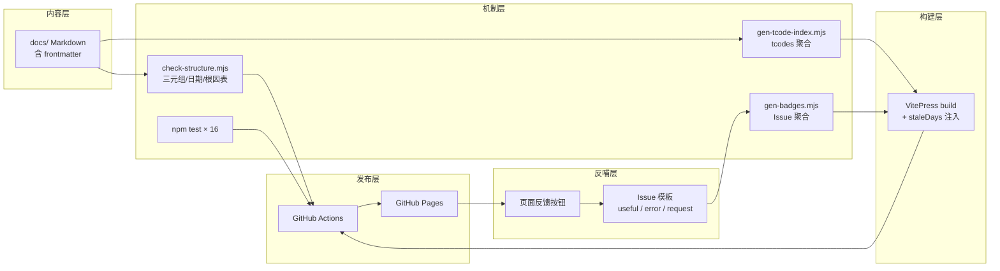
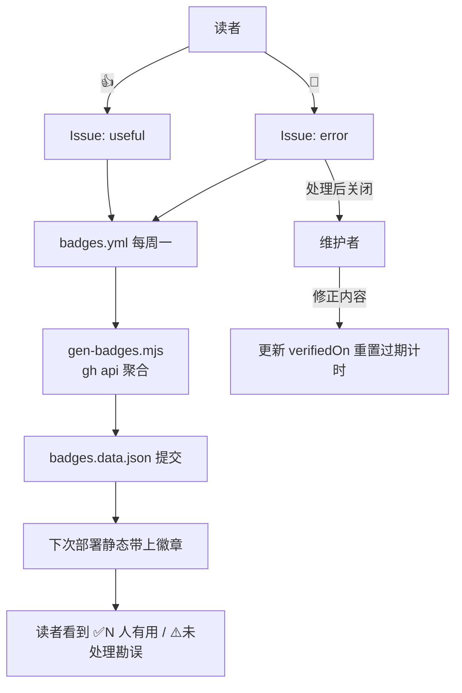

# 《SAP FICO 顾问实战手册》设计文档（v2.0）

**项目代号**：`fico-field-guide`
**站点形态**：纯静态 VitePress 电子书，托管于 GitHub Pages
**核心命题**：FICO 顾问在项目里卡住时，打开站点，30 秒内找到下一步动作。
**设计版本**：v2.0（2026-11-11，基于 v1.0 设计评审稿优化定稿，优化记录见 §2）

---

## 1. 设计目标（不变）

| 目标 | 衡量标准 |
|---|---|
| 查得快 | 高频 T-Code / 报错，3 次点击或 1 次搜索到达 |
| 能自验 | 每篇配置笔记含「验证三元组」，读者跑一遍就知道对错 |
| 不过时 | 每页标注验证日期，超期自动降级显示 |
| 好维护 | 纯 Markdown，push 即发布；格式由 CI 管，内容由读者自验兜底 |
| 移动友好 | 手机可读、表格可横滑、代码可复制 |

## 2. 设计优化记录（v1 → v2）

v1 评审稿的机制方向全部保留，v2 在工程实现上做了 10 项优化决策：

| # | 优化 | v1 做法 | v2 做法 | 理由 |
|---|---|---|---|---|
| 1 | 报错速查拆目录 | 单文件 `error-cookbook.md` | `errors/` 目录，每报错一页 + 索引页 | 每条报错独立 `verifiedOn`，独立过期、独立勘误；搜索直达页面而非锚点；单文件会随条目增长失控 |
| 2 | T-Code 自动索引 | 无 | frontmatter 增加 `tcodes` 字段，`gen-tcode-index.mjs` 聚合生成总索引页 | 「3 次点击到达」从约定变成机制；反向索引（T-Code → 页面）是 FICO 场景最高频的查找模式 |
| 3 | 过期降级构建时注入 | 页面运行时计算 | `transformPageData` 构建时注入 `staleDays` / `staleLevel`，组件只读 | 消除 SSG 预渲染与客户端水合的时间差（hydration mismatch）；阈值（12/24 个月）集中在 config 常量 |
| 4 | 验证三元组双轨 | 仅正文标记 | 正文粗体标记（CI 校验、作者可读）+ frontmatter `tcodes`（机器聚合） | 正文标记写错了人眼立刻能看见；结构化字段供索引生成，不重复内容 |
| 5 | 徽章闭环工程化 | 描述性（「每周统计」） | `gen-badges.mjs`（gh api 聚合 Issue 标题中的页面路径）→ `badges.data.json` → 组件构建时静态 import | 静态站运行时零 API 调用、无 rate limit、离线可渲染；数据流可单测 |
| 6 | 测试补强 | 无测试 | 脚本核心逻辑抽 `scripts/lib/`，`node:test` 16 个用例覆盖 frontmatter 解析 / 校验规则 / 索引 / 徽章聚合 | CI 拦截的规则本身也要被测试保护——规则脚本写错等于机制失效 |
| 7 | 搜索现实约束 | 「内置本地搜索」一笔带过 | 如实记录 miniSearch 对 CJK 不分词；FICO 搜索词以 T-Code / 消息号为主（拉丁字符，命中率 100%），中文导航靠侧边栏 + 索引页兜底；演进路径（DocSearch / Pagefind）记录在案 | 把限制写进设计而非留给读者发现；决策可追溯 |
| 8 | 图表统一 Mermaid | 未约定 | 全站图一律 Mermaid 声明式（随 Git 版本控制、GitHub/VitePress 原生渲染、diff 可审、主题统一），节点 ≤ 12、文字 ≤ 8 字 | 「专业画图」的可持续实现：图与内容同仓同版本同评审，不引入二进制图片维护负担 |
| 9 | 双许可证 | 一句带过 | `LICENSE`（代码 MIT）+ `LICENSE-CONTENT`（内容 CC BY-NC-SA 4.0）分文件 | 代码与内容授权边界清晰，便于他人复用站点骨架 |
| 10 | 交付分期 | MVP 两周 | P0 机制（脚本+CI+模板）/ P1 内容全量（配置笔记 5 + 报错 10 + 卡片 23 + 项目 3 + 支撑页）/ P2 运营（徽章数据、GoatCounter 接入） | 本次全量交付 P0+P1，P2 中需要外部账号的（GoatCounter、真实 Issue 数据）留占位与文档说明 |

## 3. 内容质量的三条硬规则

### 规则 1：配置笔记必须含「验证三元组」

每篇 `03-config-notes/` 与报错速查页面，正文必须包含：

```markdown
**验证 T-Code**：`FBL3N`
**验证判据**：执行后 GR/IR 科目余额应为 0；非 0 说明存在未清项
**失败对照**：若余额 ≠ 0，检查 F.19 是否已执行、未清项是否已处理
```

读者不需要相信作者，跑一遍就知道真假。**写错了但验证方法对，读者 30 秒发现；写对了但没给验证方法，CI 拒绝合并。**

### 规则 2：每页必须有验证日期和环境

```yaml
verifiedOn: 2026-11-11
verifiedEnv: "IDES S/4HANA 2023, CC 1000"
```

构建时自动计算：>12 个月黄色警告、>24 个月红色警示（实现见 §6.2）。机器按日期降级，不需要人工盘点。

### 规则 3：报错页强制根因排序表

```markdown
| 根因（按概率） | 验证动作 | 修复动作 |
|---|---|---|
| 1. FS00 中科目未扩展到该公司代码 | FS00 查公司代码层 | 创建公司代码层 |
```

读者按顺序试，试到哪条对上就是哪条。CI 按表头 `| 根因` 识别。

## 4. 信息架构

```text
fico-field-guide/
├── docs/
│   ├── .vitepress/
│   │   ├── config.mts                 # 导航、侧边栏、搜索、SEO、staleDays 注入、Mermaid
│   │   └── theme/
│   │       ├── index.ts               # 默认主题扩展：doc-before / doc-after 插槽
│   │       ├── config.ts              # REPO_URL / Issue 链接常量
│   │       ├── styles.css             # 表格、代码、Mermaid 容器微调
│   │       ├── badges.data.json       # 徽章数据（badges.yml 每周刷新，构建时静态打包）
│   │       └── components/
│   │           ├── VerifiedBanner.vue # 验证状态条（fresh/warn/stale 三级）
│   │           └── FeedbackButtons.vue# 反哺按钮 + 页面徽章
│   ├── public/
│   │   ├── images/                    # 截图（压缩，宽 ≤ 1200px）
│   │   └── templates/                 # xlsx 模板下载
│   ├── index.md                       # 首页（三类读者路径）
│   ├── tcode-index.md                 # T-Code 总索引（AUTO-GEN 区段）
│   ├── 00-about/
│   │   ├── how-to-use.md              # 三类读者路径
│   │   ├── version-matrix.md          # ECC vs S/4 差异总表
│   │   └── conventions.md             # 占位符、术语、写作约定（写作宪法）
│   ├── 01-daily-ops/
│   │   ├── month-end-checklist.md     # 月结 Check List
│   │   ├── tcode-cards.md             # 高频 T-Code 卡片（23 张，按模块分节）
│   │   └── errors/                    # 报错速查库（v2 拆目录）
│   │       ├── index.md               # 索引页
│   │       └── *.md                   # 每报错一页（独立 verifiedOn）
│   ├── 02-project/
│   │   ├── blueprint-questions.md     # 蓝图关键问题
│   │   ├── integration-test.md        # 集成测试脚本模板
│   │   └── go-live-runbook.md         # 上线切换 Runbook
│   ├── 03-config-notes/
│   │   ├── mm-fi-obyc.md              # OBYC 排查
│   │   ├── gl-field-status.md         # 字段状态组
│   │   ├── asset-s4-diff.md           # 新资产记账差异
│   │   ├── ap-special-gl.md           # 特别总账标识
│   │   └── co-assessment.md           # 成本中心分摊
│   └── 99-contribute/
│       └── how-to-contribute.md       # 贡献指南（含三个模板全文）
├── scripts/
│   ├── lib/
│   │   ├── frontmatter.mjs            # 零依赖 frontmatter 解析 + 日期校验
│   │   ├── validate.mjs               # 校验规则（硬/软分级）
│   │   ├── tcode-index.mjs            # tcodes 聚合 + 索引渲染
│   │   └── badges.mjs                 # Issue 聚合 + 路径提取
│   ├── check-structure.mjs            # 结构检查 CLI
│   ├── gen-tcode-index.mjs            # 索引生成 CLI（docs:build 前置）
│   └── gen-badges.mjs                 # 徽章生成 CLI（gh api / --demo / --if-missing）
├── tests/                             # node:test × 16
├── .github/
│   ├── workflows/
│   │   ├── deploy.yml                 # 构建部署（含 check+test 闸门）
│   │   ├── quality.yml                # PR：结构检查 + 测试 + 构建冒烟 + gitleaks
│   │   ├── link-check.yml             # 每周一 lychee，死链开 Issue 不阻塞 PR
│   │   └── badges.yml                 # 每周一徽章数据刷新并提交
│   └── ISSUE_TEMPLATE/
│       ├── feedback-useful.yml        # useful（纯计数）
│       ├── feedback-error.yml         # error（需版本+现象）
│       └── content-request.yml        # 内容请求（进选题池）
├── DESIGN.md                          # 本文件
├── PROGRESS.md                        # 进度事实源
├── README.md
├── LICENSE / LICENSE-CONTENT           # MIT（代码）/ CC BY-NC-SA 4.0（内容）
└── package.json
```

## 5. 技术方案

### 5.1 选型

| 项 | 选型 | 理由 |
|---|---|---|
| 站点框架 | VitePress 1.6.x | 内置本地全文搜索、构建快、SSG 输出适合 Pages |
| Mermaid | mermaid 11 + vitepress-plugin-mermaid 2.x | 声明式图表，Git 可版本控制，暗色自动切换 |
| 托管 | GitHub Pages | 免费、HTTPS、与 Actions 原生集成 |
| 统计 | GoatCounter（占位接入） | 无 cookie、隐私友好，搜索词分析驱动选题 |
| 死链 | lychee（Action，每周一） | 失败开 Issue 跟踪，不阻塞 PR |
| 敏感扫描 | gitleaks（Action，PR 必跑） | CI 失败即拦截 |
| Sitemap | VitePress 内置 | 配 `hostname` 自动生成 |
| 测试 | node:test（零依赖） | 规则脚本本身的行为被测试锁定 |

### 5.2 系统架构与数据流



### 5.3 部署流水线（`deploy.yml`）

push main → `npm ci` → `npm run check`（结构闸门）→ `npm test` → `docs:build`（内含索引与徽章生成）→ upload-pages-artifact → deploy-pages。

**启用**：仓库 Settings → Pages → Source 选 **GitHub Actions**。

### 5.4 质量 CI（`quality.yml`，PR 触发）

- `structure-and-tests`：`npm run check` + `npm test` + `npm run docs:build`（构建冒烟，确认 Mermaid 可渲染）
- `secrets`：gitleaks 全历史扫描

### 5.5 搜索的现实约束与对策

miniSearch（VitePress 本地搜索）对中文不分词，连续汉字整串成一个 token，中文短语搜索命中不稳。对策：

1. **FICO 场景主搜索词是 T-Code 与消息号**（`OBYC`、`F5 702`），拉丁字符命中接近 100%——核心场景无损。
2. 中文导航交给侧边栏 + [报错索引页] + [T-Code 总索引]（Ctrl+F 可用）。
3. 演进路径（记录不实施）：Algolia DocSearch（需申请）或 Pagefind（部署后索引）。

## 6. 机制设计详解

### 6.1 结构检查（规则 1-3 的机器执行）

`check-structure.mjs` 硬校验范围：`docs/03-config-notes/`、`docs/01-daily-ops/errors/`（除 index）、遗留单文件 `error-cookbook.md`（若存在）。其余内容页缺 `verifiedOn` 仅 warn（`--strict` 升级为阻断）。校验失败 exit 1，deploy.yml 与 quality.yml 均拦截。

### 6.2 过期降级

`config.mts` 的 `transformPageData` 在构建时计算 `staleDays` 并注入 `staleLevel`：

- `fresh`（≤12 个月）：绿色信息条「本页验证于 YYYY-MM-DD（环境…）」
- `warn`（12-24 个月）：黄色「已约 N 个月未复核，请自行验证」
- `stale`（>24 个月）：红色「大概率已偏离当前版本」

阈值集中定义于 `config.mts` 顶部常量（`STALE_WARN_DAYS = 365` / `STALE_STALE_DAYS = 730`）。

### 6.3 T-Code 总索引

页面 frontmatter 声明 `tcodes: [FB50, FB03]` → `gen-tcode-index.mjs` 聚合为「T-Code → 出现页面」反查表，写入 `docs/tcode-index.md` 的 `<!-- AUTO-GEN -->` 区段。`docs:build` 自动前置执行。

### 6.4 读者反哺闭环（徽章）



- `useful`：纯计数零处理（closed 也计数）
- `error`：仅未关闭的计入「未处理勘误」徽章；处理闭环 = 修复内容 → 更新 `verifiedOn` → 关 Issue
- 页面路径从 Issue 标题模板预填段提取（`— docs/xx.md`），正则提取逻辑有单测

### 6.5 选题机制

每月看 GoatCounter 后台 15 分钟：搜索无结果的词 = 下月写 2-3 篇；访问最低的页面 = 候选下架或合并；`error` Issue 集中的页面 = 优先修正。`content-request` Issue 进入同一决策池。没人搜的主题不写。

## 7. 页面模板

模板全文维护于 `docs/99-contribute/how-to-contribute.md`（单一事实源，本节不重复，只列骨架）：

- **配置笔记**：一句话结论 → 症状 → 根因排序表 → 配错会怎样 → 怎么配置 → 怎么验证（三元组）→ 相关 T-Code
- **报错条目**：消息文本 → 什么时候出现 → 根因排序表 → 怎么验证（三元组）→ 相关条目
- **T-Code 卡片**：用途 / 必填关键字段 / 最常见错误 / 验证
- **月结步骤**：`| # | 动作 | T-Code | 验证判据 | 失败时怎么办 |`

## 8. 人力账本

| 阶段 | 投入 | 产出 |
|---|---|---|
| 一次性搭建 | 1-2 个周末（本次已完成） | 骨架 + CI + 脚本 + 测试 + 模板 + 全量首批内容 |
| 内容填充 | 每篇 10-30 分钟 | 按模板写，带验证三元组 |
| 每周维护 | ≤15 分钟 | 处理 `error` Issue（可选） |
| 每月决策 | 15 分钟 | 看搜索榜单，定下月 2-3 篇 |
| 持续自动 | 零 | 过期标记、结构检查、死链、敏感扫描、徽章 |

## 9. 验收标准

一个未参与写作的 FICO 顾问，拿一条报错页，能按「验证 T-Code + 判据」自己确认对错。能做到，机制成立；做不到，改模板。

工程验收（本次交付）：`npm run check` 0 违规、`npm test` 16/16、`npm run docs:build` 成功无死链、全部机制在 CI 中生效。

## 10. 风险与对策

| 风险 | 对策 |
|---|---|
| 内容业务逻辑有误 | 验证三元组让读者自验；初始内容统一标注「SAP 标准行为」口径，不冒充真实系统验证 |
| 内容过时 | `verifiedOn` + 构建时自动降级，机器按日期管 |
| 敏感数据泄露 | gitleaks CI 拦截 + 占位符约定（公司代码仅 1000） |
| 维护中断 | 规则全部落在 CI 与模板；DESIGN/PROGRESS/README 三件套让任何人接手 |
| 仓库图片膨胀 | 截图压缩、宽 ≤ 1200px、图表一律 Mermaid（文本形式零膨胀） |
| 徽章数据过期 | 占位数据只影响展示不影响功能；接入真实仓库后每周自动刷新 |

## 11. 文档维护约定

| 文档 | 职责 | 更新时机 |
|---|---|---|
| `DESIGN.md` | 设计决策与理由（本文件） | 机制变更时（并追加优化记录） |
| `PROGRESS.md` | 进度事实源：任务状态、验证结果、环境坑位 | 每个工作阶段 |
| `README.md` | 面向访客/贡献者的入口说明 | 面向读者的行为变化时 |

---

**结论**：电子书的价值不在于「有人担保内容对」，在于**结构让读者自己验证、机器守住格式和时效、数据决定写什么、读者反哺替代作者自嗨**。人力只花在：一次性搭骨架、按模板写内容、每月看 15 分钟榜单。其余全部自动化或由读者自验兜底。
