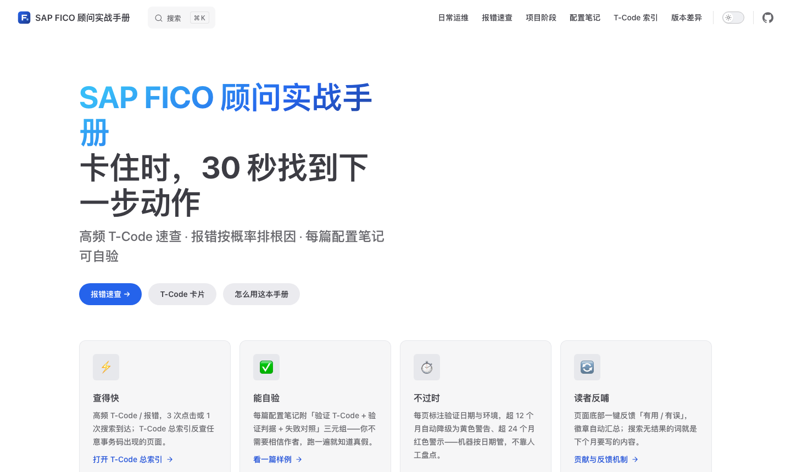
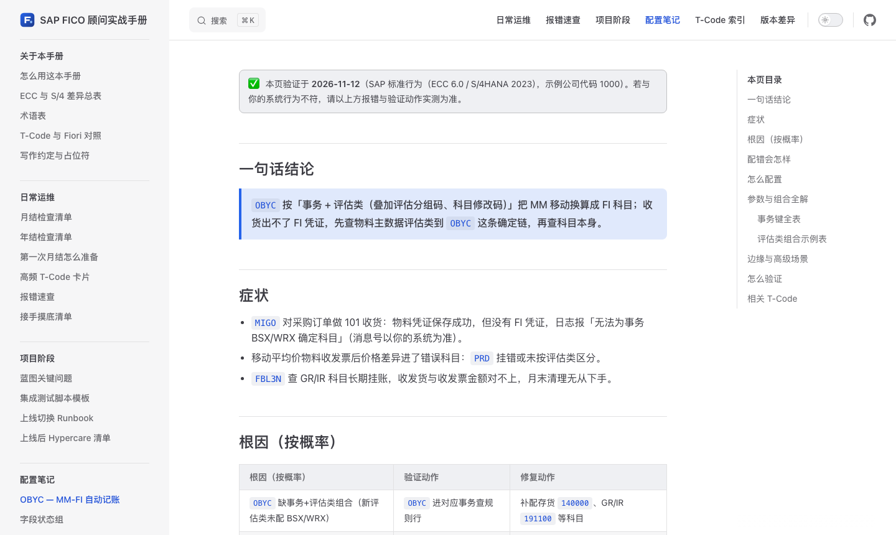
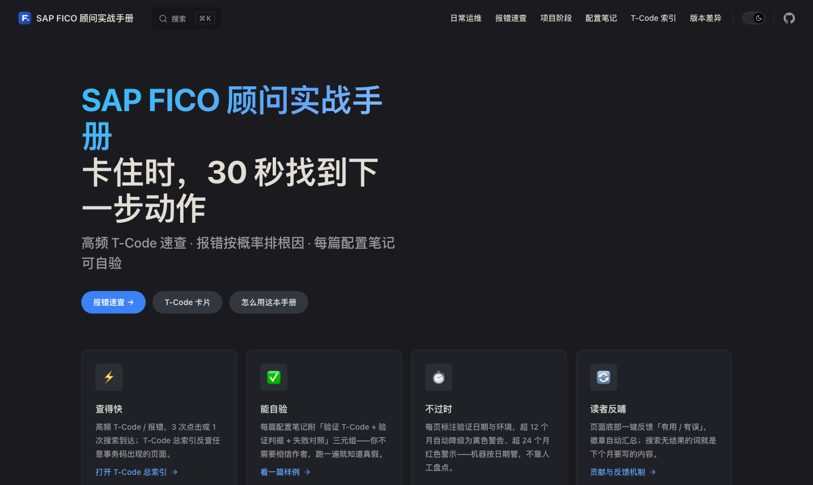

<div align="center">


# SAP FICO 顾问实战手册

**卡住时，30 秒找到下一步动作。**

高频 T-Code 逐字段详解 · 报错按概率排根因 · 排查实战从报错反查配置 · 每篇可自验

[](https://github.com/seecrazy/fico-field-guide/actions/workflows/deploy.yml)
[](https://github.com/seecrazy/fico-field-guide/actions/workflows/quality.yml)
[](./LICENSE-CONTENT)
[](./LICENSE)
[](./package.json)
[](./docs/99-contribute/how-to-contribute.md)

**[📖 在线阅读](https://seecrazy.github.io/fico-field-guide) · [排查实战](https://seecrazy.github.io/fico-field-guide/04-troubleshooting/playbook-intro) · [T-Code 索引](https://seecrazy.github.io/fico-field-guide/tcode-index) · [贡献指南](./docs/99-contribute/how-to-contribute.md)**

</div>

---





<details>
<summary>🌙 暗色模式</summary>



</details>

## ✨ 这本手册有什么不一样

| | 常见 SAP 资料 | 本手册 |
|---|---|---|
| **能自验** | 「照这样做」——信不信由你 | 每篇附「验证 T-Code + 判据 + 失败对照」三元组，跑一遍就知道真假；缺三元组的页面 **CI 直接拒绝合并** |
| **不过时** | 写完即陈旧 | 每页标注验证日期，超 12 个月自动黄色警告、超 24 个月红色警示，机器按日期管 |
| **查得快** | 翻书/翻论坛 | 111 个 T-Code 反查索引、19 条报错按**概率**排根因、3 次点击或 1 次搜索到达 |
| **教排查** | 只给答案 | 6 个实战案例演示「报错现场 → 三层排查 → 定位错误配置」的完整破案过程 |

## 🗺️ 内容地图

| 区域 | 内容 |
|---|---|
| [日常运维](./docs/01-daily-ops/tcode-cards.md) | 月结/年结清单 · **23 个 T-Code 逐字段详解** · 报错速查 19 条 · 接手摸底/首次月结 |
| [排查实战](./docs/04-troubleshooting/playbook-intro.md) | 三层排查方法论 · 6 个从报错反查配置的实战案例 |
| [配置笔记](./docs/03-config-notes/mm-fi-obyc.md) | 20 篇：OBYC · 字段状态 · 付款条件 · F110 · 特别总账 · 银行对账 · 资产 · 并行账簿 · CO-PC 主线（标准成本/结算/WIP）· 物料账 · 信贷 · 迁移工具 · 权限 · 中国本地化（金税/增值税/暂估） |
| [项目阶段](./docs/02-project/blueprint-questions.md) | 蓝图 23 问 · 集成测试三脚本 · 上线 Runbook 18 任务 · Hypercare 30 天 |
| [参考](./docs/00-about/version-matrix.md) | ECC vs S/4 差异总表 15 行 · 术语表 70 条 · T-Code/Fiori 对照 |

## 🚀 本地运行

```bash
npm install    # Node ≥ 20
npm run dev    # http://localhost:5173
```

常用命令：`npm run check`（结构校验，CI 同款）· `npm test` · `npm run docs:build`

## 🤝 贡献

| 时间 | 你能做什么 |
|---|---|
| 30 秒 | 页面底部点「👍 有用」——纯计数，自动汇成徽章 |
| 2 分钟 | 点「🐞 有误」报勘误——填系统版本与现象即可 |
| 30 分钟 | 按模板写一页 → 本地三道校验 → PR（[贡献指南](./docs/99-contribute/how-to-contribute.md) 含全部模板） |

维护者：error Issue 打 `ai-fix` 标签即可自动生成修复 PR（[AI 修勘误](./docs/99-contribute/how-to-contribute.md)）。

## 📄 License

- 内容（`docs/`）：[CC BY-NC-SA 4.0](./LICENSE-CONTENT)
- 代码（脚本/CI/主题）：[MIT](./LICENSE)

> 手册内容按 SAP 标准行为撰写并逐页标注验证口径，不承诺与任何特定客户系统一致——所有配置与结论请以你的系统实测为准，这正是每页附验证三元组的原因。
