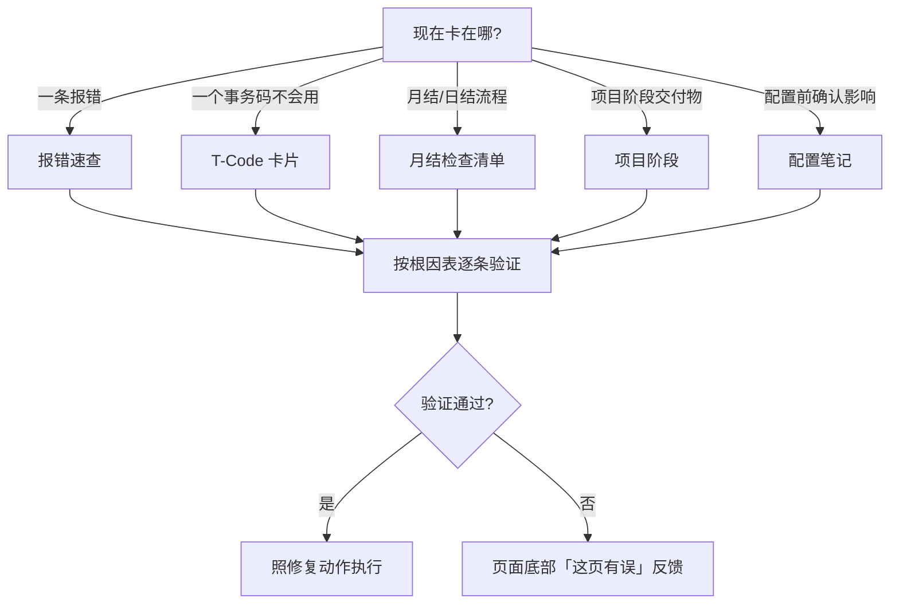

# 怎么用这本手册

这本手册的目标只有一个：**你在项目里卡住时，30 秒内找到下一步动作**。围绕这个目标，三类读者各有最短路径。

## 30 秒路径速览

## 三类读者

### 1. 运维型：卡在报错上

1. 进 [报错速查](/01-daily-ops/errors/)，用消息号（如 `F5 100`）或报错文本关键词搜索。
2. 打开条目后**从根因表第一行开始**——表已按概率排序，逐条执行「验证动作」，对上哪条就执行哪条的「修复动作」。
3. 修完跑一遍条目底部的「验证 T-Code」，确认判据成立再收工。

### 2. 项目型：在蓝图、测试或切换阶段

1. 进 [蓝图关键问题](/02-project/blueprint-questions)、[集成测试脚本模板](/02-project/integration-test) 或 [上线切换 Runbook](/02-project/go-live-runbook)。
2. 这三页是清单和模板，直接复制改用；每个动作都带验证判据，跑完即知道该步是否完成。

### 3. 配置型：动手前先确认

1. 进 [配置笔记](/03-config-notes/mm-fi-obyc)，先读「一句话结论」判断是否与你的问题相关。
2. 重点看「配错会怎样」——多数坑可以在配置前避开。
3. 按笔记配置后，**必须**执行「怎么验证」一节的三元组，再继续下一步配置。

## 怎么判断一页还可不可信

每个页面顶部有一条验证状态条：

| 状态条 | 含义 | 建议 |
|---|---|---|
| ✅ 验证于 2026-11（环境…） | 12 个月内复核过 | 正常使用，遇到不符仍以实测为准 |
| ⚠️ 验证于 2025-xx，可能已过时 | 12-24 个月未复核 | 先跑验证三元组再采用 |
| 🚨 超 24 个月未复核 | 大概率偏离当前版本 | 仅作思路参考，务必全程实测 |

## 搜索技巧

- **搜 T-Code 和消息号最准**（如 `OBYC`、`F5 702`）——它们是拉丁字符，全文搜索命中率接近 100%。
- 中文关键词搜索受本地搜索引擎限制（不分词），命中不稳时改用侧边栏目录或 [T-Code 总索引](/tcode-index)。
- 搜不到 ≠ 没人遇到：去页面底部点「希望增加内容」提一个 Issue，搜索无结果的高频词会被优先写成新页。

## 反馈闭环

每个内容页底部有两个按钮：

- **👍 这页解决了我的问题**：纯计数，每周自动汇成页面徽章，没人需要回复你。
- **🐞 这页有误 / 过时**：请填系统版本与实际现象，维护者处理后关闭，页面「⚠️ 有未处理勘误」徽章随之消失。

反馈数据直接驱动内容去留——没人搜的主题不写，`error` Issue 集中的页面优先修正（详见[贡献指南](/99-contribute/how-to-contribute)）。
