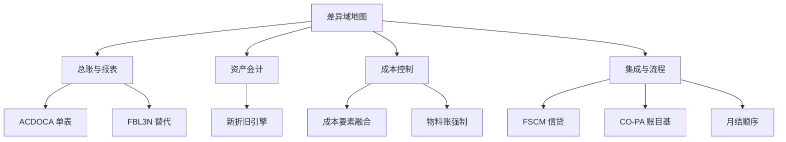

# ECC 与 S/4HANA 差异总表

> 一句话：这不是百科全书式的差异大全，是两个最高频场景的入口——**做升级评估时逐行过一遍**，**日常拿不准两版行为差异时当索引用**。每行都配 30 秒快速验证动作，采用前请在你的系统上自行确认。

## 差异域地图

先看全貌再查细节：四条主干的每个叶子节点都能在下表找到对应行与验证方式。

## 核心差异速查表

「快速验证」列全部是 30 秒内可完成的动作，结果不符时以你的系统为准。

| 领域 | ECC | S/4HANA | 实务影响 | 快速验证 |
|---|---|---|---|---|
| 总账数据模型 | BSEG 加多张补充表存明细 | ACDOCA 统一日记账，全模块明细一张表 | 报表与 FI/CO 对账从多表拼接改为单表直取 | `FAGLL03` 查科目明细，读到的就是 ACDOCA 数据 |
| 新总账 | 经典总账或可选激活新总账（是否已激活以你的系统为准） | 新总账强制，分类账法内建 | 多分类账并行、并账成为标准能力 | `FAGLL03` 按分类账维度对比同一科目余额 |
| 总账行项目查询 | `FBL3N` 是主力工具 | `FBL3N` 仍可用，SAP 主推 `FAGLL03` | 查询变体与用户习惯需要迁移重建 | 跑 `FAGLL03`，确认布局能带出段与利润中心 |
| 资产会计 | 经典资产会计 | 新资产会计：分类账法加技术清账科目 | 集成资产过账与在建工程逻辑变化 | `AFAB` 测试运行，看技术清账科目如何过账 |
| 折旧运行 | `AFAB` 运行不可重启 | `AFAB` 支持重启折旧运行 | 折旧出错后的月结返工成本大幅下降 | 进 `AFAB` 看重启选项是否可勾选 |
| 物料分类账 | 可选激活 | 强制激活 | 实际成本月结必须用 `CKMLCP` 关账 | `CKMLCP` 看未结算期间能否直接关闭 |
| 月结顺序 | 物料账可选，FI/CO 流程先行 | 物料账前置，实际成本先关账再分摊 | CO 月结日历整体重排 | 对照公司代码 1000 的月结日历核对顺序 |
| 信贷管理 | FI-AR 经典信贷检查 | 转向 FSCM 信贷管理 | 检查规则、信贷主数据与 SD 集成点全变 | `UKM_BP` 查客户信贷段是否已迁到 FSCM |
| CO-PA | 成本核算基与账目基并存 | 仅账目基，行项目进 ACDOCA | 成本基报表与衍生报表全部要重建 | `KE30` 跑一张报表，确认数据源为账目基 |
| 成本要素 | `KA01`/`KA06` 单独建初级、次级成本要素 | 成本要素即损益科目，`FS00` 统一维护 | 主数据流程合并；活动类型相关属性仍需单独维护 | 跑 `KA01` 看是否提示废弃或引导你去 FS00 |
| 内部订单与统计性记账 | `OKB9` 维护简单默认对象 | `OKB9` 部分场景增强为派生规则 | 自动记账的对象派生逻辑需逐科目梳理 | `OKB9` 查公司代码 1000 的默认对象配置 |
| CO 分摊与评估 | `KSU5` 等循环照常执行 | 循环保留，行项目与追溯统一 | 分摊结果的审计路径更直接 | `KSU5` 测试运行，看行项目明细能否追溯 |
| 凭证拆分 | 新总账激活后支持段级拆分 | 扩展凭证拆分：应收应付行也可细分（客户启用后才有） | 段与伙伴利润中心报表直接可信 | `FB50` 过账后 `FB03` 看行项目的段字段 |
| 外币评估 | `FAGL_FC_VAL` 独立评估 | 同名事务码保留，与应收应付详细评估集成更深 | 明细账评估与总账调节流程合并 | `FAGL_FC_VAL` 测试运行，`FAGL_FC_VALS` 看汇总 |
| 自动科目确定 | `FBKP`、`OBYC` 经典入口 | 入口保留，继续可用 | 升级后须逐事务校验配置迁移完整性 | `FBKP` 逐事务核对科目规则是否完整 |

## 迁移评估三问

拿这张表做升级评估时，先回答这三个问题，它们决定项目里最大的三块工作量：

1. **月结顺序变化点在哪？** 物料账强制后 `CKMLCP` 关账前置，实际成本、CO 分摊、折旧、外币评估的先后关系要重排——先画新旧月结日历对照表，再评估关账截止日是否被压缩。
2. **哪些报表要重构？** 盘点所有直接读 BSEG 及补充明细表的 Z 报表与 SAP Query，逐张改读 ACDOCA；同时把用户用惯的 `FBL3N` 变体迁到 `FAGLL03`。这张清单通常是最容易被低估的工时。
3. **团队要培训什么？** 事务码习惯迁移（旧 T-Code 保留但 Fiori 成为主推入口）、成本要素维护从 `KA01`/`KA06` 改到 `FS00`、信贷管理换到 FSCM——三件事都要进培训计划，而不是上线当天靠用户自己发现。

## 时效声明

以上差异随版本、EHP 与 FPS level 变化，个别行为在不同发布里收紧或放宽。关键决策请以对应 SAP Note 与系统实测为准；查证方向：SAP Support Portal 检索「S/4HANA Simplification List」，按模块过滤 simplification item，再对照你的版本核对。
