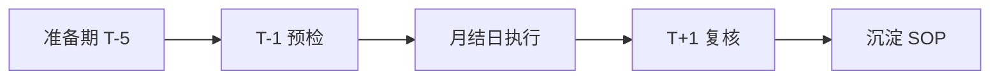

# 第一次月结怎么准备

> 第一次月结最大的风险不是「不会做」，是**顺序错**和**没留核对时间**——本页把手册已有页面串成一条时间线。

第一次做月结的人常见的失败模式是两样：跳步（CO 分摊还没跑完就去核对余额），和把核对时间挤没了（月结日当天还在处理差异，第二天报表就要交）。本页不新增动作，只把手里的页面排成一条时间线：**准备期（T-5）→ T-1 预检 → 月结日执行 → T+1 复核**。T 为月结日，示例公司代码 1000。

## 准备期（月初 T-5 起）

月结的成败一半在月结日之前。三件事：

| 动作 | 怎么做 | 完成标志 |
|---|---|---|
| 确认月结日历与责任人 | 拿[月结检查清单](/01-daily-ops/month-end-checklist)当底稿，把十步逐条填上 owner 和截止时间；没日历就当场和财务经理定一份 | 每步有人名、有日期 |
| 上月遗留问题清零 | 上月没清完的未清项、没解决的报错先收口——去[报错速查](/01-daily-ops/errors/)按根因表逐条过 | 遗留清单为空或每条有明确跟进人 |
| 期初余额异常检查 | `FAGLL03` 查高风险科目（GR/IR、应交税费、往来）的本期期初 | 每个异常大/异常为 0 的余额都能说出原因 |

## T-1 预检

月结日前一天，把「当天才发现就晚了」的事提前做掉：

| 预检项 | T-Code | 要拿到什么 |
|---|---|---|
| 收发货/发票差异清单 | `MB5S` | 差异 PO 名单当天发给采购和收票人催办，注明「月结日截止」 |
| 异常未清项 | `FBL1N` / `FBL5N` | 大额、长期未清逐条有说法；该清的当天约人清 |
| 模拟折旧 | `AFAB` | 测试运行跑一遍，错误清单当天改资产主数据——别留到月结日 |
| 期间计划 | `OB52`（MM 侧对照 `MMPV`） | 明天开几期、关几期、谁执行，写成一句话发出去确认 |

## 月结日执行

严格按[月结检查清单](/01-daily-ops/month-end-checklist)的十步顺序执行：先 MM 后 FI、先业务后财务、先 CO 分摊后 FI 结转——**每步的验证判据成立才进下一步**。第一次月结的两条纪律：

1. **卡住时按[报错速查](/01-daily-ops/errors/)的根因表从第一行逐条试**，别跳步，更别为了赶时间手工强改数据。
2. **每一步完成就打勾记时间**，第一次月结的实际耗时是你下次排日历的唯一依据。

## T+1 复核

月结日第二天，做两件事：

1. 把[月结检查清单](/01-daily-ops/month-end-checklist)的「月结后检查」三条逐条过一遍：科目余额与明细勾稽一致、未清项账龄无异常、`OB52` 回到「当期 + 上一期」的常规状态。
2. 把本次卡点记进自己的备忘——写清「卡在哪一步、症状是什么、怎么解的」。下次月结的 T-5，第一个动作就是翻出这份备忘。

## 第一次月结的五个高频卡点

| 卡点 | 症状 | 去哪页 |
|---|---|---|
| GR/IR 清不掉 | `F.13` 跑完 GR/IR 余额不为零，差异清单清不完 | [GR/IR 科目清账失败](/01-daily-ops/errors/gr-ir-not-cleared) |
| 期间开错 | `FB50` / `MIGO` 报「过账期间未开」，或旧期间还能记账 | [过账期间未开](/01-daily-ops/errors/posting-period-not-open) |
| 折旧报错 | `AFAB` 测试运行就有错，或正式后余额不平 | [AFAB 折旧过账报错](/01-daily-ops/errors/afab-depreciation-error) |
| 分摊发送方不归零 | `KSU5` 跑完，`KSB1` 看发送方成本中心还有余额 | [成本中心分摊配置](/03-config-notes/co-assessment) |
| 外币评估差异大 | `FAGL_FC_VAL` 结果与预期差得多，先怀疑取数汇率 | [外币汇率缺失](/01-daily-ops/errors/exchange-rate-missing) |

## 把卡点清单变成你的月结 SOP

第一次月结的真正产出不是「结完账」，是你手里的两样东西：一份带实际耗时的日历，一份解过的卡点清单（每条写「症状 → 根因 → 动作」）。第二次月结 T-5 把它们翻出来改一遍——第三个月起，这就是你自己的月结 SOP。每个事务码的操作细节见[高频 T-Code 速查卡片](/01-daily-ops/tcode-cards)。
