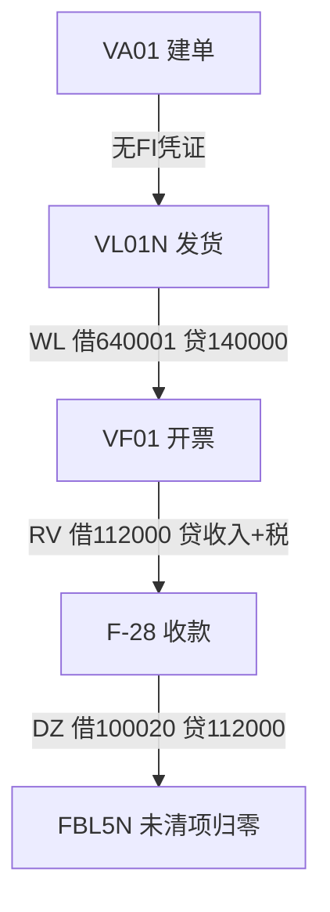

## 一句话结论

> O2C 只有两个 FI 记账点：发货借成本、贷存货（`OBYC` GBB-VAX/VAY）；开票借应收、贷收入与销项税（SD 科目确定 + 税码 + 统驭科目）。收款不产生新科目，只是把应收清掉；收入默认在开票时确认。

主线示例：公司代码 1000、客户 100001、产成品（标准价 80.00 示意，评估类 3000），销售 10 EA @ 100.00，销项税示意 17%（价税合计 117.00/EA）。ECC 与 S/4HANA 的交货、开票行为差异先看[版本差异总表](/00-about/version-matrix)。

## 全流程分录表

| 步骤 | 事务 | FI 分录（借贷 + 科目示意） | 科目从哪来 | 为什么 |
|---|---|---|---|---|
| 1 建销售订单 | `VA01` | 无 FI 凭证 | — | 订单是承诺不是收入；风险在单据层用信贷管理拦，不靠 FI 打账 |
| 2 发货 10 EA（成本 80） | `VL01N` 过账发货（PGI） | 借 640001 主营业务成本 800.00 / 贷 140000 产成品存货 800.00 | `OBYC` GBB-VAX（标准价）/ VAY（移动均价）× 评估类；存货贷记走 BSX（[OBYC 科目确定口径](/03-config-notes/mm-fi-obyc)） | 货权转移，存货按计价口径转销货成本；此刻收入还没确认 |
| 3 开票 @117 | `VF01` | 借 112000 应收 1,170.00 / 贷 600001 收入 1,000.00 / 贷 222101 销项税 170.00 | 应收 = 客户 100001 主数据统驭科目；收入 = 定价过程的条件类型 × 客户/物料科目确定组派生（配置链以你的系统为准）；税 = 税码（客户与物料税务分类 × 国家税配置） | 开票是收入确认的主流触发点；如启用 CO-PA，收入同时过账到值字段（纯文字提） |
| 4 收款 117 | `F-28` | 借 100020 银行 1,170.00 / 贷 112000（清发票） | 银行科目录入带出；清账对象 = 发票未清项 | 收款清账，`FBL5N` 未清项归零 |
| 5 折扣窗口内收款 | `F-28` | 借 100020 1,160.00 / 借 现金折扣科目 10.00 / 贷 112000 1,170.00（示意 1% × 净额 1,000.00） | 付款条件两档窗口算净额（[付款条件](/03-config-notes/payment-terms)）；折扣科目走自动科目确定 | 客户净额付款时折扣单独落账，不在应收上留尾巴 |
| 6 清账与月结对账 | `F-32` / `FBL5N` | 部分收款与剩余项清账只调整未清项结构，不出新科目 | — | 应收明细（`FBL5N`）与统驭科目余额（`FAGLL03`）月度勾稽，见站内对账页（即将创建） |

凭证类型示意：发货 WL、开票 RV、收款 DZ，以你的系统为准。

## 凭证流图

## 计价与收入确认口径

| 口径 | 一句话 |
|---|---|
| GBB-VAX（标准价） | 出库按标准价计成本：80.00 是冻结口径，销货成本不随采购价波动，差异已在 PRD 隔离 |
| GBB-VAY（移动均价） | 出库按发货时点的 MAP 计成本：成本随每次收货滚动，价差直接吃进出库金额 |

收入确认：主流是**开票触发**（`VF01` 出收入凭证）；交货即确认或按进度确认属于交货确认型，需要 SD 收入确认类配置（开票计划、服务合同、S/4 收入确认）支持——配置链与项目方案以你的系统为准。VAX 与 VAY 分科目挂（如 640000/640001 分列）时，报表直接能拆两条计价口径，这正是[OBYC 科目确定口径](/03-config-notes/mm-fi-obyc)建议分开挂的理由。

## 常见串账点

| 串账点 | 症状 | 去哪查 |
|---|---|---|
| 发货成本科目错 | 640001 串成存货类，或出库金额与库存价值对不上 | [OBYC 科目确定口径](/03-config-notes/mm-fi-obyc)：GBB-VAX/VAY × 评估类 |
| 收入科目串 | 不同条件类型的收入全进一个科目，毛利分析拆不开 | 回科目确定配置核对：科目确定组 × 条件类型的派生行，以你的系统为准 |
| 税码或税务分类错 | 销项税 170.00 金额不对，申报与 222101 对不上 | [报错速查](/01-daily-ops/errors/)税码类条目 |
| 清账选错对象 | `F-28` 没勾发票、`F-32` 清错行项目：应收虚挂、账龄失真 | `FBL5N` 按凭证号核对未清链，重清或冲销清账凭证 |
| 折扣没走折扣科目 | 净额收款后差额滚成新未清项 | [付款条件](/03-config-notes/payment-terms)：折扣科目与基数配置 |

## 自测动作

15 分钟自测，先纸上后系统：

1. **0–3 分钟**：纸上默写三张凭证（发货 800.00、开票 1,170.00、收款 1,170.00）的借贷与科目来源。
2. **4–10 分钟**：系统里走 `VA01`（100001，10 EA @ 100.00）→ `VL01N` 发货过账 → `VF01` 开票 → `F-28` 收款清账。
3. **11–14 分钟**：`FB03` 逐张开凭证，对科目、方向、金额三项；`FBL5N` 确认 100001 未清项为 0；`FAGLL03` 勾稽 112000 余额与明细合计一致。
4. **第 15 分钟**：换移动平均价物料再发一次货，对比 VAY 线的出库成本金额——两条计价线都摸过，O2C 走账才算通。

对不上的那一步，按「常见串账点」表反查；开票后凭证释放卡住、收入科目确定报错，走[报错速查](/01-daily-ops/errors/)总入口。
