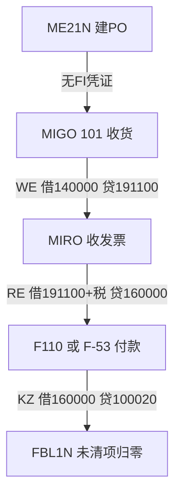

## 一句话结论

> P2P 只有三个 FI 记账点：收货借存货、贷 GR/IR（`OBYC`）；收票借 GR/IR 与进项税、贷应付（`OBYC` + 税码 + 统驭科目）；付款借应付、贷银行。中间那笔价差怎么落账，由物料是移动平均价还是标准价决定——这是本篇的灵魂。

主线示例：公司代码 1000、供应商 200001、原材料（评估类 2800 示意），PO 10 EA @ 100.00，收票价 105.00，税码示意 13%。ECC 与 S/4HANA 的走账行为差异先看[版本差异总表](/00-about/version-matrix)。

## 全流程分录表

| 步骤 | 事务 | FI 分录（借贷 + 科目示意） | 科目从哪来 | 为什么 |
|---|---|---|---|---|
| 1 建 PO | `ME21N` | 无 FI 凭证 | — | 承诺不打账：PO 只进采购与预算口径（预算控制另有机制，如激活可用性控制），账要等货到票到 |
| 2 收货 10 EA @100 | `MIGO`（101） | 借 140000 存货 1,000.00 / 贷 191100 GR/IR 1,000.00 | `OBYC` BSX（存货）× WRX（清算）× 评估类 2800（[OBYC 科目确定口径](/03-config-notes/mm-fi-obyc)） | 货到票未到：按订单价暂估存货，GR/IR 挂桥等发票来清（[MIGO 详解](/01-daily-ops/tcode-cards/migo)） |
| 3 收发票 @105 | `MIRO` | 借 191100 1,000.00（清收货）/ 借 222101 进项税 136.50 / 贷 160000 应付 1,186.50 | GR/IR 同上；进项税按税码算；应付 = 供应商 200001 主数据统驭科目 | 三单匹配（PO、收货、发票）通过后确认负债，GR/IR 收货侧挂账待清（[MIRO 详解](/01-daily-ops/tcode-cards/miro)） |
| 4 价差 50.00 去向 | `MIRO` 同凭证 | 移动平均价：借/贷 140000 调整存货（库存覆盖时），覆盖不足部分进价格差异；标准价：全额进价格差异（PRD，示意科目 231000） | `OBYC` BSX / PRD × 评估类 | 两条线分开走准：V 价把价差滚进库存价值，S 价把差异隔离给成本分析（见下节） |
| 5 付款全额 | `F-53` / `F110` | 借 160000 1,186.50（清发票）/ 贷 100020 银行 1,186.50 | 统驭科目同上；付款方式与银行由 `FBZP` 决定（[F110 配置树](/03-config-notes/ap-auto-payment)） | 清账把付款与发票配对，`FBL1N` 未清项归零 |
| 6 折扣窗口内付款 | `F-53` / `F110` | 借 160000 1,186.50 / 贷 100020 1,165.50 / 差额 21.00 落现金折扣科目（示意 2% × 净额 1,050.00；基数、科目与方向以配置为准） | 付款条件两档窗口算净额（[付款条件](/03-config-notes/payment-terms)）；折扣科目在自动科目确定维护 | 窗口内按净额清账，折扣额单独落账，不在应付上滚未清项 |
| 7 月末 GR/IR 收口 | `MB5S` / `F.13` / `F.19` | `F.13` 真清账：收货与发票按 PO 号等准则互清；`F.19` 只出重分类清单，借/贷 191100 的列示调整分录手工过账、次月初冲回 | 清账标准按准则字段配对 | 已收货未开票与已开票未收货要分开列报；长期挂账按[GR/IR 清账失败](/01-daily-ops/errors/gr-ir-not-cleared)排查 |

凭证类型示意：收货 WE、发票校验 RE、付款 KZ，以你的系统为准。

## 凭证流图

## 两条计价线的差异对照

| 环节 | 移动平均价（V） | 标准价（S） |
|---|---|---|
| 收货（`MIGO`） | 按订单价借记存货，MAP 随库存价值滚动重算 | 按标准价借记存货；订单价与标准价之差当场进 PRD |
| 收票价差（`MIRO`） | 库存数量覆盖发票数量时，价差全额借/贷记存货并重算 MAP；覆盖不足的部分进 PRD | 价差全额进 PRD，存货价值与标准价不动 |
| 期末重估 | 价格随每笔收货滚动，期末一般不单独重估（激活物料账后的期末结算以你的系统为准） | 价格变更与物料账结算经 UMB 及物料账科目确定重估存货与销货成本（以你的系统为准） |

一句话记住：**V 价把差异吃进库存，S 价把差异挤给 PRD**。物料账激活后（S/4 常开）差异期末还要分层分摊，科目链见[OBYC 科目确定口径](/03-config-notes/mm-fi-obyc)的边缘场景一节。

## 常见串账点

| 串账点 | 症状 | 去哪查 |
|---|---|---|
| OBYC / 评估类断链 | `MIGO` 有物料凭证、`FB03` 无 FI 凭证 | [MIGO 收货但 FI 无凭证](/01-daily-ops/errors/migo-no-fi-doc) |
| 价差落错科目 | V 价物料的价差没进存货，或 S 价差异串进别的差异科目 | [MIRO 差异进错科目](/01-daily-ops/errors/miro-prd-wrong-account) |
| 税码错或漏 | 进项税与应付金额同时错，申报与总账对不上 | [报错速查](/01-daily-ops/errors/)税码类条目 |
| GR/IR 长挂 | 月末 `FBL3N` 里 191100 未清项越滚越大 | [GR/IR 科目余额不为零](/01-daily-ops/errors/gr-ir-not-cleared) |
| 付款付不出去 | `F110` 提案 0 行，供应商账上明明有到期票 | [F110 无提案](/01-daily-ops/errors/f110-no-proposal) |

## 自测动作

15 分钟自测，先纸上后系统，逐笔对账：

1. **0–3 分钟**：不看上表，在纸上默写四张凭证（收货、收票、价差、付款）的借贷方向与金额。
2. **4–10 分钟**：系统里走一遍——`ME21N` 建 PO（200001，10 EA @ 100.00）→ `MIGO` 101 收货 → `MIRO` 收 @105.00 加税码 → `F-53` 付款清账。
3. **11–14 分钟**：`FB03` 逐张开凭证，与纸面分录对科目、方向、金额三项；`FBL1N` 确认 200001 未清项为 0；`MB5S` / `FBL3N` 确认 GR/IR 两侧能配平。
4. **第 15 分钟**：换标准价物料再走一遍收票，确认 50.00 价差全额落在 PRD——两条计价线都摸过，P2P 走账才算通。

对不上的那一步，按「常见串账点」表反查。月结视角的 GR/IR 收口顺序见站内月结检查清单页；应付明细与统驭科目余额的月度对账见站内对账页（即将创建）。
