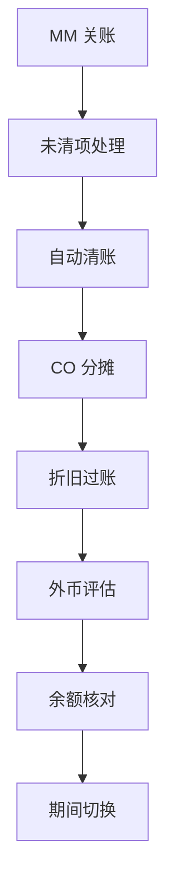

# 月结检查清单

> 月结不靠记性靠顺序：每步验证判据成立，再走下一步。

本清单按固定顺序执行，**每一步的验证判据成立后才进下一步**。顺序三原则：先业务后财务、先 MM 后 FI、先 CO 分摊后 FI 结转——业务单据没收口，后面的清账与结转全是返工。各步涉及的事务码详解见[高频 T-Code 速查卡片](/01-daily-ops/tcode-cards)。示例公司代码 1000。

## 月结主流程

| # | 动作 | T-Code | 验证判据 | 失败时怎么办 |
|---|---|---|---|---|
| 1 | 关闭 MM 期间 | `MMPV` | 对已关旧期间跑 `MIGO` 测试收货应报「期间不允许过账」；下一期可正常过账 | MM 期间只能顺序推进、不能跳期：确认公司代码与允许期间号后逐期关；与 `OB52` 不同步时先对齐再收口 |
| 2 | 收发货 / 发票未清差异清单 | `MB5S` | 差异清单为空，或每条差异已与业务确认原因（在途、未开票、退货未完成） | 逐条收口：应补收货走 `MIGO`、应补发票走 `MIRO`、真实在途注明后带出清单 |
| 3 | 自动清账 | `F.13` | 先勾「测试运行」核对清单；正式执行后再跑一次测试运行，可清项清单为空（GR/IR 可自动清项已清完） | 用 `FBL3N` / `FAGLL03` 看未清明细定位：准则字段（凭证号 / 采购订单号）不匹配、金额或币别不等——属真实未清项，转下一步列示 |
| 4 | GR/IR 重分类清单 | `F.19` | 清单按「已收货未开票 / 已开票未收货」正确列示，分类合计与 GR/IR 未清余额一致 | 清单为空但科目有余额：检查科目范围选择与未清项管理标识；调整分录据清单手工过账（月末列示、次月初冲回） |
| 5 | CO 实际分摊 | `KSU5` | 先 `KSV5` 测试运行无错；正式后 `KSB1` 查发送方成本中心余额为 0（循环覆盖范围内的初级成本） | 检查循环：接收方规则百分比合计是否 100%、接收方成本中心主数据是否有效；修正后重跑测试再正式 |
| 6 | 折旧过账 | `AFAB` | 先测试运行清单无错再正式；正式后重进 `AFAB`，当期无待过账折旧余额 | 按错误清单处理资产主数据（折旧码缺失、期间锁定）；整期跑错用冲销模式冲回后重跑 |
| 7 | 外币评估 | `FAGL_FC_VAL` | 重估凭证已生成且借贷平衡；未实现汇兑损益科目余额 = 评估清单汇总数 | 检查汇率取数（汇率类型与取数日期）、评估方法配置与未实现损益的自动记账科目设置 |
| 8 | 供应商 / 客户清账抽查 | `FBL1N` / `FBL5N` | 按「未清项」口径导出，长期未清项逐条有解释（在途、争议、待付），无应清未清 | 与业务逐条确认：可清的走 `F-44` / `F-32` 清账，争议项挂跟进人，坏账按公司政策计提 |
| 9 | 总账余额核对 | `FAGLL03` / `FBL3N` | GR/IR、税科目、过渡科目余额符合预期：GR/IR 与 `MB5S` 差异勾稽一致，税科目与申报口径一致 | 用行项目钻取定位来源凭证，常见漏网：`F.13` 未跑完、跨期过账、手工调整未入账 |
| 10 | 关上期开下期 | `OB52` | 上期 `FB50` 试过账被拒；下期试过账成功 | 核对变体是否分配到公司代码、科目类型区间（+ / A / D / K / S）是否覆盖目标科目 |

注：第 4 步 `F.19` 是**重分类清单显示**——它出清单、不清账、不自动过账；重分类调整分录据清单手工过账，次月初冲回。

## 月结后检查

1. **科目余额与明细一致**：抽 GR/IR、应交税费、汇兑损益等高风险科目，`FAGLB03` 余额与 `FAGLL03` 行项目合计勾稽一致。
2. **未清项账龄无异常**：`FBL1N` / `FBL5N` 按未清项口径导出清单，超过公司账龄口径的每一项都有跟进人和解释。
3. **期间监控移交日常**：`OB52` 保持「当期 + 上一期」的常规开放状态，期间类报错转日常处理；下月结前确认没有提前多开期间。

## 常见顺序坑

1. **`MMPV` 顺序关月不能跳**：MM 期间只能一期一期推进。发现落后多期时逐期关，且每个中间期间的补账要先在该期间开放时完成。
2. **CO 分摊必须在 FI 结转前**：先把成本中心分摊干净，再出管理报表、再结转损益；顺序反了成本口径不完整，返工要冲分摊凭证重来。
3. **`AFAB` 先测试再正式**：正式运行后才发现资产主数据错，只能整期冲销重跑；测试运行清单阶段的修正成本最低。
