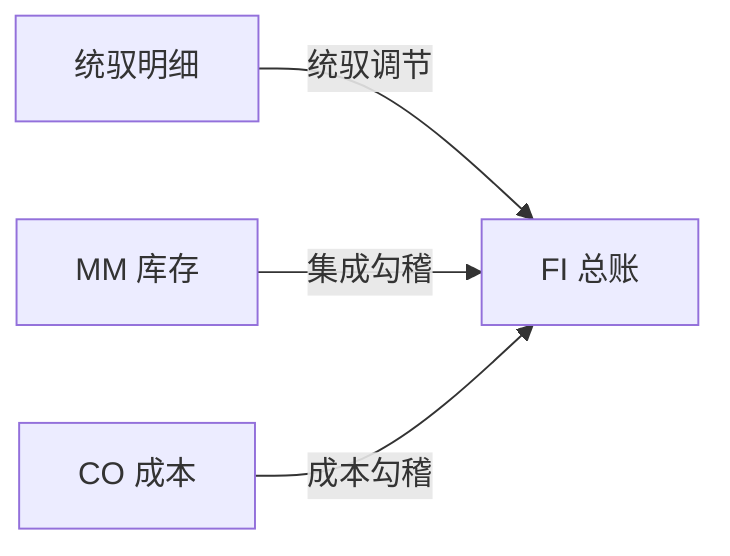

# 对账专题 — 月结勾稽的三张对账表

> 一句话：[月结检查清单](/01-daily-ops/month-end-checklist)告诉你「做什么动作」，本页告诉你「怎么证明做平了」——三张对账表，每张一条平的判据、一条不平的先查入口。

对账有三个目的：**账实相符**（账面余额对应到真实的货、票、钱）、**模块勾稽**（MM/CO 与 FI 的集成数字互相咬合）、**总账与明细一致**（每个科目余额都能被行项目解释）。对账 SOP 分三个时点：**月初复核上月末**（上月底稿归档、遗留差异逐条有主）、**月结日当日**（伴随清单第 9 步「总账余额核对」同步执行）、**月结后抽查**（抽高风险科目做余额与明细勾稽）。三张表的关系如下，逐张展开。

## 第一张：总账 vs 明细账（统驭调节）

统驭科目余额=FBL1N/FBL5N 行项目合计的比对（专用调节报表以系统为准）：

| 对账对象 | 工具 | 平的判据 | 不平先查 |
|---|---|---|---|
| 应付统驭科目 160000 | `FAGLB03` 余额 vs `FBL1N` | 供应商行项目合计（未清+已清）= 科目余额 | 有人直记统驭科目——统驭科目只能由子分类账过账，标准凭证输入会拒绝直记，但批量导入、迁移工具、自开发程序绕过校验时污染就进来了，用 `FAGLL03` 按凭证类型筛手工凭证即现形；其次是跨公司代码混查 |
| 应收统驭科目 112000 | `FAGLB03` 余额 vs `FBL5N` | 客户行项目合计（未清+已清）= 科目余额 | 同上两条；再查 `FBL5N` 漏勾「特别总账事务」——预收等挂备选统驭科目，不勾合计就缺一块。业务侧争议沿[O2C 流程](/01-daily-ops/flow-o2c)排查 |
| 总账科目（示例 191100） | `FAGLB03` 余额 vs `FAGLL03` 行项目合计（ECC 用 `FBL3N`） | 行项目合计 = 科目余额 | 未开行项目管理的技术性科目查不到行项目属正常——哪些科目以此为准看 `FS00` 行项目显示设置；排除口径问题后按余额钻取来源凭证 |

## 第二张：FI vs MM（集成勾稽）

GR/IR 的记账口径（收货贷记、收票借记的 `WRX` 规则）见[OBYC 笔记](/03-config-notes/mm-fi-obyc)，业务全链路见[P2P 流程](/01-daily-ops/flow-p2p)。

| 对账对象 | 工具 | 平的判据 | 不平先查 |
|---|---|---|---|
| GR/IR 191100 | `FAGLL03` 未清余额 vs `MB5S` | 科目未清余额 ≈ 差异清单「已收货未开票」合计（已开票未收货为反向差异） | `F.13` 清账口径（配对标准没勾采购订单号）；发票差异挂账——数量平金额不平时差额留在科目里，逐条收口见[GR/IR 清账失败](/01-daily-ops/errors/gr-ir-not-cleared) |
| 存货科目族（`BSX`：140000 等） | FI 余额 vs MM 库存价值（`MBEW` 口径；S/4 物料账用 `CKM3`） | 存货科目合计 = MM 期末库存价值 | 直记存货科目（手工凭证不经过 `OBYC` 确定）；重估未过账（价格变更或期末重估没跑） |
| S/4 差异科目（`PRD` 族） | `CKM3` 多层 vs FI 差异科目 | 物料账 `CKMLCP` 关账后，多层分摊结果与 FI 差异科目、存货科目勾稽一致 | 物料账还没关账就先对（顺序错了）；差异科目分配与 `OBYC` 口径不一致 |

物料账强制激活与月结顺序变化见[版本差异总表](/00-about/version-matrix)；GR/IR 暂估与「月末计提、次月冲回」两种流派的取舍见[中国本地化](/03-config-notes/cn-localization)。

## 第三张：FI vs CO（成本勾稽）

S/4 里初级成本要素即损益科目（`FS00` 统一维护），与 FI 比对按「要素 = 科目」直接对。

| 对账对象 | 工具 | 平的判据 | 不平先查 |
|---|---|---|---|
| 费用科目 vs 成本中心 | `FAGLL03` 发生额 vs `KSB1` | 初级成本要素发生额合计 = FI 对应费用科目净发生额 | 次级要素混入（42 分摊、43 内部作业分配只在 CO 内流转，不对应 FI 科目，比较前先筛掉）；分摊未跑完（`KSU5` 循环没跑完，`KSB1` 里发送方成本中心还有余额） |
| 生产订单结算完整性 | `CO88` 日志 vs FI 生产成本科目 | 批量结算日志无错，且当期生产成本投入与产出相抵后归零（结不平的余额即 WIP 或差异） | 日志里的报错订单逐单处理；订单没结完就出报表。完整链路见手册 CO-PC 系列页面（标准成本、订单结算、WIP 与差异），本表只管「结完了没有」 |

## 统驭科目防污染三招

1. **配置与权限掐住入口**：统驭科目只挂在供应商/客户主数据（`FK02`/`XD02`）上，凭证输入界面不出现；再上 `GGB0` 校验——凭证行含统驭科目或存货科目直接报错；权限角色不放开对这批科目的手工过账组合。
2. **月结检查点固化**：第一张表每月结日跑一遍并存档清单——对账底稿本身就是审计轨迹，别只存「平了」两个字。
3. **审计问询应对**：一句「统驭科目余额每月与 FBL1N/FBL5N 行项目合计核对一致并留档，差异逐笔有说明」——底稿在，这句话才立得住。

## 月结对账 SOP

| 时点 | 动作 | 工具 | 产出 |
|---|---|---|---|
| 月初（复核上月末） | 上月末三张表复核，遗留差异逐条派跟进人 | `FAGLB03` / `FBL1N` / `FBL5N` / `MB5S` / `KSB1` | 上月对账底稿归档 + 遗留差异清单 |
| 月结日当日 | 伴随清单第 9 步跑三张表，不平按「先查」列收口 | 三张表全套 | 当月对账底稿（每行标注平/不平） |
| 月结后抽查 | 抽 2-3 个高风险科目做余额 vs 明细勾稽 | `FAGLL03` | 抽查记录并入底稿 |

## 验证：10 分钟完整对账自测

挑上月数据，三张表各跑一条（**验证 T-Code**：`FBL1N`）：

1. `FBL1N` 公司代码 1000、供应商全选、未清+已清，导出合计 vs `FAGLB03` 的 160000 余额（约 3 分钟）。
2. `MB5S` 上月末差异清单合计 vs `FAGLL03` 的 191100 期末未清余额（约 3 分钟）。
3. `KSB1` 按初级成本要素汇总上月发生额，抽一个费用科目与 `FAGLL03` 比对（约 4 分钟）。

**验证判据**：三组数字两两相等（差异为 0），每步时间卡得住。
**失败对照**：任一组不平，按对应表「不平先查」第一行开始——先排除口径问题（勾选范围、公司代码、要素类别），再怀疑污染与漏跑。
