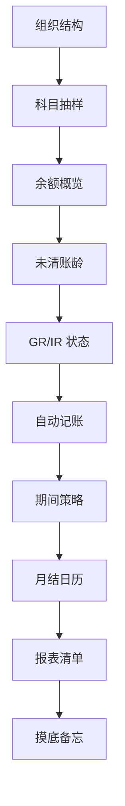

# 新接手公司代码的摸底清单

> 第一周别急着改任何东西：按这条动线看一圈，把「现状、风险、第一件事」写成一页备忘。

场景：你刚接手一个公司代码——新入职，或接了同事的摊子。最大的坑不是业务难，是**在没摸清现状前就动手**：不知道 GR/IR 有多大、不知道谁管开账关账、不知道哪些报表是必须出的。本清单把摸底动作排成一条固定动线，一周内走完；示例公司代码 1000。各事务码的具体用法见[高频 T-Code 速查卡片](/01-daily-ops/tcode-cards)。

## 摸底动线

先看结构，再看数据，再看配置，最后问人——顺序反了，问回来的东西你没法核对。

## 摸底主清单

| # | 看什么 | 怎么看（T-Code） | 判定要点 |
|---|---|---|---|
| 1 | 组织结构 | `OBY6` 看公司代码全局参数；`OX19` 看它划在哪个成本控制范围 | 公司代码 1000 挂哪张科目表、哪个会计年度变体；CO 范围罩几个公司代码——这决定内部成本报表口径是否可比 |
| 2 | 科目主数据抽样 | `FS00` 抽 10–20 个高频科目（GR/IR、税、往来、前 5 大费用） | 统驭科目类型（D 客户 / K 供应商 / A 资产）挂对没有；字段状态组风格是否统一；未清项管理、行项目显示开关与科目用途匹配 |
| 3 | 余额概览 | `FAGLB03` 逐科目看余额，异常科目用 `FAGLL03` 钻行项目 | 余额异常大或异常为 0 的科目都能说出原因；多分类账环境确认 0L 主分类账口径 |
| 4 | 未清项与账龄 | `FBL1N` / `FBL5N` 按「未清项」口径导出 | 长期未清（>90 天）逐条有没有人跟；特别总账项（预付、预收）单独勾选看一遍 |
| 5 | GR/IR 状态 | `MB5S` 看收货-发票差异清单；`FBL3N`（S/4 用 `FAGLL03`）看 GR/IR 未清明细 | 差异清单有多长、什么构成；GR/IR 余额与差异能否勾稽，趋势是持续涨还是稳定 |
| 6 | 自动记账配置盘点 | `OBYC` 逐事务抽查：BSX 存货、WRX 收货/收票、PRD 价格差异、GBB 冲抵 | 常用事务都配了科目、评估类与物料实际匹配；细节按[OBYC 配置笔记](/03-config-notes/mm-fi-obyc)核对 |
| 7 | 期间策略 | `OB52` 看 FI 期间开放状态；`MMPV` + `OMSY` 看 MM 期间推进到哪 | 当前开到几期、变体是否分配正确；FI 与 MM 是否同步；**谁有权开账关账**（问出来，写下来） |
| 8 | 月结日历与责任人 | 问：前任顾问、财务经理、共享服务中心；对照[月结检查清单](/01-daily-ops/month-end-checklist)十步 | 每步有 owner 和截止日；关账日是几号；上月卡在哪一步 |
| 9 | 报表清单 | 问 + 看：用户的变体收藏、`FAGLL03` / `FBL1N` 常用布局、IT 的作业清单 | 分清「必须出」的法定/管理报表与「顺手看」的清单；每张报表谁跑、给谁、几号要 |

## 产出：《摸底备忘》

摸底不是为了看，是为了写出一页纸，包含三块：

1. **现状**：组织结构、科目、期间、月结日历的实际情况——用你自己的话记，别复制配置截图。
2. **风险点**：下面红线信号命中的，加上摸底中自己发现的问题，逐条记。
3. **第一件该做的事**：只写一件。清单越长越没人做，挑那个「不处理会在下个月结爆」的先干。

## 三个红线信号

| 红线信号 | 为什么危险 |
|---|---|
| 未清项 > 90 天没人跟 | 发票拖着不对账，要么丢了要么有争议，越拖越难清；账龄报表和坏账计提口径全被拖歪。 |
| GR/IR 余额持续增长 | 收了货一直不收票（或反向），负债与存货被系统性扭曲——这是审计第一个盯上的科目。 |
| `OB52` 期间长期全开 | 谁都能往旧期间记账，关账后的报表随时可能被追溯改写，「已关账」三个字失去意义。 |

命中任意一条，写进《摸底备忘》的风险点，并把它放进你的「第一件事」候选。

## 下一步

- 摸完底，拿[月结检查清单](/01-daily-ops/month-end-checklist)当第一次实战脚本——它就是下一步动作。
- 每个码的具体操作与坑：[高频 T-Code 速查卡片](/01-daily-ops/tcode-cards)。
