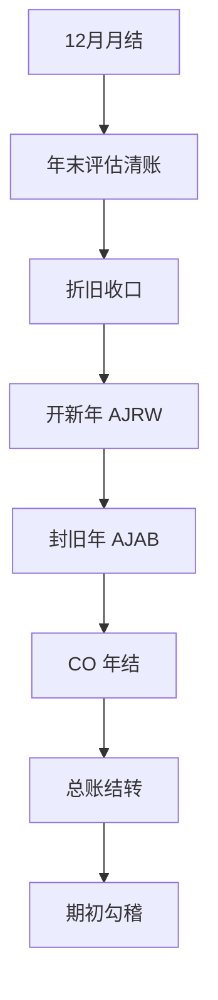

# 年结检查清单

> 年结是「12 月月结 + 一组跨年结转动作」：月结收口干净，结转按顺序跑，期初勾稽对得上，年结才算完。

**前提：12 月月结已全部完成**——各步判据见[月结检查清单](/01-daily-ops/month-end-checklist)。月结没收口就做年结，等于把 12 月的未清项、差异和折旧直接带进新年度，返工是跨年量级的。本清单承接月结：先做年末专项评估与清账，再做资产新旧年度切换，最后做余额结转与期初核对。示例公司代码 1000。

## 年结主流程

| # | 动作 | T-Code | 验证判据 | 失败时怎么办 |
|---|---|---|---|---|
| 1 | 年度外币评估（含应收应付明细评估） | `FAGL_FC_VAL` | 用年末汇率跑评估：重估凭证借贷平衡，未实现汇兑损益科目余额 = 评估清单汇总数；应收应付明细账与总账调节一致 | 查汇率类型取数日期是否为年末、评估方法与自动记账科目配置；S/4 下明细评估与总账评估集成更深，口径差异见[版本差异总表](/00-about/version-matrix) |
| 2 | GR/IR 年度清账与重分类 | `F.13` | 先测试运行核对可清项清单；正式后再跑一次测试运行，可清项清单为空；`MB5S` 差异清单每条有解释 | 用 `FBL3N` 查 GR/IR 行项目明细：准则字段不匹配、金额不等的是真实未清项，逐条与业务收口或按清单列示重分类 |
| 3 | 12 月折旧完成 | `AFAB` | 12 期折旧已正式过账：重进 `AFAB` 查无待过账折旧余额（S/4 可用重启模式处理异常） | 按错误清单处理资产主数据（折旧码缺失、期间锁定）；有未过账折旧绝不能进 `AJAB`，先补跑折旧 |
| 4 | 打开资产新年度 | `AJRW` | 新会计年度（如 2027）已创建并打开，`AW01N` 任一资产浏览能看到新年度计划值 | 检查折旧表分配与财年变式；`AJRW` 未跑就跑 `AJAB` 是年结第一坑——先回本步补开新年 |
| 5 | 封锁资产旧年度 | `AJAB` | 旧年度封锁完成，报「已封锁」类确认信息；`AW01N` 旧年度值不再变化 | 先决条件报错清单逐条处理：未过账折旧、在旧年度仍有未清购置的资产；每修一项重跑一次测试 |
| 6 | S/4：物料账年度结算前置 | `CKMLCP` | 12 月物料账已按顺序结算并关闭（S/4 物料账强制激活，月结顺序物料账在前） | 未结算生产/采购订单先收口，前期未关必须顺序补结；物料账强制激活的差异说明见[版本差异总表](/00-about/version-matrix) |
| 7 | CO 年度余额结转（事务以系统为准） | — | 按成本控制范围把余额类对象结转新年度：成本中心、内部订单余额可结转，订单未清需先结算 | CO 结转按控制范围而非公司代码执行；报错多为前期未结订单、结算接收方配置缺失，先收口订单再重跑 |
| 8 | 总账余额科目结转 | `FAGLGVTR` | 余额科目结转跑完：`FAGLL03` 新年度首日资产负债表科目期初 = 上年期末 | 程序可重复执行（幂等）是设计特性，重跑前先看日志确认无异常；报错多为科目未建新年度公司代码层，补建后重跑 |
| 9 | 损益结转留存收益 | `FAGLGVTR` | 损益科目结转跑完：上年损益科目余额全部清零，余额落入留存收益科目 | 留存收益科目在资产负债表结构里配错，损益会挂进错误科目：检查财务报表版本/留存收益科目归属后重跑 |
| 10 | 开新年度过账期间 | `OB52` | 新年度期间已按科目类型（+ / A / D / K / S）开放，`FB50` 新年度试过账成功 | 核对变式分配到公司代码 1000、科目类型区间是否覆盖；与上一期开放区间衔接不上会造成「旧年关了新年没开」的过账空窗 |
| 11 | 期初余额核对 | `FAGLL03` / `FBL3N` | 新年度首日各科目期初 = 上年期末；留存收益科目余额与上年损益结转额勾稽一致；`FBL1N` 抽查应收未清项期初与上年期末一致 | 逐科目用行项目钻取定位：漏跑 `FAGLGVTR` 的某块、结转后又在旧年度补过账、未清项结转不完整；修复后重跑结转再看日志 |
| 12 | 跨年调整期确认 | `OB52` / `OB29` | 财年变式若含第 13-16 特殊期间，调整期开放范围与年结政策一致（开放与否由 `OB29` 变式是否含特殊期间决定） | 无特殊期间的变式不可能开第 13 期间，别在 `OB52` 里硬找；审计调整需求先确认变式，再开对应调整期间 |

注：第 4、5 步顺序是资产年结的铁律——**`AJRW` 先开新年度，`AJAB` 才能封旧年度**。`AJAB` 的前置检查里就有「新年度已打开」，顺序反了不是返工，是直接报错卡住。第 8、9 步是 `FAGLGVTR` 的两块内容（余额科目 + 损益结转留存收益），一个事务码里都要跑到。

## 年结后检查

1. **新年度首月能正常过账**：`FB50`、`FB60`、`FB70` 各试一张新年度凭证，期间、科目、汇率取数都正常，才向业务放开。
2. **留存收益勾稽**：上年损益科目余额全部为 0（或按政策留存），留存收益科目新增余额 = 上年净利润，与出具报表的净利数一致。
3. **旧年度锁定移交审计**：`OB52` 收口旧年度常规期间，特殊期间（若有）按审计节奏开放；旧年度任何补账都要走变更管理。

## 常见顺序坑

1. **`AJAB` 前忘跑 `AJRW`**：封锁旧年度时才报「新年度未打开」，年结日历当场卡死。资产年结永远先 `AJRW` 后 `AJAB`，别凭记忆，按本清单第 4 → 5 步走。
2. **`AJAB` 前有资产未过折旧**：12 月折旧测试清单里带着错误就跳过去封账，`AJAB` 前置检查不过，且旧年度封锁后补折旧的代价远高于月内修正。第 3 步必须闭环。
3. **`FAGLGVTR` 重复运行看日志**：程序幂等、可重跑，这是特性不是风险；但重跑后要核对日志与期初余额，确认没有把「结转后旧年度又补过账」的部分静默更新掉——差异要在日志里看得见、说得清。

月结日常收口的动作清单见[月结检查清单](/01-daily-ops/month-end-checklist)；两版系统行为差异（物料账强制、AFAB 可重启等）见[版本差异总表](/00-about/version-matrix)。
