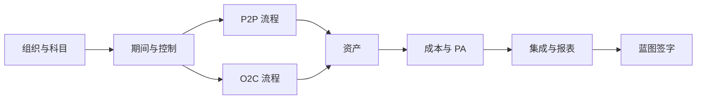

# 蓝图关键问题清单

> **一句话结论**：蓝图问漏的问题都会变成返工。23 问一页列清：每问标注「为什么问」「落到哪条配置」「问清的标准」，访谈前预习、访谈中记录、评审逐条打勾。

## 怎么用这份清单

1. **访谈前**：发客户财务负责人预习，先写初稿答案。
2. **访谈中**：记录「答案 → 影响哪条配置」，含糊的当场标黄。
3. **蓝图评审**：按「验证判据」逐条过，不满足不许签字；签字后变口径走变更。

## 蓝图问题域地图

问题域按依赖排序：先定组织与科目骨架，再定期间规则，之后是流程、资产、成本与报表——前面的答案约束后面的配置。

## 问题清单

### 组织与主数据

| # | 问题 | 为什么要问 | 答案影响哪个配置 | 验证判据 |
|---|---|---|---|---|
| 1 | 上几个公司代码？共用一张科目表还是分表？ | 骨架后改等于重建 | `OBY6`、`OB13` | 有公司代码对照表 |
| 2 | 新公司代码复制标准还是从零建？ | 复制带冗余配置，从零慢但可控 | `EC01` 复制策略 | 有复制范围清单 |
| 3 | 应收应付统驭科目细分到什么粒度？ | 决定 `FBL1N`/`FBL5N` 报表粒度 | 统驭科目清单（`FS00`） | 统驭科目清单已冻结 |

### 期间与开关账

| # | 问题 | 为什么要问 | 答案影响哪个配置 | 验证判据 |
|---|---|---|---|---|
| 4 | 会计年度变式选哪种？要不要特殊期间？ | 决定全部凭证的期间归属 | `OB29`、`OBY6` 分配 | 已选定并写明理由 |
| 5 | 特殊期间与年度切换期谁有权开？ | 授权不收紧年结必乱 | `OB52` 授权组 | 有期间责任矩阵 |
| 6 | MM 期间月末由谁推进？ | MM/FI 独立，没人管必卡 | `OMSY`、`MMPV` | 月结日历写明执行人 |

### P2P 流程

| # | 问题 | 为什么要问 | 答案影响哪个配置 | 验证判据 |
|---|---|---|---|---|
| 7 | 收货发票价差容差多大？超容差谁批？ | 决定发票冻结与放行流程 | 容差配置（如 `OMR6`） | 容差与审批人书面确认 |
| 8 | GR/IR 月末怎么清？账龄红线多久？ | 不定政策则常年挂账对不平 | 清账规则、月结清单 | 清账节奏写进月结清单 |
| 9 | 付款条件多少种？现金折扣核算吗？ | 影响主数据维护与付款跑批 | 付款条件配置 | 付款条件清单已冻结 |
| 10 | 预付款要不要？走订单还是纯 FI？ | 决定特别总账标识设计 | 特别总账标识（预付） | 有流程图与科目映射 |

### O2C 流程

| # | 问题 | 为什么要问 | 答案影响哪个配置 | 验证判据 |
|---|---|---|---|---|
| 11 | 信用控制上不上？静态还是动态检查？ | 影响订单放行流程 | 信用控制（`FD32`） | 有明确结论与检查时点 |
| 12 | 收入口径：开票即收入还是发出商品过渡？ | 口径错则收入期间全错 | 开票科目确定 | 收入口径有书面定义 |
| 13 | 汇票、预收等特别总账用哪些？ | 每个标识一套科目与清账规则 | 特别总账标识设计 | 标识与科目映射已冻结 |

### 资产

| # | 问题 | 为什么要问 | 答案影响哪个配置 | 验证判据 |
|---|---|---|---|---|
| 14 | 资产类别怎么划分？各类挂哪些科目？ | 类别定科目确定与折旧规则 | `OAOA` 与科目确定 | 类别-科目映射表已评审 |
| 15 | 折旧按月还是按日提？年中规则？ | 影响每月 `AFAB` 折旧额 | 折旧键与期间控制 | 折旧规则有测算示例 |
| 16 | 在建工程走 AuC 吗？多久结算一次？ | 影响月结步骤与投资报表 | AuC 结算规则 | 在建流程有图与责任人 |

### CO

| # | 问题 | 为什么要问 | 答案影响哪个配置 | 验证判据 |
|---|---|---|---|---|
| 17 | 成本中心按部门还是功能建？几层？ | 层次太深月结难维护 | 标准层次（`OKEON`） | 标准层次图已评审 |
| 18 | 分摊用固定循环还是每月临时定规则？ | 临时规则让首个月结延期 | 分摊/分配循环 | 每循环有规则与权重示例 |
| 19 | 内部订单做统计还是真实结算？ | 选错返工量大 | 订单类型与结算规则 | 订单用途清单已确认 |
| 20 | 获利能力分析（PA）上不上？维度多细？ | 特性后改要重导数据 | PA 特性与获利段 | 有结论与维度清单 |

### 集成与报表

| # | 问题 | 为什么要问 | 答案影响哪个配置 | 验证判据 |
|---|---|---|---|---|
| 21 | 物料评估类清单谁定、谁签字？ | 评估类错一个 `OBYC` 全乱 | `OBYC` 账户确定 | 评估类映射有双方签字 |
| 22 | 月结日历每任务谁负责、何时完成？ | 没日历的月结必漏项 | 月结检查清单 | 日历已发布并演练一遍 |
| 23 | 法定报表与管理报表各要哪些？ | 决定报表版本与科目粒度 | 报表版本（如 `OB58`） | 清单逐张有格式样例 |

## 蓝图阶段最常埋的 4 个雷

| 雷 | 后果 | 验证判据（评审时查什么） |
|---|---|---|
| 科目表按部门建段 | 组织一调整科目表就得重排 | 科目编码规则无部门段 |
| 期间控制责任不清 | 月初没人执行 `OB52`/`MMPV`，全员过不了账 | 有书面期间责任矩阵 |
| GR/IR 政策没定 | 月末 GR/IR 常年挂账对不平 | 规则与账龄红线进月结清单 |
| 分摊规则没细化 | 首个月结现编循环，CO 延期 | 每个循环有规则与权重 |

> 个别事务码在 ECC 与 S/4 间有差异，以你的系统为准。
