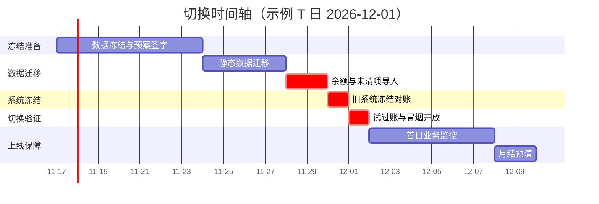

# 上线切换 Runbook

> **一句话结论**：切换成功的标志不是 T 日没出事，而是每个任务都有负责人、依赖和验证判据，任何一步判据不满足就停在冻结点——按 T-14 到 T+7 的时间轴执行，失败可回退、决策有时限。

## 使用原则

1. **每个任务四要素**：负责人（主备两人）、依赖（哪个任务完成后才能开始）、验证判据（怎么算完成）、T-x 时点（T-x = 切换前第 x 天，T+x = 切换后第 x 天）。
2. **判据不过不进下一阶段**：每阶段出口是冻结点，判据未满足就停在那里，由切换指挥决策继续、延期或回退。
3. **示例以 T 日 = 每月 1 日**（下图以 2026-12-01 为例）：月末切换可整月取旧系统余额，是最常见的切换窗口。

## 切换任务总表

| # | 阶段 | 任务 | T-Code/工具 | 负责人 | 依赖 | 验证判据 |
|---|---|---|---|---|---|---|
| 1 | T-14 | 主数据冻结清单（科目/供应商/客户/资产/物料）签字 | 清单模板 | FICO 顾问+关键用户 | 蓝图基线 | `FS00` 导出科目清单与冻结清单一字不差 |
| 2 | T-14 | 切换团队联络表与值班表发布 | — | 项目经理 | 人力到位 | 每时段每角色有主备两人 |
| 3 | T-14 | 回退预案评审并签字 | 本页第 4 节 | 项目经理 | 任务 2 | 客户项目经理书面签字 |
| 4 | T-7 | 科目主数据迁移（科目表层+公司代码层） | `FS00` + LSMW/迁移驾驶舱 | FICO 顾问 | 任务 1 | 科目数=冻结清单；抽 10 个科目字段全对 |
| 5 | T-7 | 供应商/客户主数据迁移 | LSMW/迁移驾驶舱 | 关键用户 | 任务 1 | 编号连续无断号；统驭科目无空值 |
| 6 | T-7 | 资产主数据迁移 | ECC `AS91`；S/4 以你的系统为准 | AA 顾问 | 任务 1 | 资产卡片数与清单一致 |
| 7 | T-7 | 期初未清项清单准备（供应商/客户/总账） | 旧系统导出 | 客户财务 | 任务 1 | 明细到行项目级，含单据号与到期日 |
| 8 | T-3 | 科目余额导入 | `FB01`/`FB50` 批量 | FICO 顾问 | 任务 4 | `FAGLL03` 余额与旧系统试算表逐科目一致（容差 0） |
| 9 | T-3 | 未清项导入（含 GR/IR 明细到行项目级） | LSMW/`FB01` | FICO 顾问 | 任务 5、7 | `FBL1N`/`FBL5N`/`FBL3N` 逐行勾对通过 |
| 10 | T-3 | 资产价值导入（购置价+累计折旧+当年已提） | ECC `ABLDT`；S/4 以你的系统为准 | AA 顾问 | 任务 6 | 资产累计价值与旧系统一致 |
| 11 | T-1 | 旧系统业务冻结（转只读） | 旧系统权限 | 客户 IT | 任务 8-10 | 旧系统最后一张凭证号已记录 |
| 12 | T-1 | 最后对账：新旧试算平衡表核对 | 报表导出 | 客户财务 | 任务 11 | 借贷合计相等且与旧系统一致 |
| 13 | T-1 | 期间精确控制：`OB52` 只开切换过账期间；`MMPV` 确认 MM 新期间已开 | `OB52`、`MMPV` | FICO 顾问 | 任务 12 | 仅开放 2 个期间×4 类账户；MM 当前期间=新期间 |
| 14 | T-1 | 凭证号段预留与检查 | 号段配置 | FICO 顾问 | 任务 12 | 切换凭证号段与业务号段不重叠 |
| 15 | T 日 | 试过账：每类账户各 1 笔后冲销 | `FB01` | FICO 顾问 | 任务 13、14 | 试算凭证冲销后余额完全还原 |
| 16 | T 日 | 关键用户冒烟测试 5 笔代表业务（收货/发票/开票/收款/付款）并正式开放 | `MIGO`/`MIRO`/`VF01` 等 | 关键用户+值班顾问 | 任务 15 | 5 笔全部按期望完成；开放公告已发 |
| 17 | T+1 | 首日业务监控与快速响应 | `FBL1N`/`FBL5N`/`FAGLL03` | 值班顾问 | 任务 16 | 问题 30 分钟内响应，当日闭环或升级 |
| 18 | T+7 | 第一次月结预演（按月结检查清单全流程跑一遍） | `MMPV`/`AFAB`/`F.13` | FICO 顾问 | 任务 17 | 月结清单全部打勾，法定报表出齐 |

## 余额导入验证

余额导入完成 ≠ 切换数据正确，四道验证全过才算数：

| 验证项 | T-Code | 验证判据 | 容差 |
|---|---|---|---|
| 科目余额 | `FAGLL03` | 与旧系统试算表逐科目比对 | 0 |
| 未清项 | `FBL3N`（供应商 `FBL1N`/客户 `FBL5N`） | 逐行勾对清单，条数与金额合计一致 | 0 |
| 试算平衡 | `FAGLL03` 汇总 | 借方合计 = 贷方合计 | 0 |
| 折旧 | `AFAB`（模拟运行） | 模拟折旧额与手算抽查一致 | 仅舍入差 |
| GR/IR | `FBL3N` + `F.13` | 明细余额与旧系统清单一行不差；上线后月末用 `F.13` 清已匹配项（保持真实未清，不强行清账） | 0 |

## 回退预案

| 条款 | 内容 | 验证判据 |
|---|---|---|
| 冻结点回退 | 每阶段出口即冻结点（T-7、T-3、T-1、T 日）；判据未满足，停在当前阶段不进下一步，由切换指挥决策 | 阶段冻结点清单与判据对照表已评审 |
| 数据回滚范围 | 只回滚 SAP 侧已导入数据：冲销/删除已导凭证与主数据，按导入批次执行；旧系统在 T-1 冻结前仍可续用，回退后恢复读写 | 回滚步骤按批次可执行、可追溯（谁、何时、删了什么） |
| 决策人与时限 | 切换指挥（项目经理）为唯一决策人；T 日每个冻结点最长等 2 小时，T 日 12:00 为「继续/回退」最后决策点 | 决策人签字确认，联络表已发布 |

## 切换日红线

| 红线 | 违反后果 | 验证判据 |
|---|---|---|
| 不并行手工台账 | 双记账必出两套不平的账，对账灾难 | 旧系统已转只读，无新增手工账入口 |
| 不临时改配置 | 切换窗口改配置无测试、无审批，后患无穷 | 切换期间配置传输冻结，变更一律走正式传输 |
| 不动凭证号段 | 号段一改，审计断链、追溯失效 | 切换凭证号段与业务号段区间已锁定并留档 |

切换期间发现任何与本文判据不符的现象，先记录、先上报，按回退预案决策——现场「灵活处理」是切换事故的第一来源。S/4HANA 的迁移工具与 `AS91`/`ABLDT` 的可用性以你的系统为准。
