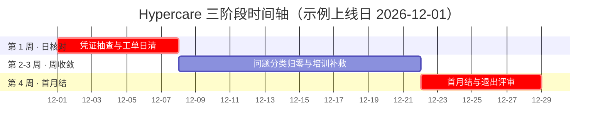

# 上线后 Hypercare 清单 — 前 30 天稳定性检查

> **一句话结论**：Hypercare 的目标不是 30 天内零问题，而是问题有分类、有 owner、有收敛曲线——第 1 周日核对止住出血点，第 2-3 周周收敛消化存量，第 4 周用首月结预演验证系统与人都能独立站住；退出标准不满足就不撤场。

## 使用原则

1. **每项检查有判定**：清单不是「看一眼」，每项都有判定标准，不满足立即开工单并归入问题分类。
2. **问题必须四分类**：配置错 / 主数据错 / 培训缺口 / 程序缺陷，四类归口不同 owner——「说不清哪类」本身就是问题。
3. **周收敛硬指标**：每周遗留问题数必须低于上周，做不到就升级管理层。
4. **示例以上线日 = 每月 1 日**（下图以 2026-12-01 为例），与[上线切换 Runbook](/02-project/go-live-runbook) 的 T+1 首日监控、T+7 月结预演任务直接衔接：Runbook 负责切到线上，本页负责切完之后站得稳。

## 稳定性检查主表

| # | 阶段 | 检查项 | 工具/T-Code | 频率 | 判定 |
|---|---|---|---|---|---|
| 1 | 第 1 周 | 当天凭证抽查（科目/税码/成本对象/凭证类型） | `FB03` | 每日 | 抽 5-10 张零错误；异常当日开工单 |
| 2 | 第 1 周 | 失败过账清单（期间未开、字段状态冲突等） | 工单系统 + `FB03` | 每日 | 当日失败当日解决或给出绕行方案 |
| 3 | 第 1 周 | 银行对账完成度 | 银行对账流程 | 每日 | 当日流水当日核对，无积压 |
| 4 | 第 1 周 | 接口错误日志（银行/金税/OA 等外围接口） | 接口监控 | 每日 | 失败记录零积压，均有重试结果 |
| 5 | 第 1 周 | 用户卡点工单 | 工单系统 | 每日 | 30 分钟内响应，当日闭环或升级 |
| 6 | 第 2-3 周 | 未清项异常增长（供应商/客户） | `FBL1N`/`FBL5N` | 每周 | 周环比无异常跳增；长期未清有清单与 owner |
| 7 | 第 2-3 周 | 期间与号段状态（FI 期间、MM 期间） | `MMPV` + 期间检查 | 每周 | MM 当前期间正确；号段无重叠、无将尽 |
| 8 | 第 2-3 周 | 问题工单趋势（新增/关闭/积压） | 工单系统 | 每周 | 新增周环比下降，积压归零在望 |
| 9 | 第 2-3 周 | 培训补救（对高发错误操作回炉培训） | 培训记录 | 每周 | 高发错误对应操作已复训并考核通过 |
| 10 | 第 4 周 | 首月结全流程（衔接 Runbook T+7 预演后的正式首月结） | 月结清单 | 一次性 | 按[月结检查清单](/01-daily-ops/month-end-checklist)全流程走通并打勾 |
| 11 | 第 4 周 | 折旧首次正式运行 | `AFAB` | 一次性 | 无错误；折旧额与模拟结果一致 |
| 12 | 第 4 周 | 报表勾稽（总账 vs 明细 vs 未清项） | `FAGLL03` | 一次性 | 试算平衡、未清项合计与台账一致，差异 = 0 |
| 13 | 第 4 周 | 性能反馈（过账与报表响应） | 用户反馈 | 一次性 | 无「不可用」级性能投诉；慢点有优化 owner |
| 14 | 第 4 周 | 关键用户独立操作认证 | 观察记录 | 一次性 | 关键用户独立完成日常操作与月结步骤 |
| 15 | 第 4 周 | Hypercare 退出评审 | 本页退出标准 | 一次性 | 退出标准表全项满足并签字归档 |

## 退出标准

| 项 | 标准 |
|---|---|
| 过账失败 | 连续两周过账失败率趋零，无系统性失败遗留 |
| 未清项 | `FBL1N`/`FBL5N` 无异常增长，GR/IR 与未到票台账一致 |
| 首月结 | 按月结日历完成，法定与管理报表出齐且勾稽通过 |
| 关键用户 | 独立完成日常操作与月结，不需要顾问坐镇 |
| 遗留问题 | 全部有 owner 与截止日，无「没人认领」项 |

## 常见翻车点

1. **用户绕过流程手工调账**：老系统习惯带进新系统，「先手工记平再说」一旦开始，集成链的数据一致性立刻破裂，而且极难追责。对策：Hypercare 期间所有调整过账必须走顾问复核，例外通道零容忍。
2. **首月结发现期初问题没人拍板**：期初余额类差异涉及「改历史还是调当期」，必须有客户财务经理级的人当场拍板，否则问题挂到月底变成月结事故。对策：第一次月结预演时就明确期初差异的决策人与时限。
3. **培训只做一次没有跟进**：上线培训覆盖不住真实业务的长尾场景，第 2-3 周必然出现「不会做就绕着做」。对策：把工单高发操作变成每周 30 分钟的复训 + 考核，直到该类工单归零。

Hypercare 期间发现的配置类问题一律走正式传输流程修复并记录，不在生产系统直接改配置——这条与[上线切换 Runbook](/02-project/go-live-runbook) 的切换日红线一脉相承，是撤场后系统可审计的底线。
