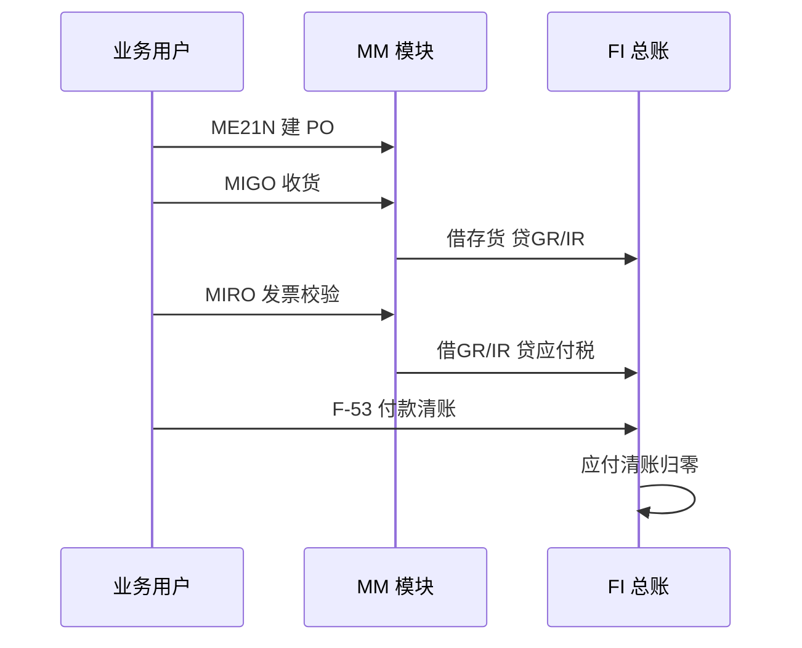

# 集成测试脚本模板

> **一句话结论**：集成测试不是「点点看能不能跑」——每个脚本用真实主数据走跨模块完整链路，每一步写清期望结果与 FI 影响，实际结果对不上就记缺陷、修复后重测；全部脚本打勾，才有资格谈上线。

## 测试三原则

1. **跨模块、真主数据**：脚本必须穿透 MM/SD/FI 边界，用测试号段的真实主数据（见文末数据规范），不用「万能科目」绕过配置。
2. **每步带期望结果**：执行前先写清这一步应该产生什么 FI 凭证、什么借贷方向；没有期望的步骤等于没测。
3. **失败必须记录与重测**：任何一步实际结果与期望不符，先记缺陷（见缺陷模板），不现场改配置蒙混过关；修复后整条脚本从头重跑，不允许只重跑失败那步。

## P2P 全链路与 FI 记账点

三个 FI 记账点（收货、发票校验、付款清账）是 P2P 脚本的核对骨架：每步用 `FB03` 查看生成的凭证，科目与借贷方向必须与 `OBYC`、税码、统驭科目配置逐一对应。

## 脚本一：P2P 收货收发票付款

前置：供应商 200001、物料 RM001（移动平均价 10.00）已建，税码 13% 已配置。

| 步骤 | 事务 | 操作 | 期望结果 / FI 影响（验证判据） | 实际结果 | 结论 |
|---|---|---|---|---|---|
| 1 | `ME21N` | 建 PO：200001，RM001 ×100 @ 10.00 | PO 生成；无 FI 凭证；净价 1,000.00 |  |  |
| 2 | `MIGO` | 对 PO 收货，移动类型 101 | 物料凭证 + FI 凭证：借 存货 1,000.00 / 贷 GR/IR 1,000.00 |  |  |
| 3 | `FB03` | 查收货 FI 凭证 | 凭证类型 WE；科目与 `OBYC`（BSX/WRX）配置一致 |  |  |
| 4 | `MIRO` | 发票校验：价税合计 1,130.00（税 13%） | 借 GR/IR 1,000.00 / 借 进项税 130.00 / 贷 供应商 1,130.00；三单匹配通过 |  |  |
| 5 | `FBL1N` | 查 200001 未清项 | 一条未清 1,130.00，到期日按付款条件推出 |  |  |
| 6 | `F-53` | 付款 1,130.00 并清账 | 借 应付账款 / 贷 银行存款；凭证含清账标识 |  |  |
| 7 | `FBL1N` | 复查供应商未清项 | 未清项 0，已清项可见清账日期 |  |  |
| 8 | `FB03` | 查 GR/IR 科目 | 收货与发票两行已互相清账，GR/IR 余额 0 |  |  |
| 9 | `MIRO` | 另一 PO 录价差发票：发票 1,020.00 vs PO 1,000.00 | 差异 20.00 落入价格差异或存货科目；未被容差拦下 → 容差配置正确 |  |  |
| 10 | `FB60` | 录一笔无 PO 费用发票（如办公费 200.00） | 直接借费用/贷供应商，不产生 GR/IR；与有 PO 流程形成对照 |  |  |

## 脚本二：O2C 开票收款清账

前置：客户 100001、成品 FG001（标准成本 80.00，售价 100.00）已建。

| 步骤 | 事务 | 操作 | 期望结果 / FI 影响（验证判据） | 实际结果 | 结论 |
|---|---|---|---|---|---|
| 1 | `VA01` | 建销售订单：100001，FG001 ×10 @ 100.00 | 订单生成；无 FI 凭证；可用性检查通过 |  |  |
| 2 | `VL01N` | 建交货单并过账发货（PGI） | 借 主营业务成本 800.00 / 贷 库存商品 800.00（标准成本结转） |  |  |
| 3 | `VF01` | 对交货开票 | 借 应收账款 1,130.00 / 贷 主营业务收入 1,000.00 / 贷 销项税 130.00；凭证类型 RV |  |  |
| 4 | `FBL5N` | 查 100001 未清项 | 一条未清 1,130.00，到期日按付款条件推出 |  |  |
| 5 | `F-28` | 部分收款 500.00 并清账 | 借 银行存款 500.00 / 贷 应收账款（部分清账过账） |  |  |
| 6 | `F-32` | 对剩余 630.00 做剩余项清账 | 生成新未清项 630.00（带到期日），原未清项关闭 |  |  |
| 7 | `F-28` | 收款 630.00 并清账 | 未清项 0；客户余额与总账统驭科目一致 |  |  |

## 脚本三：月结日切验证（MM/FI 期间交叉）

前置：当期 MM/FI 业务已全部过账，演练月结日切。

| 步骤 | 事务 | 操作 | 期望结果 / FI 影响（验证判据） | 实际结果 | 结论 |
|---|---|---|---|---|---|
| 1 | `MMPV` | 关闭当期 MM 期间（公司代码 1000） | 提示期间已推进；重复执行提示已是下期 |  |  |
| 2 | `MIGO` | 尝试以上期日期收货 | 报错：过账期间已关（错误文本以你的系统为准） |  |  |
| 3 | `FB01` | 尝试以上期日期过账总账凭证 | 行为取决于 `OB52`：FI 期间关则拒绝；开则允许 → 证明 FI 与 MM 期间互相独立 |  |  |
| 4 | `FB60` | 以当期日期过账一笔费用发票 | 过账成功，凭证期间为当前期间 |  |  |
| 5 | `MIGO` | 以当期日期正常收货 | 成功；GR/IR 出现新余额，物料账当期更新 |  |  |
| 6 | 汇总 | 核对期间状态 | MM 当前期间 = FI 开放期间；月结检查清单该项可打勾 |  |  |

## 缺陷记录模板

| 编号 | 脚本/步骤 | 现象 | 期望 vs 实际 | 严重度 | 状态 |
|---|---|---|---|---|---|
| IT-001 | 脚本一 / 步骤 4 | `MIRO` 报税码不存在 | 期望过账成功 vs 实际报错 | 高（阻断脚本） | 待修复 |

严重度分级：**高** = 阻断脚本无法继续；**中** = 有替代方案但不符蓝图；**低** = 提示与界面类问题。状态流转：待修复 → 已修复 → 重测通过（整条脚本重跑后才能改「重测通过」）。

## 测试数据规范

| 主数据 | 编号约定 | 示例 | 用途 |
|---|---|---|---|
| 供应商 | 2000xx | 200001 | P2P 脚本 |
| 客户 | 1000xx | 100001 | O2C 脚本 |
| 原材料 | RMxxx | RM001 | 采购收货 |
| 成品 | FGxxx | FG001 | 销售发货 |
| 单据号段 | 测试单据类型独立号段，与正式号段隔离 | — | 防止测试数据混入真实账 |

所有测试数据统一在公司代码 1000 下创建，测试完成后按号段整体清理，不与真实业务共用任何主数据。

## 导出与执行

本页所有表格可直接复制到 Excel 使用（保留表头即可），打印为纸质脚本由执行人逐步签字；「实际结果」与「结论」两列留空即勾选栏。交货事务（`VL01N`）与部分清账行为在 ECC 与 S/4HANA 间存在差异，以你的系统实测为准。
