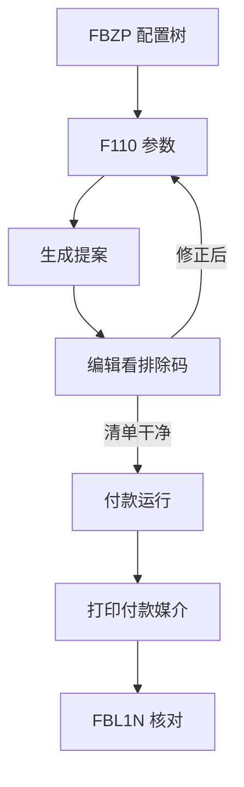

## 一句话结论

> `F110` 自动付款跑不出来，九成不在运行本身：`FBZP` 配置树决定「能不能付」，供应商主数据与到期窗口决定「付谁」；提案 0 行先编辑提案看排除码，那是排错的第一入口。

## 症状

- `F110` 测试运行提案 0 行，但 `FBL1N` 里明明有一堆到期未清的供应商发票。
- 付款运行显示正常完成，却没生成付款凭证，银行科目纹丝不动。
- 大部分发票进了提案，固定几家供应商（如 200001）每次都被排除，人工付款补漏成了惯例。

## 根因（按概率）

| 根因（按概率） | 验证动作 | 修复动作 |
|---|---|---|
| 供应商主数据未勾该付款方式（支付交易视图） | 查供应商 200001 支付交易视图的付款方式字段 | 补勾付款方式并维护付款条件，注意主数据变更只影响之后的提案 |
| 到期日不在窗口：付款条件 + 基准日算出的到期日晚于「下一付款日」 | `FBL1N` 未清项看到期日列，对比运行参数的下一付款日 | 修基准日 / 付款条件，或把下一付款日放到来覆盖到期日的那天 |
| `FBZP` 该公司代码 + 付款方式 + 币种组合未配 | `FBZP` 逐层查付款方式的国家层与公司代码层定义 | 补配付款方式（含允许币种、最小金额、表单），再回银行确定挂规则 |
| 发票或供应商带付款冻结标记 | `FBL1N` 看未清项冻结标识，主数据看付款冻结字段 | 与业务确认后解冻，或本次运行按参数设定跳过冻结项 |
| 金额低于付款方式的最小金额门槛 | `FBZP` 公司代码层付款方式查最小金额 | 调门槛，或让小票挂账累计到下期一起付 |

## 配错会怎样

- 全员卡在付款日：`F110` 反复跑，`FBZP` 没问题的表象下藏着银行确定缺规则，付款运行直接报错中断。
- 付错口径：该排除的没排除（冻结票付了）、该付的没付（到期口径没对齐），月末银行对账与 `FBL1N` 未清清单两头对不上。
- 凭证类型配错：付款凭证进了错误编号范围，后续清账与审计追溯都别扭，还要逐张 `FB08` 冲销重来。

## 怎么配置

`FBZP` 是配置树入口，按树的层次逐个 tab 检查：

1. **公司代码参数**：公司代码 1000 是否已挂到付款流程（含付款公司代码——跨公司代付才用得上）、凭证类型与「立即付款」等标识。
2. **付款方式**：先在国家层定义付款方式（如 C 支票、T 转账），再在公司代码层启用——每公司代码允许的付款方式与币种在这里控制，最小金额门槛也在这层。
3. **银行确定**：按「付款方式 + 币种 + 银行」组合配可用银行，确定规则里管可用金额区间与取数排序——多银行账户时配漏组合，运行就找不到付款银行。
4. **下一付款运行号码**：确认号码范围没卡住；反复删除重建运行后号码异常，在这里看。
5. **凭证类型**：付款过账用的凭证类型与编号范围，别与手工付款混号。

供应商侧：支付交易视图必须勾选对应付款方式，付款条件与基准日决定到期日；两层都通了，`F110` 才看得见这张票。

`F110` 运行四步，一步一验证：

1. **参数**：运行日期 + 标识 + 凭证日期 + 过账至日期 + 公司代码 + 付款方式 + 下一付款日——「过账至日期」收口本期，「下一付款日」决定到期窗口。
2. **提案**：先编辑提案看清单——**被排除的发票在这里逐行带排除码（冻结、未到期、金额不足等，具体码值以你的系统为准），这是排查的第一入口**，比任何后台表都快。
3. **付款运行**：提案干净后正式跑，生成付款凭证与付款文件。
4. **打印/媒介**：支票打印或付款文件传出（媒介格式以你的系统配置为准）。

手工补付走 `F-53`（带清账），付错的付款凭证用 `FB08` 冲销；冲销前先确认付款文件是否已发银行。

## 怎么验证

公司代码 1000、供应商 200001，选一笔当天到期的发票（或按付款条件临时造一笔），`F110` 参数里付款方式、下一付款日与该票到期口径对齐，先测试运行。

**验证 T-Code**：`F110`
**验证判据**：测试运行提案行数 = `FBL1N` 按同口径（同付款方式、到期日不晚于下一付款日、金额不低于最小门槛、无冻结）查出的到期未清项数；正式运行后 `FBL1N` 中该发票变为已清，银行科目有付款凭证过账、借贷平衡。
**失败对照**：提案 0 行或缺票 → 编辑提案看排除码，按码反查根因表前三行；付款完成却无凭证 → 回 `FBZP` 查银行确定组合与「立即付款」标识、下一付款运行号码是否异常；具体报错消息定位见[报错速查](/01-daily-ops/errors/)。

## 相关 T-Code

`F110` · `FBZP` · `FBL1N` · `F-53` · `FB08`
