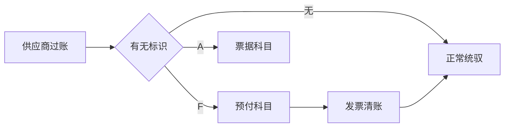

## 一句话结论

> 特别总账标识让同一供应商的往来绕开正常统驭科目，改走备选统驭科目或只记备忘项；`FBKP` 一个事务配齐所有标识，预付链 `F-47` → `F-48` → `F-54` 任何一环配错就串户。

## 症状

- `F-48` 付完预付款，`FBL1N` 常规视图看不到，报表里它挂在正常应付统驭科目（示意 `160000`）而不是预付科目（示意 `115000`）。
- 汇票业务（标识 A）承兑/贴现科目错，票据负债串进应付账款。
- `F-47` 预付请求过账后生成了真实负债行项目——被当成普通过账，而不是备忘项（noted item）。

## 根因（按概率）

| 根因（按概率） | 验证动作 | 修复动作 |
|---|---|---|
| 标识 F 未挂备选统驭科目 | `FBKP` 查 F 的科目确定 | 挂预付科目 `115000` |
| 标识属性错：预付款/备忘项标志未按业务勾选 | `FBKP` 查属性页 | 勾对性质再重记 |
| 用户过账时没输特别总账标识 | `FB03` 查凭证行特别 G/L 字段为空 | 冲销重记或调整入账 |
| 汇票标识 A 科目确定缺行 | `FBKP` 查 A 配置 | 补挂票据应付科目 |

## 配错会怎样

- 预付挂进正常应付：应付/预付重分类失真，资产负债表往来净额不对。
- 清账链断：`F-54` 找不到可清的预付项，供应商月结对不平。
- 备忘项当真实过账：虚增负债，审计必须调整，且 `F-53` 正常付款清账逻辑全乱。

## 怎么配置

1. `FBKP`：选目标科目类型 K（供应商），维护特别总账标识；常用：`A` 汇票、`F` 预付款。
2. 每个标识配两件事：属性（借贷方向、是否备忘项、是否预付款性质）与科目确定（备选统驭科目，如 F → `115000`；票据科目编码以你的系统为准）。
3. 预付闭环：`F-47` 登记预付请求（备忘项，不进余额表）→ `F-48` 支付预付款（真实过账，标识 F）→ 到票后 `MIRO`/`FB60` 记发票 → `F-54` 把预付结转清账到发票；日常货款走 `F-53`，不带标识。
4. 报表口径：`FBL1N` 勾选「特别总账事务」才能看到预付与汇票的未清项。

## 怎么验证

公司代码 1000、供应商 200001，`F-48` 过一笔 1,000.00 预付款，标识 F。

**验证 T-Code**：`F-48`
**验证判据**：`FBL1N` 勾选「特别总账事务」能看到该未清项；`FB03` 凭证行特别 G/L 标识 = F；科目落在备选统驭科目 `115000` 而非 `160000`。
**失败对照**：落在正常统驭科目 → 回 `FBKP` 核 F 的备选科目与属性；标识字段为空 → 过账时漏选标识，按预付闭环第 3 步重走。

## 相关 T-Code

`FBKP` · `FBL1N` · `F-47` · `F-48` · `F-53` · `F-54`
