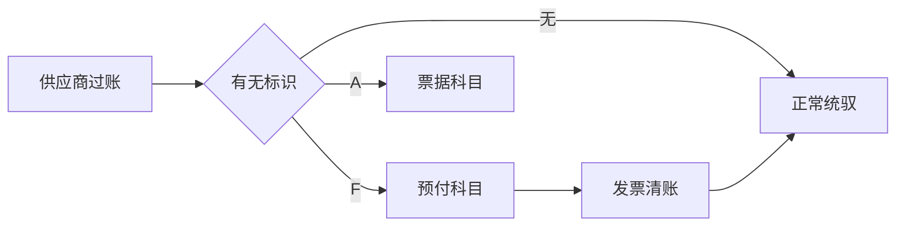

## 一句话结论

> 特别总账标识让同一供应商的往来绕开正常统驭科目，改走备选统驭科目或只记备忘项；`FBKP` 一个事务配齐所有标识，预付链 `F-47` → `F-48` → `F-54` 任何一环配错就串户。

## 症状

- `F-48` 付完预付款，`FBL1N` 常规视图看不到，报表里它挂在正常应付统驭科目（示意 `160000`）而不是预付科目（示意 `115000`）。
- 汇票业务（标识 A）承兑/贴现科目错，票据负债串进应付账款。
- `F-47` 预付请求过账后生成了真实负债行项目——被当成普通过账，而不是备忘项（noted item）。

## 根因（按概率）

| 根因（按概率） | 验证动作 | 修复动作 |
|---|---|---|
| 标识 F 未挂备选统驭科目 | `FBKP` 查 F 的科目确定 | 挂预付科目 `115000` |
| 标识属性错：预付款/备忘项标志未按业务勾选 | `FBKP` 查属性页 | 勾对性质再重记 |
| 用户过账时没输特别总账标识 | `FB03` 查凭证行特别 G/L 字段为空 | 冲销重记或调整入账 |
| 汇票标识 A 科目确定缺行 | `FBKP` 查 A 配置 | 补挂票据应付科目 |

## 配错会怎样

- 预付挂进正常应付：应付/预付重分类失真，资产负债表往来净额不对。
- 清账链断：`F-54` 找不到可清的预付项，供应商月结对不平。
- 备忘项当真实过账：虚增负债，审计必须调整，且 `F-53` 正常付款清账逻辑全乱。

## 怎么配置

1. `FBKP`：选目标科目类型 K（供应商），维护特别总账标识；常用：`A` 汇票、`F` 预付款。
2. 每个标识配两件事：属性（借贷方向、是否备忘项、是否预付款性质）与科目确定（备选统驭科目，如 F → `115000`；票据科目编码以你的系统为准）。
3. 预付闭环：`F-47` 登记预付请求（备忘项，不进余额表）→ `F-48` 支付预付款（真实过账，标识 F）→ 到票后 `MIRO`/`FB60` 记发票 → `F-54` 把预付结转清账到发票；日常货款走 `F-53`，不带标识。
4. 报表口径：`FBL1N` 勾选「特别总账事务」才能看到预付与汇票的未清项。

## 参数与组合全解

### FBKP 标识维护字段全解

| 字段 | 管什么 | 配错后果 |
|---|---|---|
| 备选统驭科目（科目确定行） | 带该标识的行项目绕开正常统驭科目，挂到这里 | 预付挂进正常应付 `160000`，往来重分类失真 |
| 借贷方向 | 标识只允许用于供应商的借方（或贷方） | 方向配反：过账被拦，或串到错误往来 |
| 清账 / 备忘项属性 | 行项目是真实未清项，还是不进余额表的备忘项 | `F-47` 请求被当真实负债，虚增负债 |
| 预付款性质 | 勾上才启用预付清算与预付税金处理逻辑 | 预付税金口径错，报税要重梳 |
| 税务类型 | 该标识允许/要求的税码处理方式 | 税挂错环节，预付转票时税额对不上 |

属性页是全局口径（按科目类型 + 标识定义），科目确定是公司代码口径——排查时先分清查哪一层，别在全局属性里找公司代码差异。

### 常见标识组合场景

| 标识（示意） | 场景 | 行项目性质 | 落账口径 |
|---|---|---|---|
| 无标识 | 正常应付发票/付款 | 真实过账 + 未清项 | 正常统驭 `160000` |
| F | 预付款支付（`F-48`） | 真实过账 + 未清项 | 备选统驭 `115000`，参与清账 |
| F（备忘形态） | 预付请求（`F-47`） | 备忘项，不进余额表 | 只提示待付的预付，无负债 |
| A | 汇票承兑/贴现 | 真实过账 + 未清项 | 票据科目链（应付票据、贴现科目） |
| W | 保证金/担保类往来 | 真实过账 | 保证金往来科目 |

在用标识清单与各自属性以系统现状为准（`FBKP` 逐个开属性页核对）。

### 预付三步流的凭证口径

| 步骤 | 事务 | 凭证口径 | 余额表影响 |
|---|---|---|---|
| 预付请求 | `F-47` | 备忘项（单边备忘行，不生成平衡凭证） | 无 |
| 预付支付 | `F-48` | 借预付 `115000` / 贷银行，标识 F | 有，预付挂未清 |
| 发票到达 | `MIRO`/`FB60` | 正常应付发票（无标识，`160000`） | 有，应付挂未清 |
| 预付清转 | `F-54` | 清账凭证：预付未清项结转冲抵发票 | 预付未清项清掉，应付净额回归真实 |

## 边缘与高级场景

- **清转时点——收票后还是付款后**：推荐**收票后立即 `F-54` 清转**：月度 `FBL1N` 的预付未清项 = 真实未到票预付、应付未清项 = 真实未付票；拖到付款时点才清转，报表期间预付与应付同时虚挂，账龄两头失真。
- **汇票贴现的科目链**：承兑时挂应付票据；贴现时银行按净额入账、贴现息进财务费用——票据风险是否终止确认决定中间挂「贴现应收」还是「短期借款」口径，具体科目链与准则判断以系统与项目方案为准。
- **跨公司代码的标识一致性检查**：属性按科目类型 + 标识全局定义，备选统驭科目却按公司代码维护——集团多公司代码时同一标识要逐公司代码核对（1000 配了 `115000`，2000 漏配就挂错科目或过不了账），上线前用清单全量对一遍，否则合并口径分裂。

## 怎么验证

公司代码 1000、供应商 200001，`F-48` 过一笔 1,000.00 预付款，标识 F。

**验证 T-Code**：`F-48`
**验证判据**：`FBL1N` 勾选「特别总账事务」能看到该未清项；`FB03` 凭证行特别 G/L 标识 = F；科目落在备选统驭科目 `115000` 而非 `160000`。
**失败对照**：落在正常统驭科目 → 回 `FBKP` 核 F 的备选科目与属性；标识字段为空 → 过账时漏选标识，按预付闭环第 3 步重走。

## 相关 T-Code

`FBKP` · `FBL1N` · `F-47` · `F-48` · `F-53` · `F-54` · `FB03` · `MIRO`
