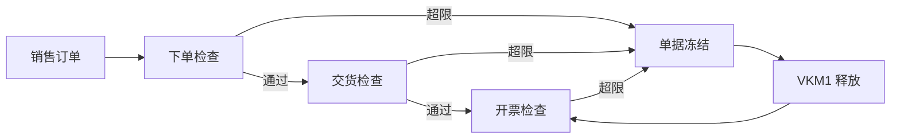

## 一句话结论

> 信贷管理两代并存：ECC 简单信贷用 `FD32` 维护额度、`OVA8` 配自动信贷控制（信贷组 × 风险类 × 反应），在订单/交货/开票三个检查点拦截；S/4 主推 FSCM，信贷主数据挪到 `UKM_BP`；被冻结的单据统一从 `VKM1`/`VKM3` 释放。

## 症状

- `VA01` 下单或 `VL01N` 交货时弹出信贷超限，单据存不进去或直接进冻结清单。
- `FD32` 里额度明明还有富余，报表却看不出占用到底花在哪些未清票上。
- 系统切到 FSCM 后，`FD32` 老习惯入口看不全或不再生效，客户经理到处找新入口。

## 根因（按概率）

| 根因（按概率） | 验证动作 | 修复动作 |
|---|---|---|
| 额度不足或已过有效期 | `FD32` 查额度、占用与有效期 | 提额或延期，走信贷审批 |
| 未清发票占满额度（简单信贷按未清项累计占用） | `FD33` 看占用构成 | 催收清账释放占用，或临时提额 |
| `OVA8` 风险类×信贷组组合反应过严（B 错误 / C 冻结） | `OVA8` 核对该组合的反应与占用公式 | 与业务确认后放宽反应或公式 |
| 单据被冻结后无人释放，业务绕道催客户 | `VKM1` 看冻结清单是否积压 | `VKM1`/`VKM3` 释放并留痕 |

## 配错会怎样

- 该拦的不拦：超信用客户照样发货，坏账风险直接跟着物流出去了。
- 不该拦的全拦：交货车停在月台等 `VKM1` 释放，客户体验崩塌。
- FSCM 切换后简单信贷配置悄悄失效：检查不再执行，所有人都以为还在管控。

## 怎么配置

1. **ECC 简单信贷主数据**：`FD32` 给客户 100001 维护额度（`FD33` 显示占用构成）；客户主数据定风险类，销售凭证类型/交货类型各挂信贷组。
2. **`OVA8` 自动信贷控制**：按「信贷控制范围 + 风险类 + 信贷组」组合配置——反应 A 警告放行、B 报错中断、C 冻结单据待释放；额度占用公式（静态 / 含未清项等）也在这里选。
3. **三个检查点**：订单（`VA01`）、交货（`VL01N`）、开票（`VF01`）——信贷组挂在凭证类型上检查才会真正发生，三个点可配不同松紧。
4. **S/4 FSCM**：信贷主数据与业务伙伴集成，`UKM_BP` 按信贷段维护额度、规则与计分；简单信贷数据可迁移，迁移工具与激活开关以你的系统为准，两版差异见[版本差异总表](/00-about/version-matrix)「信贷管理」行。
5. **释放入口**：被冻结单据在 `VKM1`（按单据）/`VKM3`（按客户）释放——放行不改额度，下一单照样拦；被拦后的完整排查路径见[销售单据被信贷冻结](/01-daily-ops/errors/credit-block)。

## 怎么验证

公司代码 1000、客户 100001：`FD32` 记下当前额度与占用 → 把额度临时调小到占用以下 → `VA01` 给该客户下一张新单。

**验证 T-Code**：`FD32`
**验证判据**：额度调小后新单按 `OVA8` 配置的反应被拦（B 出错误消息，C 进冻结清单且 `VKM1` 可见）；`VKM1` 释放后单据可继续交货开票；额度调回后 `FD33` 占用回落，下单不再拦截。
**失败对照**：下单完全不拦 → 查销售凭证类型是否挂信贷组、`OVA8` 该组合是否漏配（无配置即不检查）；`VKM1` 看不到冻结单 → 反应配成了 A（警告），只弹窗不冻结。

## 相关 T-Code

`FD32` · `FD33` · `VKM1` · `VKM3` · `UKM_BP` · `OVA8`
