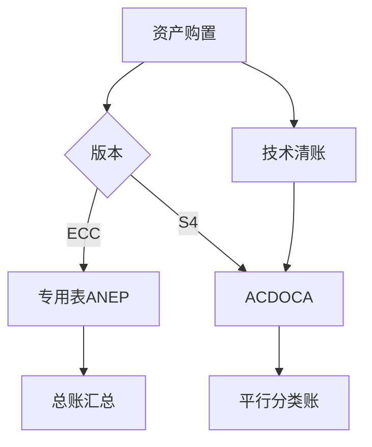

## 一句话结论

> S/4HANA 新资产会计把资产明细并入统一日记账 `ACDOCA`，购置走技术清账科目、按分类账平行过账，折旧跑错可直接重启；ECC 时代查 ANEP/ANLC、先撤销再重跑的习惯要整套更新。

## 症状

- 老报表/ABAP 还从 `ANEP`/`ANEA`/`ANLC` 取数，S/4 里数据残缺或为零——这些专用表不再作为记账源（兼容视图口径以你的系统为准）。
- `F-90` 购置过账后，一个陌生的中转科目长期挂账：技术清账科目（ASKB）没配好或没被清账。
- `AFAB` 折旧跑了一半出错，ECC 顾问下意识找「撤销」，S/4 的入口是重启（Restart）继续跑。

## 根因（按概率）

| 根因（按概率） | 验证动作 | 修复动作 |
|---|---|---|
| 技术清账科目未配置或挂错科目 | `FAGLL03` 查该科目未清余额 | 上线前补配并跑通购置链 |
| 折旧范围与分类账（含平行货币）映射缺失 | 资产会计配置里核对映射（以系统为准） | 补映射后重跑 `AFAB` |
| 老程序仍读 ECC 资产表 | 检查报表数据源 | 改为读 `ACDOCA`/CDS 视图 |
| 折旧跑错后手工调总账 | `AW01N` 与 `FAGLL03` 对余额 | 走重启重跑，恢复资产明细一致 |

## 配错会怎样

- 技术清账科目漏配：集成购置（`F-90` 等）上线首日直接报错，卡掉所有采购入账。
- 手工调账绕过新折旧引擎：总账与 `ACDOCA` 资产明细脱节，审计对不上。
- 只迁主数据不核对迁移余额：`AW01N` 资产值与总账长期差一分钱级别差异，年底解释成本极高。

## 怎么配置

1. 上线前：折旧范围分配到分类账（0L 及平行准则分类账，支持平行货币），并配置技术清账科目——集成购置的 APC 先记技术清账科目，再由各折旧范围按自身规则向总账清账（配置路径以你的系统为准）。
2. 折旧：换用新折旧计算引擎，计划内/计划外折旧逻辑有调整；`AFAB` 支持直接重启折旧运行，不必像 ECC 先整单撤销（重启选项以你的系统为准）。
3. 日常操作不变：`AS01`/`AS02`/`AS03` 建改查资产；`AW01N` 资产浏览器看各范围计划值与过账值（ECC 对应 `AW01`）；`OAOA` 维护资产类别，屏幕布局与科目确定仍在。
4. 查账口径统一到 `ACDOCA`：总账侧用 `FAGLL03`，资产侧看 `AW01N`，别再依赖旧表。版本行为差异另见[版本兼容矩阵](/00-about/version-matrix)。

## 怎么验证

`AS01` 在公司代码 1000 建测试资产 → `F-90` 对供应商 200001 购置入账 → `AFAB` 试运行一次。

**验证 T-Code**：`AW01N`
**验证判据**：`AW01N` 各折旧范围购置值正确；`FAGLL03` 能查到对应总账行项目；技术清账科目上该笔已清、无余额。
**失败对照**：技术清账科目挂余额 → 查购置过账配置与折旧范围-分类账映射；`AW01N` 与总账不平 → 回迁移规则核对，勿手工硬调。

## 相关 T-Code

`AS01` · `AFAB` · `AW01N` · `FAGLL03` · `OAOA`
