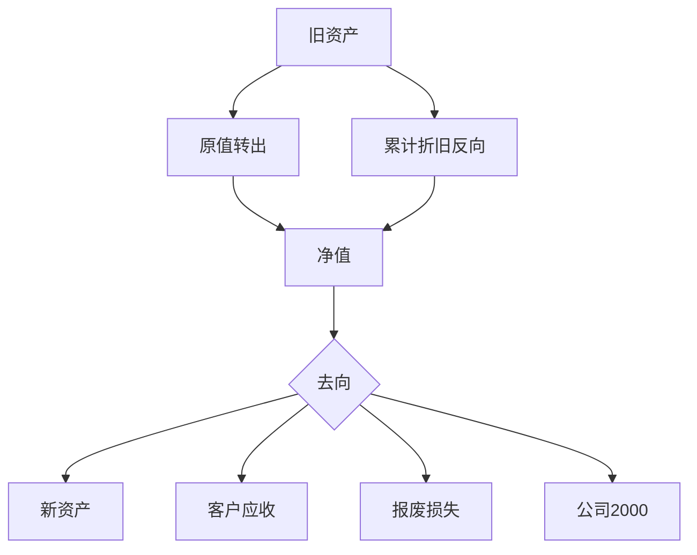

## 一句话结论

> 资产末端四把刀：`ABUMN` 公司内转移搬净值、`ABAON` 卖给客户、`ABAVN` 无收入报废、`ABT1N` 跨公司转移——分录本质都是「原值转出、累计折旧反向、净值找去向」，不平先查转移变式与科目确定。

## 症状

- `ABUMN` 转移后旧资产、新资产净值合计与转移前对不平，差一角或差一大截。
- `ABAVN` 报废损失异常大，或 `ABAON` 销售损益与事前测算差一截——多半是折旧口径错位。
- `ABT1N` 跨公司转移卡住：一边过账一边没过，或公司间往来科目两边挂账不平。

## 根因（按概率）

| 根因（按概率） | 验证动作 | 修复动作 |
|---|---|---|
| 转移变式选错：转移了不该转的值或口径（如只该转净值却连折旧关键一起搬） | `FB03` 看凭证借贷结构 | 冲销后按业务选对变式重做 |
| 报废月折旧口径错：当月该不该再提一笔没按折旧关键执行 | `AW01N` 看报废月折旧是否已提 | 先跑当期折旧再报废（口径以你的系统为准） |
| 跨公司配置缺失：双公司科目确定或公司间往来未配平 | 看卡单报错消息 | 补科目确定与公司间配置后重跑 |
| 部分转移口径错：按金额或百分比切分与预期不符 | 核对转移前后净值合计 | 按净值守恒原则冲销重做 |

## 配错会怎样

- 变式用错：旧资产转出的口径与新资产接到的口径不一致，折旧计划全盘重排，报表两期跳变。
- 报废前漏提当月折旧：处置损益凭空虚增或虚减，税局与审计口径对不上。
- 跨公司单边过账：公司 1000 与 2000 的往来科目各挂一半，月结对账灾难。

## 怎么配置

四种操作各管一段（公司代码 1000，资产 100001 号段）：

1. **`ABUMN` 公司内转移**：资产间转账，旧资产净值（原值、累计折旧按变式决定）转到新资产，借贷走「固定资产清理」类过渡科目（科目确定以你的系统为准）；支持按金额或百分比部分转移。
2. **`ABAON` 有客户销售报废**：借「应收客户」（含税）、累计折旧反向借出、贷「固定资产」原值，差额进资产处置损益。
3. **`ABAVN` 无收入报废**：无客户无收入，净值一次性进报废损失，适合盘亏、毁损、提前退役。
4. **`ABT1N` 跨公司转移**：公司 1000 → 2000，双公司分录加公司间往来（intercompany）科目，两边科目确定与转移价口径要配平（配置以你的系统为准）。
5. **事后核对**：`FB03` 逐张看凭证三段结构是否齐全（原值、累计折旧、净值去向）；转移与报废走的过渡科目月末必须清零。

## 参数与组合全解

**四种操作分录结构对照**：

| 操作 | 固定资产原值 | 累计折旧 | 净值去向 |
|---|---|---|---|
| `ABUMN` 公司内转移 | 旧资产转出、新资产转入 | 随变式反向结转 | 过渡科目一借一贷（或直接对转，以变式为准） |
| `ABAON` 销售报废 | 转出（贷） | 反向（借） | 借应收客户，差额进处置损益 |
| `ABAVN` 无收入报废 | 转出（贷） | 反向（借） | 全额进报废损失 |
| `ABT1N` 跨公司转移 | 双公司各自转出/转入 | 随净值口径 | 公司间往来科目，两边挂平 |

**转移变式**：决定「哪些值、按什么口径转移」——只转 APC、转 APC 加累计折旧（净值口径）、是否重排折旧关键等；不同变式对应不同业务场景，配置入口以你的系统为准。

**部分转移口径**：按金额（切一笔 APC 与对应折旧）或按百分比——验收标准只有一条：转移后两资产净值合计等于转移前旧资产净值。

**报废月折旧口径**：当月是否再提一笔折旧由折旧关键里的期间控制决定（写稳：按折旧关键配置执行，以你的系统为准）——实务上先跑当期折旧再报废，口径最干净。

## 边缘与高级场景

- **报废后又收款**：`ABAVN` 后意外收到保险赔款或残值变现，走后续清算凭证补记并调整处置损益（后续过账入口以你的系统为准）。
- **销售报废的增值税**：`ABAON` 出具发票口径含销项税，税码与价税分离须过中国本地化（cn-localization）配置核对——此处仅作业务提醒。
- **过渡科目月末清零**：转移与报废借贷走的「固定资产清理」类科目月末应无余额——挂余额说明单边过账或科目确定错位，科目属性与字段状态核对见[总账字段状态](/03-config-notes/gl-field-status)。
- **年末报废与 AJAB**：报废做干净才允许年末结算，`AJAB` 会检查报废完整性，顺序与检查点见[年末核对清单](/01-daily-ops/year-end-checklist)。
- **转移后口径重排与并行账**：新资产可换折旧关键、剩余使用年限重排；S/4 平行分类账下各折旧范围口径详见[新资产会计差异](/03-config-notes/asset-s4-diff)。

## 怎么验证

公司代码 1000，挑一台有原值与累计折旧的测试资产，做一笔按 50% 的部分转移。

**验证 T-Code**：`ABUMN`
**验证判据**：转移后旧资产净值 + 新资产净值＝转移前旧资产净值；`AW01N` 两边 APC 与累计折旧符合所选变式；`FB03` 凭证借贷平衡。
**失败对照**：净值合计不平 → 变式或部分转移口径错；过渡科目挂余额 → 查科目确定；处置损益异常大 → 先查报废月折旧是否漏提，参考[AFAB 折旧报错](/01-daily-ops/errors/afab-depreciation-error)。

## 相关 T-Code

`ABUMN` · `ABAON` · `ABAVN` · `ABT1N`
