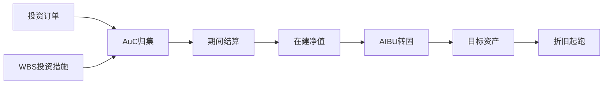

## 一句话结论

> 在建工程（AuC）是资产世界的「中转仓」：建设期发生额先归集到 AuC，期末按期间结算规则滚存在建净值，竣工时 `AIBU` 按分配规则把归集额转固到目标资产、从折旧起始日起提折旧——该转不转，AuC 就成了越滚越大的差异黑洞。

## 症状

- AuC 余额逐月越滚越大，项目早已完工仍不转固，折旧迟迟起不来。
- `AIBU` 转固金额与 AuC 归集发生额对不平：差一笔、差一期，或多结给某台目标资产。
- 转固完成后目标资产没跑折旧，或 AuC 仍留残值长期挂账。

## 根因（按概率）

| 根因（按概率） | 验证动作 | 修复动作 |
|---|---|---|
| 期间结算没跑：当期发生额未按期间结算规则结转在建，净值口径不完整 | `AW01N` 比对各期间过账值与发生额 | 每月按序先跑期间结算，再做竣工转固（机制以你的系统为准） |
| 分配规则缺失或合计不等于 100%：竣工结算没有完整指到目标资产 | `AIBU` 测试运行看分配清单 | 补分配行（按百分比/等额/金额），指到 100001 号段目标资产 |
| 转固凭证过账失败：AuC 类别科目确定缺失或期间已锁 | `FB03` 查结算凭证与报错消息 | 补科目确定、开回期间后重跑结算 |
| 折旧起始日配错：资本化日或期间控制不对，转固次月折旧没起 | `AW01N` 看目标资产计划折旧起始期间 | 修正折旧起算口径后重跑 `AFAB`，报错定位见[AFAB 折旧报错](/01-daily-ops/errors/afab-depreciation-error) |

## 配错会怎样

- AuC 资产类别没配行项目管理和自动结算规则：费用借不进 AuC，投资额散落在费用科目里，期末无人对账。
- 转固时点拖到「完全竣工」而不是「达到预定可使用状态」：折旧晚提数月，审计与税务口径都站不住。
- 转固后又往 AuC 追补费用：要么再转固一次、要么永久挂余额，两种口径都难向审计解释。

## 怎么配置

两条实现路径，蓝图期选一（公司代码 1000）：

1. **投资订单**：内部订单的订单类别＝投资，发生额结算时借记 AuC 资产，适合小额、短周期投资。
2. **投资措施（WBS）**：项目系统（PS）里 WBS 元素挂 AuC，成本按项目结构归集，适合大工程多层级管控。

过程三步：

1. **归集**：发票、领料、报工进投资订单或 WBS，期末结算写 AuC（借 AuC、贷费用中转类科目，科目确定以你的系统为准）。
2. **期末结算**：AuC 按期间结算规则结转自身在建，把各期发生额滚成在建净值（写稳：按期间结算规则处理，底层机制以你的系统为准）。
3. **竣工转固**：`AIBU` 选 AuC，按分配规则一次或分批结算到最终资产；借「固定资产」、贷「AuC」，同行项目管理。转固基准是业务口径「达到预定可使用状态」，不是物理完工。

## 参数与组合全解

**AuC 资产类别配置要点**：

| 配置项 | 作用 | 要点 |
|---|---|---|
| 行项目管理 | 每张投资订单/措施自动挂明细 AuC 资产 | 投资类 AuC 的核心开关（配置入口以你的系统为准） |
| 自动结算规则 | 归集发生额期末自动结算进 AuC | 免手工逐单建规则 |
| 科目确定 | 购置、在建转固的借贷科目 | 借固定资产、贷 AuC 的科目对 |
| 折旧关键 | AuC 自身通常不提折旧 | 配无计划折旧的折旧关键 |

**结算分配规则结构**：

| 组成 | 说明 |
|---|---|
| 分配对象 | 指到 100001 号段的具体目标资产，可一台或多台 |
| 分配方式 | 按百分比（各行合计须 100%）、等额，或直接按金额结算 |
| 结算批次 | 一次全额转固，或分批部分转固，余额留在 AuC 继续归集 |

**转固凭证借贷**：借「固定资产」（目标资产 APC）、贷「在建工程」（AuC），同行项目管理按净值口径结转；AuC 阶段累计折旧通常为零（AuC 不折旧），转固后目标资产按折旧起始日起算。

## 边缘与高级场景

- **部分转固（分批）**：工程分期交付时分批结算——每批一次 `AIBU`，按金额或百分比切分；每批目标资产的折旧起始日各自起算，台账要按批登记交付时点。
- **转固后追补费用**：原则上应避免——口径上转固后发生额属当期费用或下一批次；确要追补，重开结算补结，跨期口径以你的系统为准。
- **S/4HANA 新资产会计联动**：AuC 转固同样走技术清账科目并入 `ACDOCA` 平行过账，月末核对技术清账科目余额为零，详见[新资产会计差异](/03-config-notes/asset-s4-diff)。
- **折旧起算三口径**：转固日（资本化日）、期间控制、折旧起始期间三者蓝图期对齐；版本行为差异另见[版本兼容矩阵](/00-about/version-matrix)。

## 怎么验证

公司代码 1000，挑一个归集齐全、当月完工的测试 AuC。

**验证 T-Code**：`AIBU`
**验证判据**：测试运行清单金额与 AuC 余额一致；正式运行后 AuC 余额＝0，目标资产 `AW01N` 出现购置值，且次期起有计划折旧。
**失败对照**：测试清单与余额不平 → 回查期间结算是否漏跑；转固后 AuC 有残值 → 查分配规则合计是否 100%；目标资产无折旧 → 查折旧起始日与期间控制；年末批量口径见[年末核对清单](/01-daily-ops/year-end-checklist)。

## 相关 T-Code

`AIBU` · `AW01N` · `FB03`
