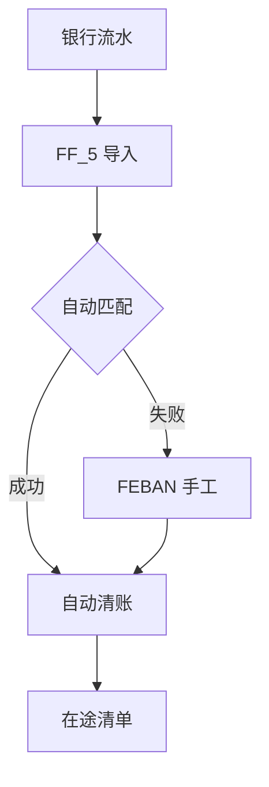

## 一句话结论

> 银行对账两条路：电子对账单 `FF_5` 导入 + `FEBAN` 后处理（自动清账 + 手工匹配），或 `FF67` 手工录入对账单再清账；目标是银行科目未清项 = 可解释的在途清单——任何直记银行科目绕过清账流程的做法都是雷。

## 症状

- 银行存款科目余额与银行对账单余额长期对不上，月底编不出余额调节表，差额全挂「待查」。
- `FF_5` 导入后 `FEBAN` 里大量未匹配项，人工逐笔一对就是一整天。
- 支票开出挂账后，银行实际扣款没人清，未清项滚雪球，越来越没人敢碰。

## 根因（按概率）

| 根因（按概率） | 验证动作 | 修复动作 |
|---|---|---|
| 对账单格式映射错（金额/日期/参考字段错位） | `FF_5` 导入日志核对字段映射 | 修映射后重新导入 |
| 未清项缺参考（支票号/凭证号没写进行项目） | `FEBAN` 看匹配不上的项缺什么 | 补参考规则或人工指定清账 |
| 期末在途款项未列示（一方已记一方未记） | 科目未清项与对账单逐笔比对 | 编在途清单，长期在途逐笔追 |
| 手工直记银行科目（如 `FB50`）绕过清账流程 | 查银行科目行项目的来源凭证 | 冲销直记凭证，改走收款/付款清账 |

## 配错会怎样

- 格式映射错还强行导入：产生错误清账，冲销成本远高于一开始就人工对账。
- 长期不对账：差异越积越深，审计必查，真出现挪用也很难发现。
- 在途项不清理：未清项陈旧，连自动清账工具都无从下手。

## 怎么配置

1. 主数据先行：宅银行与银行账户主数据关联银行存款总账科目（ECC 经典事务 `FI12`，S/4 入口以你的系统为准），账户与科目对不上，后面全白搭。
2. `FF_5`：维护电子对账单导入格式（MT940、CSV 等，以你的银行格式为准）、字段映射与自动清账规则；规则能命中的流水导入时即自动清账。
3. `FEBAN`：导入后处理——自动匹配的核对结果，未匹配的逐笔手工指定未清项清账，或做调整过账。
4. `FF67`：拿不到电子对账单的账户，手工录入对账单并过账清账，口径与电子路一致。
5. 流程纪律：银行科目只允许通过对账/清账流程动账，禁止 `FB50` 直记；对账至少每月随月结做一次，差异不过月。

## 参数与组合全解

### FF_5 导入配置链

| 环节 | 管什么 | 典型错配 |
|---|---|---|
| 对账单格式 | 外部格式（MT940/CSV 等）解析成流水行的字段映射 | 金额符号、日期字段错位——导入即错，宁停勿导 |
| 解释算法 | 流水行按什么规则识别业务（按参考号/支票号找未清项） | 算法选弱：明明能自动清的笔笔落手工 |
| 过账规则 / 科目映射 | 识别出的业务过到哪些科目（手续费、利息等） | 手续费没配规则 → 全部落悬账等人工 |
| 清账规则 | 借方/贷方/未知三类流水如何与未清项清账 | 清账方向错 → 假清账，冲销代价高 |

### FEBAN 状态机

| 状态 | 含义 | 下一步操作 |
|---|---|---|
| 未处理 | 流水已导入、未过账 | 核对后过账（单笔或批量） |
| 已记账（含未清差异） | 凭证已生成但未完全清账 / 部分挂悬账 | 补指定未清项清账、重分类悬账 |
| 已清账 | 凭证生成且清账完成 | 无，可抽查复核 |

状态名称与细分以你的系统为准。

### 手工 FF67 vs 电子 FF_5 怎么选

| 维度 | FF_5 电子导入 | FF67 手工录入 |
|---|---|---|
| 笔量 | 高笔量账户唯一可行解 | 只适合低笔量账户 |
| 前提 | 银行提供标准格式并建好映射 | 无格式要求，人工看单敲 |
| 人力与差错 | 一次配置长期自动，错在配置不在录入 | 逐笔人工，录错风险常驻 |
| 适用 | 主营账户、流水密集账户 | 拿不到电子对账单的小账户、遗留账户 |

## 边缘与高级场景

- **跨日截止的在途项挂账口径**：月末最后一天企业已记的收付、银行次月才入账——按「记账口径」归期，列进当月在途清单（企业已记、银行未付），不追平到日；关键是**每月同一口径滚动**，别某月为平而平硬调。
- **手续费自动匹配失败的兜底**：金额不规则、无参考号的手续费匹配不上是常态——给「未识别流水」配置悬账/清算科目落账（仍不直记银行科目），`FEBAN` 里定期把悬账重分类到财务费用；悬账科目月内清理、月末必须为零。
- **月末未达账清单（调节表）怎么做平**：`FEBAN` 处理完毕后，银行科目未清项就是清单来源——「银行对账单余额 ± 未达项（企业已记银行未记；银行已记企业未记）」与「账面余额 ± 对应未达项」两边各自加减后相等；做不平的那笔回查格式映射与直记凭证（根因表第一、四行）。资金口径衔接见[现金头寸](/03-config-notes/tr-cash-position)。

## 怎么验证

公司代码 1000，`FF_5` 导入当月对账单并在 `FEBAN` 处理完毕，看银行存款科目（示意 `100200`）的未清项。

**验证 T-Code**：`FEBAN`
**验证判据**：未清项 = 在途清单——每笔都能归入「企业已记、银行未付」或「银行已扣、企业未记」；账面余额经在途调节后与对账单余额一致，无说不清的差额。
**失败对照**：未清项里出现对账单已包含的流水 → 查格式映射或参考规则；仍有一笔讲不通的差额 → 查有无直记银行科目的凭证，凭证层排查看[报错速查](/01-daily-ops/errors/)。

## 相关 T-Code

`FF_5` · `FF67` · `FEBAN`
