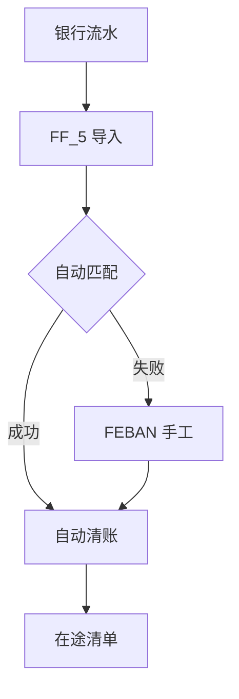

## 一句话结论

> 银行对账两条路：电子对账单 `FF_5` 导入 + `FEBAN` 后处理（自动清账 + 手工匹配），或 `FF67` 手工录入对账单再清账；目标是银行科目未清项 = 可解释的在途清单——任何直记银行科目绕过清账流程的做法都是雷。

## 症状

- 银行存款科目余额与银行对账单余额长期对不上，月底编不出余额调节表，差额全挂「待查」。
- `FF_5` 导入后 `FEBAN` 里大量未匹配项，人工逐笔一对就是一整天。
- 支票开出挂账后，银行实际扣款没人清，未清项滚雪球，越来越没人敢碰。

## 根因（按概率）

| 根因（按概率） | 验证动作 | 修复动作 |
|---|---|---|
| 对账单格式映射错（金额/日期/参考字段错位） | `FF_5` 导入日志核对字段映射 | 修映射后重新导入 |
| 未清项缺参考（支票号/凭证号没写进行项目） | `FEBAN` 看匹配不上的项缺什么 | 补参考规则或人工指定清账 |
| 期末在途款项未列示（一方已记一方未记） | 科目未清项与对账单逐笔比对 | 编在途清单，长期在途逐笔追 |
| 手工直记银行科目（如 `FB50`）绕过清账流程 | 查银行科目行项目的来源凭证 | 冲销直记凭证，改走收款/付款清账 |

## 配错会怎样

- 格式映射错还强行导入：产生错误清账，冲销成本远高于一开始就人工对账。
- 长期不对账：差异越积越深，审计必查，真出现挪用也很难发现。
- 在途项不清理：未清项陈旧，连自动清账工具都无从下手。

## 怎么配置

1. 主数据先行：宅银行与银行账户主数据关联银行存款总账科目（ECC 经典事务 `FI12`，S/4 入口以你的系统为准），账户与科目对不上，后面全白搭。
2. `FF_5`：维护电子对账单导入格式（MT940、CSV 等，以你的银行格式为准）、字段映射与自动清账规则；规则能命中的流水导入时即自动清账。
3. `FEBAN`：导入后处理——自动匹配的核对结果，未匹配的逐笔手工指定未清项清账，或做调整过账。
4. `FF67`：拿不到电子对账单的账户，手工录入对账单并过账清账，口径与电子路一致。
5. 流程纪律：银行科目只允许通过对账/清账流程动账，禁止 `FB50` 直记；对账至少每月随月结做一次，差异不过月。

## 怎么验证

公司代码 1000，`FF_5` 导入当月对账单并在 `FEBAN` 处理完毕，看银行存款科目（示意 `100200`）的未清项。

**验证 T-Code**：`FEBAN`
**验证判据**：未清项 = 在途清单——每笔都能归入「企业已记、银行未付」或「银行已扣、企业未记」；账面余额经在途调节后与对账单余额一致，无说不清的差额。
**失败对照**：未清项里出现对账单已包含的流水 → 查格式映射或参考规则；仍有一笔讲不通的差额 → 查有无直记银行科目的凭证，凭证层排查看[报错速查](/01-daily-ops/errors/)。

## 相关 T-Code

`FF_5` · `FF67` · `FEBAN`
