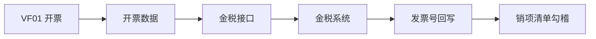

## 一句话结论

> 中国本地化 FICO 的三件事：销项开票走金税接口（SAP 出数据、金税开票、发票号回写）、增值税靠税码管住进项与销项两个方向、应付暂估在标准 GR/IR 与「月末计提次月冲回」两种流派里选一种坚持到底——三条线共同的红线是：账面销项税额与金税开票清单勾稽得上。

## 症状

- 金税开票完成，但发票号/发票代码没回写 SAP，销项报表与金税开票清单合计对不上。
- 应付暂估科目月度波动大：本月大额挂账、次月骤降又重挂，说不清余额里哪些是「票未到」。
- 采购发票税额与申报口径不一致，税码用错档位（应高一档的用成低一档），月度申报时才发现。

## 根因（按概率）

| 根因（按概率） | 验证动作 | 修复动作 |
|---|---|---|
| 税码档位配错（税率或进销项方向错） | `FTXP` 查该税码税率与过账科目 | 修正配置；已过账凭证走调整或红冲 |
| 金税回写接口未跑或失败 | 查接口日志的失败/未处理记录 | 重跑回写；失败单据逐笔补录发票号 |
| 暂估次月冲回遗漏 | `FBL1N`/`FBL3N` 查暂估科目上月计提行有无对应冲回 | 补冲回，并把冲回固化成月结固定作业 |
| GR/IR 与手工暂估并行，重复计提 | 同一物料/订单在两边同时挂账 | 二选一定流程，清理重复计提 |

## 配错会怎样

- 税码错档位：销项/进项税额直接错，账面与金税清单勾稽不上，税务调整成本高。
- 回写断链：SAP 销项台账缺发票号，后续红冲（发票冲销）与催收都失去依据。
- 两套暂估并行：同一笔采购重复计提或两边都漏，月结时暂估余额没人能解释。

## 怎么配置

1. **税码与税过程**：国家配置把中国指到税计算过程（`OBBG` 口径，路径以系统为准），`FTXP` 维护税码：进项（采购方向）与销项（销售方向）分开建码，码名按项目规范命名。现行增值税档位结构大致为 13%、9%、6% 三档（另有零税率与简易计征场景），**具体税率与适用范围以最新政策为准**；税率调整只改 `FTXP` 配置，不动已过账凭证。
2. **销项与金税接口**：数据流是——SAP 开票数据（客户、金额、税码、商品行）经标准 Golden Tax 接口或第三方中间件导出 → 金税系统开具增值税发票 → 发票号码与代码回写 SAP（回写到开票凭证或发票登记信息）。接口只做数据搬运，**开票动作发生在金税系统**，SAP 不直接生成税控发票；接口版本与字段映射以你的项目实现为准。
3. **进项**：有 PO 采购走 `MIRO` 发票校验，税码随订单带入，进项税额自动过账到进项税科目；无 PO 费用发票用 `FB60` 手工录入。**进项抵扣的认证/勾选在税务系统完成，在 SAP 之外管理**，两边以税务流程对齐——SAP 只管账面进项税额。
4. **应付暂估二选一**（写进财务制度，不并行）：

| 流派 | 机制 | 一句适用场景 |
|---|---|---|
| 标准 GR/IR | 收货即暂估，`MIRO` 票到自动清账；GR/IR 科目由 OBYC 的 WRX 事务确定，机制见[MM-FI 自动记账](/03-config-notes/mm-fi-obyc) | 有 PO 采购为主、收货流程规范的企业 |
| 月末计提 + 次月冲回 | 月末按「未到票清单」手工计提，次月 1 日全额冲回，票到按实际入账 | 无 PO 费用与紧急采购占比高、财务主导暂估的企业 |

5. **月结衔接**：GR/IR 流派下月末清账（清已匹配项、保留真实未清）与暂估余额核对纳入月结顺序，见[月结检查清单](/01-daily-ops/month-end-checklist)。

## 参数与组合全解

**金税接口字段级数据流——出向（SAP → 金税系统）**：

| 字段 | SAP 侧来源 | 对不上的后果 |
|---|---|---|
| 购方名称与税号 | 客户主数据名称与税号 | 金税端退回或开错抬头，红冲重开 |
| 不含税金额 / 税额 / 价税合计 | 开票凭证行金额 × 税码算出的税额 | 与回款对不上，清账出差异 |
| 税率 | 开票行税码 → `FTXP` 折算 | 档位错一档，销项税额错，与申报表勾稽不上 |
| 发票类型（专票/普票） | 客户主数据或订单属性 | 开成普票无法抵扣，被迫红冲 |
| 商品行 / 税收分类编码 | 物料 / 服务文本与商品编码映射 | 编码与品名不符被退 |

**回向（金税系统 → SAP）**：

| 字段 | 回写目标 | 对不上的后果 |
|---|---|---|
| 发票号码 | 开票凭证的发票登记信息 | 红冲无依据、催收无凭据 |
| 发票代码 | 同上，与发票号联合定位一张票 | 与发票号一起缺失即「回写断链」 |
| 开票日期 | 发票登记信息 | 跨月开票，勾稽期间错位 |

**增值税税码矩阵（示意结构，以最新政策为准）**：

| 方向 | 税码示例 | 档位 | 典型业务 |
|---|---|---|---|
| 销项 | J1 | 13% | 货物销售、加工修理 |
| 销项 | J2 | 9% | 运输、建筑、不动产 |
| 销项 | J3 | 6% | 现代服务、无形资产 |
| 销项 | J0 | 免税 / 零税率 | 出口（配合免抵退口径） |
| 进项 | F1 / F2 / F3 | 13% / 9% / 6% | 对应档位采购 |
| 进项 | FZ | 不可抵扣 | 免税、集体福利（走进项转出） |

**红字发票（红冲）流程**：

| 步骤 | 税务侧动作 | SAP 侧动作 |
|---|---|---|
| 1 红字申请 | 销售方或购方在税务系统提申请 | 定位原蓝票开票凭证与回写发票号 |
| 2 信息表 | 税务系统出具红字信息表编号 | 登记备查 |
| 3 开红票 | 金税按信息表开红字发票 | 开贷项凭证冲收入与销项税（`VF11`） |
| 4 回写 | 红票发票号 / 代码回写 SAP | 红蓝票关联，勾稽按红冲净额口径 |

## 边缘与高级场景

- **出口退税的数据链**：出口销售走零税率 / 免税税码，免抵退计算在税务申报体系完成（一句带过，以最新政策为准）——SAP 侧保证出口发票、免税销项、外销收入口径一致，别混进应税档。
- **附加税费计提**：城建税、教育费附加、地方附加的计税基数是当期实际缴纳的增值税额——月末按「应交增值税 × 属地税率」计提：城建 7% / 5% / 1%、教育附加 3%、地方附加 2%，以最新政策为准；计提凭证挂应交税费—附加科目，次月缴纳后清。
- **月末勾稽容差**：账面销项与金税开票清单合计设小容差（±0.01 元），容差内调整；超容差逐笔比对：第一轮按回写发票号核红冲净额，第二轮查跨月开票（账面本月、金税次月），建「跨月开票登记表」管住期间错位。

## 怎么验证

月底把销项税科目当月贷方发生额导出，与金税系统当月开票清单税额合计勾稽；暂估科目月末余额与财务「未到票清单」合计对数。

**验证 T-Code**：`FBL3N`
**验证判据**：当月销项税科目（如 `222102`，示意编号）贷方发生额 = 金税开票清单税额合计（红冲票按净额口径）；暂估/GR-IR 科目月末余额 = 未到票清单合计。
**失败对照**：销项差一笔 → 先查金税回写日志有无失败或未跑，再查税码档位是否用错；暂估余额对不上 → 查次月冲回是否遗漏、是否两套暂估并行重复计提。

## 相关 T-Code

`FTXP` · `OBBG` · `FBL1N` · `MIRO` · `FB60`

> 本篇为**机制口径**：税率、申报与认证流程以最新政策及税务顾问为准；金税接口采用标准 Golden Tax 接口还是第三方中间件，以你的项目实现为准。
