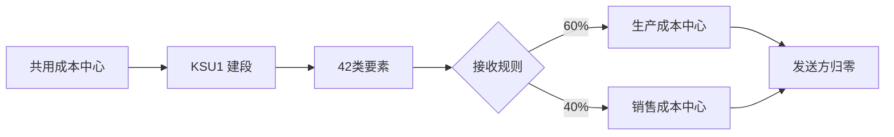

## 一句话结论

> 分摊（assessment）用 42 类次级成本要素把共用成本中心的余额按规则结给业务部门，`KSU5` 正式跑完发送方余额必须为 0；要保留原始成本要素明细就用分配（distribution，`KSV5`）。

## 症状

- 月结跑完，管理部、IT 等共用成本中心仍有余额，费用下摊不干净。
- 分摊跑完接收方只看到一条 42 类次级要素汇总行，业务部门追问「这团钱由什么构成」答不上——这是分摊的固有属性，需要明细时用分配。
- `KSU5` 执行报「接收方权数为 0」或「百分比合计不等于 100%」。

## 根因（按概率）

| 根因（按概率） | 验证动作 | 修复动作 |
|---|---|---|
| 段的发送方成本要素范围漏了要素 | `KSU2` 查段的成本要素范围 | 补全要素组 |
| 接收方用变量权重，但统计关键指标当期无值 | 查统计关键指标实际值 | 先补录指标或改固定比例 |
| 固定百分比合计不等于 100% | `KSU2` 查接收方规则 | 修正比例 |
| 分摊后又发生新过账 | `KSB1` 查发送方行项目过账时间 | 按月结顺序最后重跑分摊 |

## 配错会怎样

- 发送方清不干净：成本中心余额非 0，往 PA/FI 结转时差异滞留在中间层。
- 月结顺序错：先结转后分摊，分摊后又有新费用，永远差一笔。
- 次级成本要素类别建错（非 42）：循环建得再好，`KSU5` 一跑就报类别错误。

## 怎么配置

1. 先建 42 类次级成本要素（如 `942000` 分摊-房租示意），段里引用它做聚合载体。
2. `KSU1` 建循环：定周期（通常月）与循环组；循环内建段（segment），一段管一类结转。
3. 每段三块：发送方（成本中心 + 成本要素范围）、发送方规则（百分比/固定金额等）、接收方（成本中心）+ 接收方规则（固定百分比/固定金额/变量权重，权重取统计关键指标；可选项以你的系统为准）。
4. 月结顺序：先做内部结算与分摊/分配，最后才往 PA/FI 结转；顺序细节见[月结检查清单](/01-daily-ops/month-end-checklist)。

## 参数与组合全解

**发送方规则三模式**（决定「从发送方结多少钱出来」）：

| 模式 | 结转口径 | 适用场景 | 典型坑 |
|---|---|---|---|
| 固定百分比 | 按发送方余额的百分比结转，默认 100% 即全额结平 | 常规月结清零 | 比例设不满 100% 时残留余额留在共用中心，无人认领 |
| 固定金额 | 每段结固定金额，最多结到余额为止 | 已知金额的合同分摊（房租、服务费） | 余额不足时结不满；余额远大于固定额时尾巴越挂越大 |
| 统计指标（权数） | 按统计关键指标值折算结转额（可选项与算法以你的系统为准） | 结转额随业务量波动 | 指标无值时该段结 0，发送方清不掉 |

**接收方规则三模式**（决定「钱在接收方之间怎么分」）：

| 模式 | 分摊依据 | 适用场景 | 典型坑 |
|---|---|---|---|
| 固定百分比 | 各接收方固定比例，合计必须 100% | 部门结构长期稳定（按面积、编制一次谈定） | 组织调整后比例不自动更新；合计不等于 100% 时 `KSU5` 直接报错 |
| 固定金额 | 各接收方结固定金额 | 合同价分摊（门店按合同额背房租） | 固定额合计大于发送方余额时结不平，尾差留发送方 |
| 变量权数（统计指标） | 权数取当期统计关键指标实际值（人数、面积、机器工时） | 分摊基础随业务量波动，最贴近真实耗用 | 指标当期漏维护则权数为 0，`KSU5` 报「接收方权数为 0」——症状第一条的根源 |

**计划 vs 实际周期**：循环分两套——计划分摊跑在计划版本的计划数据上（供计划成本中心报表、计划作业价格反推），实际分摊跑在版本 0 的当期实际数上（计划分摊 `KSW1` 建、`KSW5` 跑，以你的系统为准）。两套结构同源、分开维护、分开执行。常见坑：计划用固定比例、实际用统计指标，计划与实际的分摊差异月月都在却没人解释——两套循环的规则口径要在设计时对齐。

**分摊 / 分配 / 作业价格分摊的边界**（本篇灵魂，选错工具一切白搭）：

| 方式 | 结转载体 | 原始要素明细 | 什么场景用 |
|---|---|---|---|
| 分摊（assessment，`KSU5`） | 42 类次级成本要素，聚合结转 | 不保留——接收方只见一条 42 类汇总行 | 共用费用按管理口径下摊：房租、水电、IT 服务费 |
| 分配（distribution，`KSV5`） | 原始初级成本要素原样平移 | 保留原始成本要素与行项目结构 | 接收方要按费用科目继续分析：预算控制、审计口径 |
| 作业价格分摊（作业分配） | 作业类型 × 作业价格，按确认的活动量结转 | 借贷按作业类型列示 | 工作量可计量（机器工时、检修工时），价格来自成本中心计划/实际作业价格 |

判别口诀：**分摊聚合结转换要素，分配保留要素平移，作业分配按活动量确认、不结余额**。三者可以串联使用：先作业分配（量驱动、给得出单价），再分摊（把共用中心余额清零），需要明细的场合改用分配。

## 边缘与高级场景

- **迭代多段循环的顺序依赖**：循环内各段按序执行，多个循环之间按执行先后串行——A 循环的接收方若是 B 循环的发送方，B 必须排在 A 之后才能把分摊进来的 42 类要素再往下结。存在互为发送/接收的循环时可启用迭代处理，让系统反复执行直到收敛（循环属性里的迭代标识，行为以你的系统为准）。链式分摊的设计要点：链路上任何一段的接收方规则改动都会重塑下游全部结果，口径要一次定死并写进月结手册。
- **统计指标漏维护的月中补录影响**：`KB31N` 补录指标只落在补录期间——补当期，重跑分摊即可补上权数；但分摊之后若订单结算、PA 结转已经跑过，整条月结链要按顺序重跑。跨期补录（补上月指标）需要开回期间，且上期已清零的发送方不会自动重新出数。指标维护应作为月结前置检查项，而不是事后补救项。
- **次级要素 42 类建错类别码的返工**：分摊要素必须是次级成本要素类别 42（老系统亦见 41，以你的系统为准）；建错成 21（内部结算）等类别时循环建得起来、`KSU5` 一跑就报类别错误。返工路径：要素尚无任何过账 → `KA02` 直接改类别；已有过账 → 类别一般不允许直接修改（以你的系统为准），只能冻结旧要素、新建正确类别的新要素、改循环引用后重跑——历史行项目留在旧要素上，报表要把新旧两个要素合并看。预防：建次级要素时按用途（41/42 分摊、21 结算）在编号区间上先分段。

## 怎么验证

`KSU5` 选循环，先勾测试运行看清单。

**验证 T-Code**：`KSU5`
**验证判据**：测试运行清单无错；正式跑完后 `KSB1` 查发送方成本中心当期余额为 0，接收方收到 42 类次级要素（如 `942000`）的分摊行。
**失败对照**：发送方仍有余额 → 按根因表查要素范围漏项或跑后又新过账；接收方无值 → 查统计关键指标当期实际数是否维护。

## 相关 T-Code

`KSU1` · `KSU2` · `KSU5` · `KSB1` · `KSV5`
