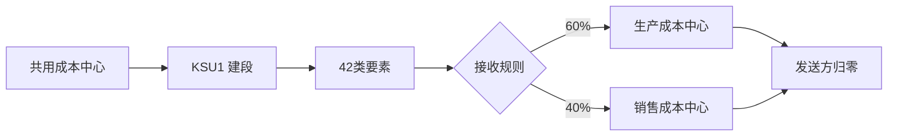

## 一句话结论

> 分摊（assessment）用 42 类次级成本要素把共用成本中心的余额按规则结给业务部门，`KSU5` 正式跑完发送方余额必须为 0；要保留原始成本要素明细就用分配（distribution，`KSV5`）。

## 症状

- 月结跑完，管理部、IT 等共用成本中心仍有余额，费用下摊不干净。
- 分摊跑完接收方只看到一条 42 类次级要素汇总行，业务部门追问「这团钱由什么构成」答不上——这是分摊的固有属性，需要明细时用分配。
- `KSU5` 执行报「接收方权数为 0」或「百分比合计不等于 100%」。

## 根因（按概率）

| 根因（按概率） | 验证动作 | 修复动作 |
|---|---|---|
| 段的发送方成本要素范围漏了要素 | `KSU2` 查段的成本要素范围 | 补全要素组 |
| 接收方用变量权重，但统计关键指标当期无值 | 查统计关键指标实际值 | 先补录指标或改固定比例 |
| 固定百分比合计不等于 100% | `KSU2` 查接收方规则 | 修正比例 |
| 分摊后又发生新过账 | `KSB1` 查发送方行项目过账时间 | 按月结顺序最后重跑分摊 |

## 配错会怎样

- 发送方清不干净：成本中心余额非 0，往 PA/FI 结转时差异滞留在中间层。
- 月结顺序错：先结转后分摊，分摊后又有新费用，永远差一笔。
- 次级成本要素类别建错（非 42）：循环建得再好，`KSU5` 一跑就报类别错误。

## 怎么配置

1. 先建 42 类次级成本要素（如 `942000` 分摊-房租示意），段里引用它做聚合载体。
2. `KSU1` 建循环：定周期（通常月）与循环组；循环内建段（segment），一段管一类结转。
3. 每段三块：发送方（成本中心 + 成本要素范围）、发送方规则（百分比/固定金额等）、接收方（成本中心）+ 接收方规则（固定百分比/固定金额/变量权重，权重取统计关键指标；可选项以你的系统为准）。
4. 月结顺序：先做内部结算与分摊/分配，最后才往 PA/FI 结转；顺序细节见[月结检查清单](/01-daily-ops/month-end-checklist)。

## 怎么验证

`KSU5` 选循环，先勾测试运行看清单。

**验证 T-Code**：`KSU5`
**验证判据**：测试运行清单无错；正式跑完后 `KSB1` 查发送方成本中心当期余额为 0，接收方收到 42 类次级要素（如 `942000`）的分摊行。
**失败对照**：发送方仍有余额 → 按根因表查要素范围漏项或跑后又新过账；接收方无值 → 查统计关键指标当期实际数是否维护。

## 相关 T-Code

`KSU1` · `KSU2` · `KSU5` · `KSB1` · `KSV5`
