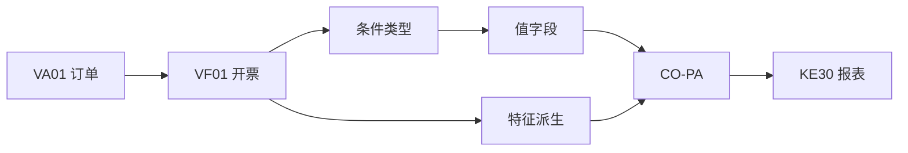

## 一句话结论

> CO-PA 回答「哪个产品/客户/区域赚不赚钱」：**特征**（characteristic，维度：产品、客户、区域、渠道）× **值字段**（value field，度量：收入、成本、毛利）构成一张多维损益表；数据主源是 SD 开票（`VA01` → `VF01`），成本侧靠结算与分摊流入——收入有数、成本没数，九成是成本侧映射或结转没接上。

## 症状

- `KE30` 报表当期收入有数、成本为空，毛利系统性虚高。
- 特征维度大面积空值：报表按区域/渠道切下去全是「未分配」。
- ECC 迁 S/4HANA 后，老的成本核算基报表口径失灵或数据不全。

## 根因（按概率）

| 根因（按概率） | 验证动作 | 修复动作 |
|---|---|---|
| 值字段映射缺成本侧条件（只映射了收入类） | 查 SD 条件类型到值字段的分配 | 补映射后重开票或重传当期数据 |
| 特征派生规则漏（如未从客户主数据派生区域） | 用测试单据走一遍派生过程 | 补派生规则并重推当期开票 |
| 结算/分摊未跑完，成本滞留中间层 | 查生产订单/成本中心当期余额 | 按月结顺序补跑，见[成本中心分摊](/03-config-notes/co-assessment) |
| ECC 成本基报表未迁账目基口径 | 确认 S/4 实际启用的 CO-PA 类型 | 重做报表取数口径，见[版本兼容矩阵](/00-about/version-matrix) |

## 配错会怎样

- 只映收入不映成本：管理层按「毛利」做决策，数字虚高，CO-PA 从决策工具变成信任事故。
- 特征派生缺失：多维分析退化成总额分析，建 CO-PA 的意义归零。
- 月结顺序错（先出报表后跑结算/分摊）：报表数与最终账面对不上，每月解释成本极高。

## 怎么配置

1. **数据模型**：在经营范畴（operating concern）下定义特征（取自客户、物料、区域等主数据，可加派生规则）与值字段（收入、销售成本、运费、毛利等度量）。特征 = 维度，值字段 = 度量。
2. **两代架构**：ECC 成本核算基（costing-based，数据按获利能力段汇总存储）与账目基（account-based，与财务凭证同源）并存可选；S/4HANA 账目基成为标配，账目基数据进统一日记账体系 `ACDOCA`，新建实施通常只上账目基（成本核算基是否并存以你的项目选型为准）。两代差异与迁移影响见[版本兼容矩阵](/00-about/version-matrix)。
3. **SD 集成（主数据源）**：`VA01` 建销售订单 → 交货 → `VF01` 开票；开票凭证的条件类型按映射写入值字段，特征按派生规则带出，开票即转 CO-PA——这是收入与销售类费用进入 CO-PA 的主干道。
4. **成本侧**：销售成本随开票/结算进入，生产成本经订单结算、共用成本经成本中心分摊流入 CO-PA；分摊机制见[成本中心分摊](/03-config-notes/co-assessment)，月结顺序见[月结检查清单](/01-daily-ops/month-end-checklist)。

## 参数与组合全解

**特征 × 值字段两维模型**（特征 = 维度「按什么切」，值字段 = 度量「看什么数」）：

| 类型 | 是什么 | 取值来源 | 典型例子 |
|---|---|---|---|
| 固定特征 | 经营范畴自带、系统预置、不可删 | 系统标准字段 | 公司代码 1000、工厂、销售组织、客户、产品 |
| 自定义特征 | 项目自建特征 | 从主数据表（客户/物料）字段复制取值 | 区域、渠道、品牌、细分市场 |
| 派生特征 | 过账时按派生规则从其他特征/字段推算，不靠手工录入 | 派生规则（按客户带出区域、按物料带出产品组；维护入口以你的系统为准） | 客户 → 区域、物料 → 产品层级 |
| 值字段 | 报表可加总的度量列（金额/数量） | SD 条件类型映射、成本要素结转 | 收入、折扣、销售成本、运费、毛利 |

特征建少了可以后补，但历史行项目不会自动回填新特征（见边缘场景）。

**SD 条件类型 → 值字段的传输链**（收入侧主干道，开票自动过账）：链路是 `VA01` 订单（定价过程确定）→ 交货 → `VF01` 开票，定价过程里每个条件类型（价格、成本、运费、税）按配置映射到 CO-PA 值字段，开票过账即生成 CO-PA 行项目。三个要点：

- 一个条件类型只映射一个值字段，多个条件类型可以映射到同一个值字段；只有映射了的条件才传输——成本侧条件漏映射就是「收入有数成本空」的高发根因。
- 条件是否传输还受定价过程里的传输/统计标记控制（配置细节以你的系统为准）。
- 改映射只影响之后的开票；当期数据要么重开票要么重传，历史不会自动补。

**成本核算基 vs 账目基（ECC 两代架构）**：

| 维度 | 成本核算基 costing-based | 账目基 account-based |
|---|---|---|
| 数据存储 | 独立获利能力段行项目表（CE1 系列），按特征组合汇总 | 与 FI 凭证同源；S/4 下进统一日记账 `ACDOCA`，按特征字段存放 |
| 收入/成本时点 | 可与 FI 不同步，结算/分摊随时补写 | 与 FI 完全同账同时点 |
| 成本要素 | 不强制使用成本要素，值字段即可 | 成本必须挂成本要素 |
| 与 FI 对账 | 两套存储，需要专门对账 | 天然一致，无需对账 |
| 报表灵活性 | 特征组合任意切换、可存计划数据 | 维度受科目/特征结构约束 |
| S/4 现状 | 存量系统可并存保留 | S/4 标配，新建实施默认只上账目基 |

## 边缘与高级场景

- **直接手工过账的口径**：不走 SD 开票、直接往 CO-PA 记一笔（内部调整、样品成本）用直接过账——成本核算基有真正的手工获利能力段行项目录入（传统 ECC 事务如 `KE21N`，以你的系统为准）；账目基下的「手工过账」本质是 FI 凭证加特征派生，必须过得了科目与成本要素校验。两种架构下手工单据的特征值都必须填全，否则直接落「未分配」无人认领；行项目核对用成本基行项目浏览器（如 `KE24`，以你的系统为准）。
- **ECC → S/4 迁移时成本基报表重建**：迁移后成本基历史数据可以搬进 S/4 继续查，但新数据流默认走账目基/`ACDOCA`；成本基报表的取数口径、特征派生、值字段定义要在 S/4 里按账目基重建。典型事故：老报表还挂着但取不到新数据，用户喊「丢数」——实际是取数源没切。重建顺序：盘点特征/值字段清单 → 定报表口径 → 迁历史数据；迁移工具见[迁移工具](/03-config-notes/migration-tools)。
- **特征值变更对历史数据的影响**：派生规则改了只影响未来过账，已过账行项目不自动重派生；客户/物料主数据变更同样不回溯历史。要按新口径看历史，要么接受新老口径并存并在报表注明切换日（多数项目的选择），要么对当期数据做重派生/重传（工具与授权以你的系统为准）。

## 怎么验证

`VA01` 给客户 100001 下一张测试销售订单（物料 100001）→ 交货 → `VF01` 开票过账，然后查当期报表。

**验证 T-Code**：`KE30`
**验证判据**：当期该特征组合（客户 100001 × 物料 100001）下收入、成本、毛利三行都有数，且毛利 = 收入 − 成本。
**失败对照**：收入有数成本空 → 按根因表查值字段是否缺成本侧映射、结算/分摊是否跑完；特征为空 → 查特征派生规则；迁 S/4 后老报表无数据 → 确认成本基报表是否已切到账目基口径。

## 相关 T-Code

`KE30` · `VA01` · `VF01`
