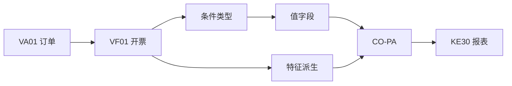

## 一句话结论

> CO-PA 回答「哪个产品/客户/区域赚不赚钱」：**特征**（characteristic，维度：产品、客户、区域、渠道）× **值字段**（value field，度量：收入、成本、毛利）构成一张多维损益表；数据主源是 SD 开票（`VA01` → `VF01`），成本侧靠结算与分摊流入——收入有数、成本没数，九成是成本侧映射或结转没接上。

## 症状

- `KE30` 报表当期收入有数、成本为空，毛利系统性虚高。
- 特征维度大面积空值：报表按区域/渠道切下去全是「未分配」。
- ECC 迁 S/4HANA 后，老的成本核算基报表口径失灵或数据不全。

## 根因（按概率）

| 根因（按概率） | 验证动作 | 修复动作 |
|---|---|---|
| 值字段映射缺成本侧条件（只映射了收入类） | 查 SD 条件类型到值字段的分配 | 补映射后重开票或重传当期数据 |
| 特征派生规则漏（如未从客户主数据派生区域） | 用测试单据走一遍派生过程 | 补派生规则并重推当期开票 |
| 结算/分摊未跑完，成本滞留中间层 | 查生产订单/成本中心当期余额 | 按月结顺序补跑，见[成本中心分摊](/03-config-notes/co-assessment) |
| ECC 成本基报表未迁账目基口径 | 确认 S/4 实际启用的 CO-PA 类型 | 重做报表取数口径，见[版本兼容矩阵](/00-about/version-matrix) |

## 配错会怎样

- 只映收入不映成本：管理层按「毛利」做决策，数字虚高，CO-PA 从决策工具变成信任事故。
- 特征派生缺失：多维分析退化成总额分析，建 CO-PA 的意义归零。
- 月结顺序错（先出报表后跑结算/分摊）：报表数与最终账面对不上，每月解释成本极高。

## 怎么配置

1. **数据模型**：在经营范畴（operating concern）下定义特征（取自客户、物料、区域等主数据，可加派生规则）与值字段（收入、销售成本、运费、毛利等度量）。特征 = 维度，值字段 = 度量。
2. **两代架构**：ECC 成本核算基（costing-based，数据按获利能力段汇总存储）与账目基（account-based，与财务凭证同源）并存可选；S/4HANA 账目基成为标配，账目基数据进统一日记账体系 `ACDOCA`，新建实施通常只上账目基（成本核算基是否并存以你的项目选型为准）。两代差异与迁移影响见[版本兼容矩阵](/00-about/version-matrix)。
3. **SD 集成（主数据源）**：`VA01` 建销售订单 → 交货 → `VF01` 开票；开票凭证的条件类型按映射写入值字段，特征按派生规则带出，开票即转 CO-PA——这是收入与销售类费用进入 CO-PA 的主干道。
4. **成本侧**：销售成本随开票/结算进入，生产成本经订单结算、共用成本经成本中心分摊流入 CO-PA；分摊机制见[成本中心分摊](/03-config-notes/co-assessment)，月结顺序见[月结检查清单](/01-daily-ops/month-end-checklist)。

## 怎么验证

`VA01` 给客户 100001 下一张测试销售订单（物料 100001）→ 交货 → `VF01` 开票过账，然后查当期报表。

**验证 T-Code**：`KE30`
**验证判据**：当期该特征组合（客户 100001 × 物料 100001）下收入、成本、毛利三行都有数，且毛利 = 收入 − 成本。
**失败对照**：收入有数成本空 → 按根因表查值字段是否缺成本侧映射、结算/分摊是否跑完；特征为空 → 查特征派生规则；迁 S/4 后老报表无数据 → 确认成本基报表是否已切到账目基口径。

## 相关 T-Code

`KE30` · `VA01` · `VF01`
