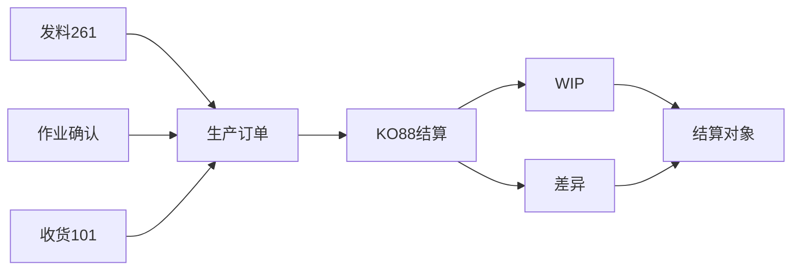

## 一句话结论

> 生产订单是个成本容器：发料 261 借「物料成本」、作业确认借「转换成本」、收货 101 贷「产出」；`KO88`（单个）/`CO88`（批量）一结，订单余额清零——结不走的余额就是 WIP 或差异，全额按结算规则推给结算对象。

## 症状

- `CO88` 批量结算大批报错，月结卡在生产订单结算这一步过不去。
- 结算报告说完成，订单当期余额却不是 0，生产成本科目月结后清不干净。
- 差异挂在前几期的生产成本科目里，订单清单对不上，没人说得清挂的是哪张订单。

## 根因（按概率）

| 根因（按概率） | 验证动作 | 修复动作 |
|---|---|---|
| 订单未 TECO（技术性完成）：差异终算以 TECO 为前提，未 TECO 订单的结算口径不完整 | 订单抬头查系统状态（是否 TECO） | 完工订单立即做技术性完成，再跑当期结算 |
| WIP 未计算就结算：期末未完订单要先算 WIP（`KKAX`/`KKAO`），跳过直接结算是顺序错误 | 查 WIP 计算清单是否覆盖该订单 | 按顺序返工：先算 WIP 再结算（见本系列 WIP 篇） |
| 结算规则缺失/失效：订单没带出默认结算规则，或结算对象无效 | 结算测试运行报「无结算规则/结算参数缺失」 | 维护结算规则；订单型生产的默认策略在订单类型+工厂层面配置（具体路径以你的系统为准） |
| 期间锁 / 成本要素锁：FI 期间已关或 CO 侧被冻结，结算凭证过不了账 | 看报错消息的期间提示；查期间状态与成本要素 | 按流程开回期间或补结，处理顺序并入[月结检查清单](/01-daily-ops/month-end-checklist) |

## 配错会怎样

- 结算规则配错对象：该结回物料的差异进了成本中心，物料账拿不到差异，实际成本失真。
- 分配结构漏要素：发料用的生产成本要素不在分配结构里，结算报「要素无法分配」，订单余额永远挂着。
- 不 TECO 就批量结算：差异不终算，报表跑完还在变，月结日历反复返工。

## 怎么配置

生产订单成本循环（工厂 1000，产 FG001）：

1. **发料 261**：车间领 RM001，借「生产成本-物料」初级成本要素；`MB51` 按移动类型 261 查。
2. **作业确认**：报工确认工时，按作业类型 × 作业价格从生产成本中心结转到订单，借「生产成本-转换」——作业价格体系与成本中心侧的结转见[成本中心分摊](/03-config-notes/co-assessment)。
3. **收货 101**：FG001 入库，贷「生产成本-产出」，按物料标准价计（标准价来自发布，见本系列标准成本估算篇）。
4. **结算**：`KO88` 单个订单 / `CO88` 按订单类型 + 工厂批量。已 TECO 订单：余额终算为差异；未 TECO 订单：余额转 WIP——都全额按结算规则结到对象（订单型生产默认结算到产出物料，也可按策略结到成本中心 / PA）。
5. **结算规则与分配结构**：结算规则通常按订单类型 + 工厂默认带出；分配结构负责成本要素到结算类别的映射，具体配置路径以你的系统为准。
6. **生命周期收口**：创建 → 释放 → 确认 → TECO → 结算 → 「关闭」。TECO 后差异才能终算；结算完成后再「关闭」，防止后续又发生过账。

## 怎么验证

工厂 1000、当月，挑一张已 TECO 且发料/报工/收货齐全的 FG001 订单。

**验证 T-Code**：`KO88`
**验证判据**：`KOB1` 行项目借贷构成完整——261 发料借方、作业确认借方、101 收货贷方；`KO88` 结算无错，结算后订单当期余额＝0；结算清单上的差异金额与差异科目里该订单的发生额一致。
**失败对照**：报「无结算规则」→ 根因表第 3 行补结算规则；报「成本要素没有分配/不能结算」→ 查分配结构的要素覆盖；`CO88` 大批报错 → 按报错消息归类处理，集中在未 TECO 与期间锁两行；具体报错消息定位见[报错速查](/01-daily-ops/errors/)。

## 相关 T-Code

`KO88` · `CO88` · `KOB1` · `MB51`
