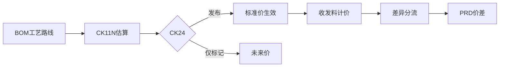

## 一句话结论

> 标准成本三步：`CK11N`（单个）/`CK40N`（批量）估算 → `CK24` 标记 + 发布——只有「发布」才把标准价写进物料主数据；之后收发料按标准价计价，实际与标准的差进价格差异科目。

## 症状

- `CK11N` 跑 FG001 直接报「找不到数量结构」或 BOM 无法展开，估算出不来。
- 估算做完也发布了，`MM03` 成本 2 视图的标准价还是旧价，当月收发料继续按旧价计。
- 估算结果与工艺路线对不上：同一工序，估算取的作业单价和成本中心的计划作业价格不一致，标准成本没人敢签字。

## 根因（按概率）

| 根因（按概率） | 验证动作 | 修复动作 |
|---|---|---|
| 数量结构缺失或不匹配：BOM 未建/未发布，工艺路线的状态、用途不在成本核算变式的取数范围 | 看 `CK11N` 报错里的数量结构日志；查 BOM/工艺路线主数据的用途与状态 | 补齐 BOM 与工艺路线并核对用途/状态；外购或无 BOM 物料改用无数量结构估算（按价格直估） |
| 只标记未发布：`CK24` 的「标记」写未来价，「发布」才写当期生效价 | `CK24` 看该物料标记/发布的勾选状态；`CKR1` 按状态查估算清单 | 当期要生效就执行发布；跨期切换用「先标记、期初发布」的节奏 |
| 估价变式取价策略不对：外购件取了物料主数据计划价而不是信息记录价，作业没取成本中心计划作业价格 | `CK13N` 逐项看取价来源；对照信息记录与成本中心计划作业价格 | 调整估价变式的价格策略顺序（配置路径以你的系统为准）后重估 |
| 日期控制读旧版本：估价日期/数量结构日期落在旧 BOM、旧工艺路线版本的有效期内 | `CK13N` 看实际展开的数量结构与版本号 | 统一估价日期与版本有效期，或调整成本核算变式的日期控制 |

## 配错会怎样

- 没发布就开跑生产：当月收发料按旧标准价计，标准与实际的差全堆进物料差异，期末重估金额异常。
- 取价策略配错：标准成本系统性偏高/偏低，订单差异月月都是大额价格差异，差异分析失去意义。
- 无数量结构估算被滥用：成本脱离 BOM 与工艺路线，工程改动反映不到成本，标准价失真没人发现。

## 怎么配置

核心对象是成本核算变式＝估价变式（取价策略）＋日期控制（按什么日期读 BOM/工艺路线/价格），加数量结构确定（BOM 用途/状态、工艺路线类型）；变式到工厂/物料的分配以你的系统为准。

1. **估算**：`CK11N` 单个——物料 FG001 + 工厂 1000 + 成本核算变式 + 估价日期，展开数量结构（BOM + 工艺路线）算出单位成本；`CK40N` 批量——把「选对象 → 估算 → 标记 → 发布」串成一次成本核算运行。
2. **价格来源**（估价变式里定优先级）：自制件的工序——成本中心计划作业价格（作业价格与成本中心侧的结转体系见[成本中心分摊](/03-config-notes/co-assessment)）；外购件（RM001 这类）——采购信息记录或物料主数据计划价。
3. **标记 + 发布**：`CK24` 标记把估算写入成本 2 视图的「未来」价；发布把「当期」生效标准价写进物料主数据（`MM03` 成本 2 视图可见）。
4. **发布后的记账链**：收发料按标准价计，实际价与标准价的差进价格差异科目（OBYC 链的 PRD / UMB，科目确定细节以你的系统为准）。
5. **期末重估不在这步**：标准价口径的差异月末归集与多层分摊，见[物料账结算](/03-config-notes/ml-closing-s4)。

## 参数与组合全解

**成本核算变式两件套拆解**：

| 组件 | 控制什么 | 关键参数 | 典型坑 |
|---|---|---|---|
| 估价变式 | 取什么价 | 自制件：成本中心计划/实际作业价格；外购件：信息记录 → 合同 → 物料主数据计划价等，顺序可配 | 优先级配反：外购件取了计划价而不是最新信息记录价 |
| 数量结构确定 | 展开什么 | BOM 用途（如 1 生产 / 6 成本核算）与状态、工艺路线类型、是否允许替代 BOM | 用途或状态不在取数范围 → 「找不到数量结构」 |
| 日期控制 | 按哪天读 | 数量结构与估价的日期策略（按估价日期还是当天取） | 日期落在旧版本有效期 → 展开旧 BOM、取旧价格 |

估价日期是取数时间锚：未来标准价锚下期期初，结构与价格可分别跟随不同日期策略（以你的系统为准）——「先标记、期初发布」正围绕它设计。

**CK24「标记 vs 发布」语义差**：

| 动作 | 写到哪 | 生效吗 | 语义 |
|---|---|---|---|
| 标记 Mark | 成本 2 视图的「未来」标准价 | 不生效，仅保存建议价 | 建议价排队等下期，跨期切换的预置动作 |
| 发布 Release | 物料主数据「当期」标准价 | 立即生效，当期收发料按新价计 | 标准价正式写入；与标记独立、可分别执行 |

两动作独立执行：只标记（排队）、只发布（当期生效）、先标记后发布（期初动作）。

**混合成本估算与批量估算的选择变式策略**：

- `CK40N` 批量估算用「选择变式」圈物料范围（物料组、工厂等），选对象 → 估算 → 标记 → 发布一次串完；圈太大长跑锁表、圈太小漏物料——按物料组分批。
- 混合成本估算（mixed costing）：一个物料多种采购替代（自制/外购、多产线）按混合比例合成标准价，先建拆分结构与混合码再估算（如 `CK91N`，入口以你的系统为准）。适用产能爬坡、外协过渡；混合比例一变就要重估重发布。

## 边缘与高级场景

- **期间内标准价变更对在途订单的影响**：月中发布新价后，收发料从发布时点起按新价计；在途订单材料按旧价领入、产出按新价收，中间价差混进订单差异，既非采购价差也非作业价差。库存不做全量重估（S/4 物料账口径以你的系统为准）。纪律：标准价变更集中在期初发布。
- **发布锁口径**：发布后当期标准价即被锁定，不允许在 `MM03` 手工改价绕过估算（以你的系统为准），要改价只能重走估算 → 发布。「标准价从 CK24 来、不从 MM03 来」的纪律即来源于此。
- **无数量结构物料的估价路径**：不展开 BOM 与工艺路线，按取价策略直估（信息记录价 + 附加费成本表），适用外购转售、外协件、BOM 未建全的新品；估算参数允许「无数量结构」（以你的系统为准）。坑在维护：绕过工程主数据后没人回头补，BOM 建全了也不重估——应列进定期重估清单，主数据补全后转回数量结构估算。

## 实操走查（跟着做一遍）

> 目标：对 FG001 走完「估算 → 仅标记（看状态差）→ 发布 → 物料主数据换价」全链。以工厂 1000、成本核算变式 PPC1（示意）、估价日期 2026-12-01 为例，全程约 15 分钟。

1. **`CK11N` 估算**：物料 FG001、工厂 1000、变式 PPC1、估价日期 2026-12-01 → 回车，预期 BOM/工艺路线正常展开（RM001 2 PC + 两道工序）；如果报「找不到数量结构」→ 说明 BOM/工艺路线的用途或状态不在取数范围（根因表第 1 行），补主数据后重估。
2. **看成本构成**：逐项页签预期——材料 RM001 2 PC × 100.00 = 200.00；作业 LABOR 0.5 h × 80.00 = 40.00、MACH 0.5 h × 60.00 = 30.00；合计单位成本 270.00；如果作业单价与成本中心计划作业价格对不上 → 用 `CK13N` 回溯取价来源（根因表第 3 行）。
3. **保存估算**：点保存 → 状态栏返回估算号（如 2600000123），记下。
4. **`CK24` 仅标记**：输工厂/物料/变式/期间 → 执行列出估算 2600000123 → 勾选该行、点「标记」→ 预期提示标记成功。
5. **看状态差**：`MM03` FG001 成本 2 视图 → 预期「未来」标准价 = 270.00，而「当期」标准价仍是旧价 250.00——只标记不发布，当期收发料仍按 250.00 计，这就是「标记 vs 发布」的语义差。
6. **`CK24` 发布**：回 `CK24` 再勾同一行、点「发布」→ 预期提示价格已写入物料主记录；如果 `MM03` 价格没变 → 说明只做了标记没做发布，用 `CKR1` 按状态确认。
7. **`MM03` 验价**：成本 2 视图当期标准价更新为 270.00（生效自 2026-12-01）、价格控制 S、价格单位 1。
8. **收口**：发布后当月首笔收发料按 270.00 计价，`MM03` 当期价 = 估算单位成本，与「怎么验证」判据一致，闭环。

## 怎么验证

工厂 1000、当月期间，对 FG001 走完整链：估算 → 发布 → 查价。

**验证 T-Code**：`CK24`
**验证判据**：`CK11N` 估算无错、数量结构正常展开；`CK24` 发布成功后，`MM03` 成本 2 视图的当期标准价＝估算单位成本；`CK13N` 打开估算明细，材料（RM001）取价与工序作业取价的来源逐项可解释；发布后当月首笔收发料按新标准价计。
**失败对照**：估算报数量结构缺失 → 根因表第 1 行，补主数据或改无数量结构估算；发布后 `MM03` 价格没变 → 查是否只标记未发布（`CKR1` 按状态确认）；取价与预期不符 → `CK13N` 回溯取价来源、对照估价变式；具体报错消息定位见[报错速查](/01-daily-ops/errors/)。

## 相关 T-Code

`CK11N` · `CK24` · `CK40N` · `CK13N` · `CKR1` · `MM03`
