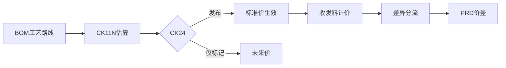

## 一句话结论

> 标准成本三步：`CK11N`（单个）/`CK40N`（批量）估算 → `CK24` 标记 + 发布——只有「发布」才把标准价写进物料主数据；之后收发料按标准价计价，实际与标准的差进价格差异科目。

## 症状

- `CK11N` 跑 FG001 直接报「找不到数量结构」或 BOM 无法展开，估算出不来。
- 估算做完也发布了，`MM03` 成本 2 视图的标准价还是旧价，当月收发料继续按旧价计。
- 估算结果与工艺路线对不上：同一工序，估算取的作业单价和成本中心的计划作业价格不一致，标准成本没人敢签字。

## 根因（按概率）

| 根因（按概率） | 验证动作 | 修复动作 |
|---|---|---|
| 数量结构缺失或不匹配：BOM 未建/未发布，工艺路线的状态、用途不在成本核算变式的取数范围 | 看 `CK11N` 报错里的数量结构日志；查 BOM/工艺路线主数据的用途与状态 | 补齐 BOM 与工艺路线并核对用途/状态；外购或无 BOM 物料改用无数量结构估算（按价格直估） |
| 只标记未发布：`CK24` 的「标记」写未来价，「发布」才写当期生效价 | `CK24` 看该物料标记/发布的勾选状态；`CKR1` 按状态查估算清单 | 当期要生效就执行发布；跨期切换用「先标记、期初发布」的节奏 |
| 估价变式取价策略不对：外购件取了物料主数据计划价而不是信息记录价，作业没取成本中心计划作业价格 | `CK13N` 逐项看取价来源；对照信息记录与成本中心计划作业价格 | 调整估价变式的价格策略顺序（配置路径以你的系统为准）后重估 |
| 日期控制读旧版本：估价日期/数量结构日期落在旧 BOM、旧工艺路线版本的有效期内 | `CK13N` 看实际展开的数量结构与版本号 | 统一估价日期与版本有效期，或调整成本核算变式的日期控制 |

## 配错会怎样

- 没发布就开跑生产：当月收发料按旧标准价计，标准与实际的差全堆进物料差异，期末重估金额异常。
- 取价策略配错：标准成本系统性偏高/偏低，订单差异月月都是大额价格差异，差异分析失去意义。
- 无数量结构估算被滥用：成本脱离 BOM 与工艺路线，工程改动反映不到成本，标准价失真没人发现。

## 怎么配置

核心对象是成本核算变式＝估价变式（取价策略）＋日期控制（按什么日期读 BOM/工艺路线/价格），加数量结构确定（BOM 用途/状态、工艺路线类型）；变式到工厂/物料的分配以你的系统为准。

1. **估算**：`CK11N` 单个——物料 FG001 + 工厂 1000 + 成本核算变式 + 估价日期，展开数量结构（BOM + 工艺路线）算出单位成本；`CK40N` 批量——把「选对象 → 估算 → 标记 → 发布」串成一次成本核算运行。
2. **价格来源**（估价变式里定优先级）：自制件的工序——成本中心计划作业价格（作业价格与成本中心侧的结转体系见[成本中心分摊](/03-config-notes/co-assessment)）；外购件（RM001 这类）——采购信息记录或物料主数据计划价。
3. **标记 + 发布**：`CK24` 标记把估算写入成本 2 视图的「未来」价；发布把「当期」生效标准价写进物料主数据（`MM03` 成本 2 视图可见）。
4. **发布后的记账链**：收发料按标准价计，实际价与标准价的差进价格差异科目（OBYC 链的 PRD / UMB，科目确定细节以你的系统为准）。
5. **期末重估不在这步**：标准价口径的差异月末归集与多层分摊，见[物料账结算](/03-config-notes/ml-closing-s4)。

## 怎么验证

工厂 1000、当月期间，对 FG001 走完整链：估算 → 发布 → 查价。

**验证 T-Code**：`CK24`
**验证判据**：`CK11N` 估算无错、数量结构正常展开；`CK24` 发布成功后，`MM03` 成本 2 视图的当期标准价＝估算单位成本；`CK13N` 打开估算明细，材料（RM001）取价与工序作业取价的来源逐项可解释；发布后当月首笔收发料按新标准价计。
**失败对照**：估算报数量结构缺失 → 根因表第 1 行，补主数据或改无数量结构估算；发布后 `MM03` 价格没变 → 查是否只标记未发布（`CKR1` 按状态确认）；取价与预期不符 → `CK13N` 回溯取价来源、对照估价变式；具体报错消息定位见[报错速查](/01-daily-ops/errors/)。

## 相关 T-Code

`CK11N` · `CK24` · `CK40N` · `CK13N` · `CKR1` · `MM03`
