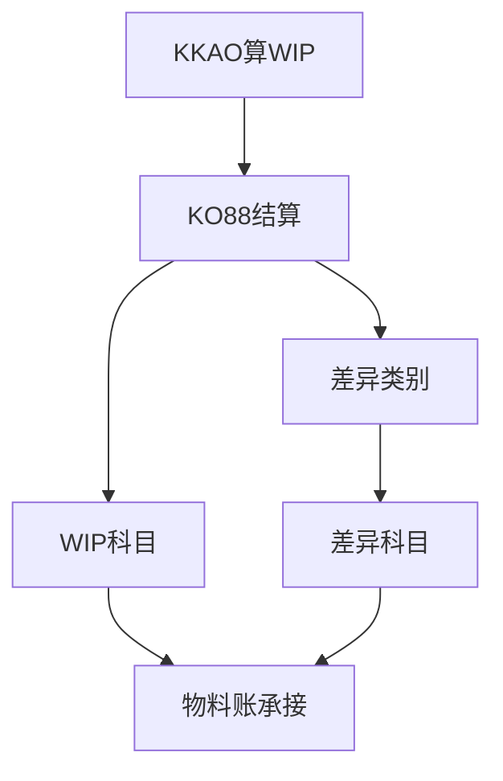

## 一句话结论

> WIP 按订单余额法：期末未完订单的实际成本减产出；`KKAX`/`KKAO` 先算 WIP，`KO88`/`CO88` 再结算——顺序是铁律；已 TECO 订单的余额终算成差异，按差异类别推给科目与结算对象。

## 症状

- WIP 金额大得离谱或干脆是负数，车间的在制量不可能这么大。
- 差异科目余额与订单差异清单对不上，差异解释不到订单、也解释不到类别。
- 月结都跑完了 WIP 还在变——结算之后又有人补确认、补过账。

## 根因（按概率）

| 根因（按概率） | 验证动作 | 修复动作 |
|---|---|---|
| 没算 WIP 就先结算：`KKAO` 没跑或后跑，订单余额被按错误口径结走 | 查 WIP 计算与结算的执行时间先后 | 当期按顺序返工：先 `KKAO` 再 `KO88`/`CO88` |
| 完工订单未及时 TECO：还按在制口径处理，本该终算的差异留在 WIP 里 | 订单清单筛「完工但未 TECO」 | 补 TECO 后重跑当期 WIP 与结算 |
| 产出确认遗漏：收货漏做，订单全额头寸都成了 WIP | `KOB1` 看订单有无收货/产出的贷方行 | 补收货或按业务更正后重算 |
| 期初 WIP 承接错：上期 WIP 金额/口径错，本期越滚越歪 | 上期 WIP 清单与本期期初对数 | 更正上期（反结算重跑的权限与流程以你的系统为准），再跑当期 |

## 配错会怎样

- 顺序反了：先结算后算 WIP，订单余额被结空，WIP 无金额可算，在制资产漏记。
- 差异类别没映射科目：差异算出来落不了账，或全挤进剩余差异，科目口径与分析口径脱节。
- WIP 虚大/虚小：资产负债表在制失真，毛利率月月漂移，管理层不认报表。

## 怎么配置

1. **WIP 计算**：`KKAX` 单个订单、`KKAO` 批量（工厂 1000 + 订单类型）。口径＝订单余额法：期末未完订单（未 TECO）借方实际成本 − 产出（贷方）＝ WIP，每期重算。
2. **月结顺序铁律**：先 `KKAO` 算 WIP → 再 `KO88`/`CO88` 结算。未 TECO 订单算 WIP、已 TECO 订单终算差异，状态分流在结算时完成，但 WIP 必须算在前——反了当期差异和 WIP 双双算错。顺序细节并入[月结检查清单](/01-daily-ops/month-end-checklist)。
3. **差异细分**：结算时订单差异按类别拆分——输入价格差异、资源差异、生产数量差异、剩余差异（类别名称与启用范围以你的系统为准）。
4. **差异类别到科目**：生产差异科目维护在差异类别的科目分配里（按工厂/成本对象层级），不是 OBYC；配置路径以你的系统为准。
5. **分析与承接**：单张订单看结算清单的差异数据；差异随后结到物料，实际成本的多层分摊见[物料账结算](/03-config-notes/ml-closing-s4)。

## 参数与组合全解

**差异类别全表**（每类 = 什么业务产生 + 分析价值；类别名称与启用范围以你的系统为准，是否启用在差异码里定义）：

| 差异类别 | 什么业务产生 | 分析价值 |
|---|---|---|
| 输入价格差异 | 发料价、作业单价与标准成本取价不一致（采购价波动、计划作业价格与实际偏差） | 判断标准价是否过期：价格类差异月月同向 → 该重估标准价 |
| 输入数量差异 | 同样产出下多耗材料 / 工时（损耗、返工） | 追现场效率与 BOM 准确性，工程改善的直接抓手 |
| 资源差异 | 工序 / 组件与标准数量结构不一致：多做工序、替代料、工艺路线变更 | 追「实际做法 vs 标准做法」的偏离，暴露标准维护质量问题 |
| 生产数量差异 | 实际产出偏离计划产出，固定成本摊薄差（批量没跑足） | 追排产与批量策略：小批量高频切换的真实成本代价 |
| 剩余差异 | 拆不到上述类别的兜底 | 健康指标：占比大 = 差异细分未启用或主数据不可分，先修细分再谈分析 |

单订单差异看差异计算清单（如 `KKS2` 单个、`KKS1` 批量，入口以你的系统为准）。

**差异类别 → 科目的分配配置链**（写准：这是 CO-PC 的科目分配，不是 OBYC）：链条 = 差异码（variance key，分配到工厂 / 成本对象层）→ 差异码里启用差异类别 → 每个启用类别在 CO-PC 生产差异的科目分配里按工厂 / 成本对象挂总账科目 → 结算时按类别过账。OBYC 管的是 MM 移动类差异（如 PRD），生产差异科目不走 OBYC；差异码与科目分配的维护事务以你的系统为准。配错的典型症状：差异全挤在剩余差异一个科目里，科目余额与类别细分报表永远差一块。

**目标成本版本对比**（差异 = 实际 − 目标，目标取哪个版本决定差异在说什么）：

| 目标成本版本 | 目标成本怎么来 | 差异的含义 |
|---|---|---|
| 标准成本估算 | 发布的标准价 × 实际产出数量 | 与存货计价口径一致的差异，月结 / 对外口径最常用 |
| 当期成本估算 | 按当期价格重估的目标成本 | 剔除标准过期噪音，回答「当期价格下订单该花多少」——判断标准该不该更新 |
| 订单计划成本 | 订单计划数量 × 计划价 | 评价订单执行（实际 vs 计划），追车间执行偏差 |

版本可用性与默认版本以你的系统为准。

## 边缘与高级场景

- **WIP 为负的合法场景（多收产出）**：订单余额在贷方（产出大于投入）时 WIP 算出来是负数——常见于收货先做、发料/报工确认延迟，或超产。负 WIP 不必然是错：订单余额法如实反映「多收了产出」，期末在制按净额列报（列报口径以你的系统为准）。要区分合法负 WIP 与流程漏单：`KOB1` 看投入是否明显缺行——漏发料要补过账，不能让负 WIP 常态化掩盖流程缺口。
- **期初 WIP 跨年结转**：每期结算都是「上期 WIP 先冲回、按新计算重挂」，未完订单的 WIP 自动滚入下期，跨年同理；上年末未 TECO 订单的 WIP 成为新年期初在制，上年已 TECO 订单的差异进上年损益不再动。前提是上年按顺序跑完 `KKAO` + `KO88`——顺序错了跨年就是错的接力。跨年反结（冲回上年结算）的权限与流程以你的系统为准。
- **月结顺序错误后的当期返工路径**：发现「先结算后算 WIP」「WIP 漏算」时按固定顺序返工：① 反结算当期订单（`KO88`/`CO88` 的冲销模式，入口与授权以你的系统为准）→ ② 补算 / 重算 WIP（`KKAO`）→ ③ 重跑结算 → ④ 核对 WIP 科目与差异科目余额。只反结算不重算 WIP，差异与 WIP 仍然错位。返工前先确认期间未被后续步骤（PA 结转、FI 关账）锁死，否则先按流程退锁；顺序并入[月结检查清单](/01-daily-ops/month-end-checklist)。

## 怎么验证

工厂 1000、当月，先测试运行再正式。

**验证 T-Code**：`KKAO`
**验证判据**：测试运行清单与在制订单清单一致（未 TECO 订单全覆盖、无漏单）；按顺序算完 WIP 并结算后，WIP 科目余额＝在制订单的 WIP 清单合计；差异科目发生额可在订单结算清单里按差异类别逐笔解释。
**失败对照**：WIP 虚大或为负 → 按根因表顺序查（先查执行顺序，再查 TECO、产出确认）；差异科目对不上订单 → 用结算清单逐类别比对，剩余差异占比异常多为类别细分未启用或科目映射缺失；月结后 WIP 还在变 → `KOB1` 按过账日期查结算后的新过账；具体报错消息定位见[报错速查](/01-daily-ops/errors/)。

## 相关 T-Code

`KKAX` · `KKAO` · `KO88` · `KOB1`
