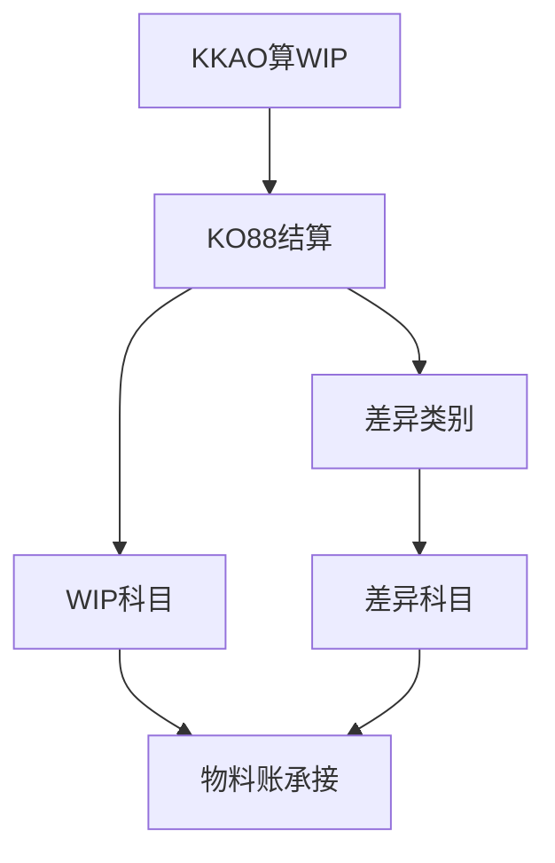

## 一句话结论

> WIP 按订单余额法：期末未完订单的实际成本减产出；`KKAX`/`KKAO` 先算 WIP，`KO88`/`CO88` 再结算——顺序是铁律；已 TECO 订单的余额终算成差异，按差异类别推给科目与结算对象。

## 症状

- WIP 金额大得离谱或干脆是负数，车间的在制量不可能这么大。
- 差异科目余额与订单差异清单对不上，差异解释不到订单、也解释不到类别。
- 月结都跑完了 WIP 还在变——结算之后又有人补确认、补过账。

## 根因（按概率）

| 根因（按概率） | 验证动作 | 修复动作 |
|---|---|---|
| 没算 WIP 就先结算：`KKAO` 没跑或后跑，订单余额被按错误口径结走 | 查 WIP 计算与结算的执行时间先后 | 当期按顺序返工：先 `KKAO` 再 `KO88`/`CO88` |
| 完工订单未及时 TECO：还按在制口径处理，本该终算的差异留在 WIP 里 | 订单清单筛「完工但未 TECO」 | 补 TECO 后重跑当期 WIP 与结算 |
| 产出确认遗漏：收货漏做，订单全额头寸都成了 WIP | `KOB1` 看订单有无收货/产出的贷方行 | 补收货或按业务更正后重算 |
| 期初 WIP 承接错：上期 WIP 金额/口径错，本期越滚越歪 | 上期 WIP 清单与本期期初对数 | 更正上期（反结算重跑的权限与流程以你的系统为准），再跑当期 |

## 配错会怎样

- 顺序反了：先结算后算 WIP，订单余额被结空，WIP 无金额可算，在制资产漏记。
- 差异类别没映射科目：差异算出来落不了账，或全挤进剩余差异，科目口径与分析口径脱节。
- WIP 虚大/虚小：资产负债表在制失真，毛利率月月漂移，管理层不认报表。

## 怎么配置

1. **WIP 计算**：`KKAX` 单个订单、`KKAO` 批量（工厂 1000 + 订单类型）。口径＝订单余额法：期末未完订单（未 TECO）借方实际成本 − 产出（贷方）＝ WIP，每期重算。
2. **月结顺序铁律**：先 `KKAO` 算 WIP → 再 `KO88`/`CO88` 结算。未 TECO 订单算 WIP、已 TECO 订单终算差异，状态分流在结算时完成，但 WIP 必须算在前——反了当期差异和 WIP 双双算错。顺序细节并入[月结检查清单](/01-daily-ops/month-end-checklist)。
3. **差异细分**：结算时订单差异按类别拆分——输入价格差异、资源差异、生产数量差异、剩余差异（类别名称与启用范围以你的系统为准）。
4. **差异类别到科目**：生产差异科目维护在差异类别的科目分配里（按工厂/成本对象层级），不是 OBYC；配置路径以你的系统为准。
5. **分析与承接**：单张订单看结算清单的差异数据；差异随后结到物料，实际成本的多层分摊见[物料账结算](/03-config-notes/ml-closing-s4)。

## 怎么验证

工厂 1000、当月，先测试运行再正式。

**验证 T-Code**：`KKAO`
**验证判据**：测试运行清单与在制订单清单一致（未 TECO 订单全覆盖、无漏单）；按顺序算完 WIP 并结算后，WIP 科目余额＝在制订单的 WIP 清单合计；差异科目发生额可在订单结算清单里按差异类别逐笔解释。
**失败对照**：WIP 虚大或为负 → 按根因表顺序查（先查执行顺序，再查 TECO、产出确认）；差异科目对不上订单 → 用结算清单逐类别比对，剩余差异占比异常多为类别细分未启用或科目映射缺失；月结后 WIP 还在变 → `KOB1` 按过账日期查结算后的新过账；具体报错消息定位见[报错速查](/01-daily-ops/errors/)。

## 相关 T-Code

`KKAX` · `KKAO` · `KO88` · `KOB1`
