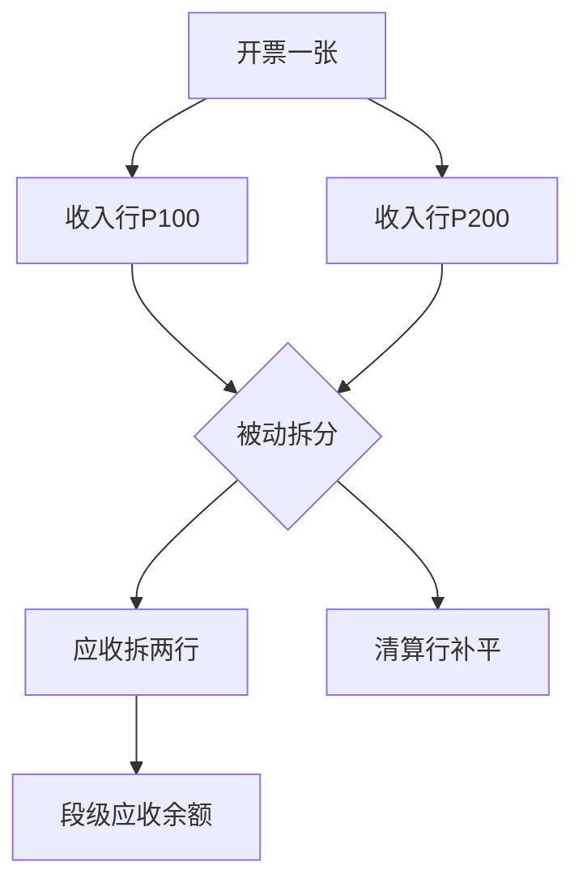

## 一句话结论

> 凭证拆分解决「应收/应付行天生不带段/利润中心，怎么出分部资产负债表」：拆分规则把客户/供应商行按对方行的利润中心比例拆成多行——一张发票收入 60% P100、40% P200，应收也拆成两条——再用零余额清算科目自动补平维度内差额；S/4 里它与新总账深度绑定，是分部报表的引擎，验收标准是「段级应收有明细、零余额清算科目月余额为 0」。

## 症状

- 段/利润中心报表里应收、应付全部挂在未分配，分部资产负债表只有费用侧可信。
- 零余额清算科目月末有余额——本该自动归零的技术科目成了新的勾稽差异点。
- `F110` 批量付款跑完，单张付款凭证行数异常爆炸，后台运行时间陡增、审计抽凭工作量翻倍。

## 根因（按概率）

| 根因（按概率） | 验证动作 | 修复动作 |
|---|---|---|
| 拆分方法漏配某业务交易的规则，整单不拆 | `FB03` 看凭证客户/供应商行是否单行未拆 | 补业务交易×科目分类的拆分规则 |
| 零余额清算科目未按维度分配或分配不全 | `FAGLL03` 按利润中心查清算科目余额 | 按维度补配清算科目 |
| 清账的业务流程未维护，付款与发票拆分行对不上 | 对比付款凭证与被清发票的拆分行 | 维护清账业务流程后重跑付款 |
| 手工凭证（`FB50`）硬敲利润中心，拆分比例失真 | `FB03` 看手工凭证的拆分基础 | 规范手工过账走标准入口与培训 |

## 配错会怎样

- 应收应付不拆：段级资产负债表先天残缺，IFRS 8 分部披露只能靠表外调整。
- 清算科目有余额：科目余额表多出一个没人认领的差异科目，月结勾稽链断裂。
- 拆分爆炸：凭证行数随清账规模放大，数据库、后台作业、审计抽凭全线承压。

## 怎么配置

1. **激活前提**：凭证拆分配在分类账 0L 上（新总账能力）；ECC 经典总账无拆分、新总账可选激活，S/4 与拆分深度绑定（S/4 的实际激活状态以你的系统为准），两代差异口径见[版本兼容矩阵](/00-about/version-matrix)。
2. **拆分方法**：按公司代码 1000 定义拆分方法：先给科目分**科目分类**（由科目属性决定），再按业务交易与流程变式给每类科目配拆分规则；规则配置入口以你的系统为准。
3. **零余额清算科目**：按维度（利润中心/段）分配零余额清算科目——拆分造成维度内不平衡时，系统自动生成清算行挂到该科目，任一时点该科目各维度余额合计为 0。
4. **验证闭环**：上线前把多分部发票、付款、清账全场景样例各跑一遍，确认拆分结果与清算科目归零（动作见下文验证）。

## 参数与组合全解

### 科目分类概念表

| 科目分类 | 典型科目 | 在拆分中的角色 |
|---|---|---|
| 资产负债表科目 | 现金、存货、固定资产 | 可作拆分基础或被拆对象 |
| 客户/供应商 | 应收/应付统驭科目 | 天生无维度，靠继承被拆 |
| 收入/费用 | 损益科目 | 天然带利润中心，是被动拆分的基础 |
| 中性科目 | 税、现金折扣等技术科目 | 不参与拆分，差额进清算科目 |

### 拆分场景表

| 场景 | 拆分方式 | 结果 |
|---|---|---|
| 应收发票（`VF01`） | 被动：应收行按收入行利润中心比例继承 | 收入 60% P100/40% P200 → 应收拆两条 |
| 应付发票（`MIRO`） | 被动：供应商行按费用/存货行比例继承 | 应付按对方行比例拆 |
| 付款（`F110`/收款） | 主动：银行行无维度，按被清发票的拆分基础拆 | 银行行随发票拆分行逐条匹配 |
| 清账 | 清算逻辑按业务流程匹配拆分行 | 未匹配差额挂清算科目行 |

### 继承规则：业务交易 × 科目分类 → 拆分基础

被动拆分与主动拆分的分水岭在**对方行有没有维度**：收入/费用行天然带利润中心，客户/供应商行按其比例继承，这是被动拆分；现金行自己没有维度，要按拆分规则（通常是被清对象的拆分行）主动切分。规则矩阵按业务交易类型×科目分类维护，可选项与默认行为以你的系统为准。

## 边缘与高级场景

- **F110 批量付款的拆分爆炸**：一笔付款清几十张发票，每张发票的拆分行都要在付款凭证里对上，凭证行数随清账笔数倍增——性能、后台时长、审计抽凭全被放大。缓解思路：付款批次按分部聚组、控制单张凭证的清账笔数（参数以你的系统为准）。
- **手工凭证绕过拆分**：`FB50` 直接给行指定利润中心，整单维度不平衡时强制生成清算行；常见坑是手工凭证只顾借贷平衡、不管维度平衡，把差异全推进清算科目——手工过账要按「维度也要平」培训，字段入口控制见[字段状态组](/03-config-notes/gl-field-status)。
- **拆分与并行账簿共存**：拆分配在 0L，并行账簿继承同一套凭证与拆分结果；并行账簿的账簿特定调整凭证同样参与拆分，两套账簿口径管理见[并行账簿](/03-config-notes/parallel-ledger)。

## 怎么验证

`VF01` 开一张含两行收入的发票（P100/P200 各一行），过账后看凭证。

**验证 T-Code**：`FB03`
**验证判据**：`FB03` 打开该发票凭证：应收行按对方行比例拆成多条（60% P100、40% P200 各一条），各维度借贷自平；月末 `FAGLL03` 查零余额清算科目当月余额为 0。
**失败对照**：应收单行未拆 → 拆分规则缺失；清算科目有余额 → 按维度补配清算科目或查清账业务流程；凭证行数异常多 → 评估 F110 拆分爆炸的缓解方案。

## 相关 T-Code

`FB03` · `FAGLL03`
