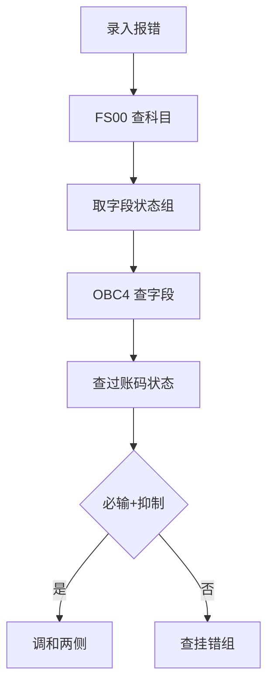

## 一句话结论

> 凭证行项目上某字段能不能输、是否必输，由「科目的字段状态组（`OBC4`）」与「过账码的字段状态」叠加决定；同一字段一边必输一边抑制就会冲突报错，排查必须两边都看。

## 症状

- `FB50` 录凭证时成本中心字段根本不出现，科目是损益类必须带成本对象，保存时报「成本中心必输」（消息号以你的系统为准）。
- `FB60` 供应商发票界面某辅助字段（如分配号、文本）被隐藏，业务无处可填。
- 同一科目换过账码（如 40 换 70）后字段行为不一样，用户以为系统坏了。

## 根因（按概率）

| 根因（按概率） | 验证动作 | 修复动作 |
|---|---|---|
| 字段状态组把成本中心设为抑制 | `FS00` 查科目挂的组，`OBC4` 逐字段核对 | 组内改为可选或必输 |
| 过账码字段状态与科目组冲突（必输+抑制） | 过账码配置里查该字段状态（入口以你的系统为准） | 调整一侧，消除 R+S 组合 |
| 科目挂错字段状态组（复制科目时沿袭了源科目） | `FS00` 控制数据页查字段状态组 | 换成正确的组 |
| 科目组层面设置被误当成记账控制（`OBD4` 管的是主数据界面） | `OBD4` 查科目组字段状态 | 区分主数据/记账两层，改对地方 |

## 配错会怎样

- 必输字段被抑制：手工录入卡单报错，月底凭证积压在业务手里。
- 可选字段设成必输：自动记账接口（如 MM-FI，见 [OBYC 配置](/03-config-notes/mm-fi-obyc)）因缺字段整批失败，排查方向被带偏。
- 字段状态组是共享配置：改一个组影响所有挂它的科目，动手前先评估影响面。

## 怎么配置

1. `OBC4`：在字段状态变式下维护字段状态组，逐字段设 抑制（Suppressed）/ 必输（Required）/ 可选（Optional）。
2. 字段状态变式在 `OB14` 定义，公司代码的分配在公司代码全局参数中维护（入口以你的系统为准）。
3. `FS00`：科目主数据公司代码层「控制数据」标签页挂字段状态组（如自建组 G006 管损益类）。
4. 过账码侧：每个过账码自带字段状态（借贷、科目类型之外的行项目字段控制），经典入口说法是 `OB41`，具体菜单以你的系统为准。叠加规则：抑制优先于可选，必输+抑制=冲突报错。
5. 别混淆：`OBD4` 是科目表层（作业图表层）入口之一，管的是 `FS00` 维护界面哪些字段出现（含显示 Display 状态）；`OBC4` 管的是记账时行项目字段。两层各查各的。

## 怎么验证

公司代码 1000，`FB50` 过一笔借 `400000`（损益示意科目）、带成本中心的凭证。

**验证 T-Code**：`FB50`
**验证判据**：成本中心字段可见、可输、保存成功，成本中心实际行项目报表能查到该笔。
**失败对照**：字段不可见或报必输冲突 → 按上面流程图回 `OBC4` 与过账码两侧逐字段比对；两侧都不冲突仍异常 → 查 `OBD4` 是否动错层。

## 相关 T-Code

`OBC4` · `OB14` · `FS00` · `FB50` · `FB60` · `OBD4`
