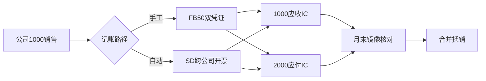

## 一句话结论

> 跨公司交易本身不难记账，难在「配对」：公司 1000 的应收-IC 与公司 2000 的应付-IC 必须按伙伴公司代码互为镜像，月末两侧余额绝对值相等、方向相反；不平的三大来源永远是单边过账、跨期、汇率。

## 症状

- 月末对账：1000 的 IC 应收科目余额 480 万，2000 的 IC 应付科目余额 465 万，差额 15 万找不到凭证。
- 一笔内部交易只在一侧有账：1000 记了应收-IC 并挂未清，2000 侧查不到任何对应行。
- 集团合并抵销跑不平，抵销分录反复带差，合并报表出不来，只能连夜逐笔找差异。

## 根因（按概率）

| 根因（按概率） | 验证动作 | 修复动作 |
|---|---|---|
| 单边过账：一侧已记账另一侧漏记 | `FBL3N` 按日期区间导出两侧 IC 行项目逐笔比对 | 补记缺失一侧，用统一参照号双凭证对敲 |
| 跨期：一侧记本期、另一侧记下期 | `FB03` 比对两侧行的过账日期与期间 | 统一记账时点规则，跨期项登记在途清单 |
| 汇率差：两侧外币折算口径不同 | `FB03` 看两侧凭证汇率与本位币金额 | 统一折算规则，差额进汇兑损益 |
| IC 科目没按伙伴公司配对 | 查两侧 IC 科目设置与行项目的伙伴公司标识 | 重建 1000↔2000 科目对，迁移挂错余额 |
| 自动路径配置链断 | 查跨公司单据是否生成两张公司凭证 | 修复配置链（以系统为准），缺的凭证补记 |

## 配错会怎样

- 合并报表抵销不平：集团层面 IC 往来拆不干净，合并试算表永远带差，审计调整单成堆。
- 对账成本失控：科目不配对时只能按金额盲对，几百笔内部交易逐笔核到深夜，月度口径见[往来对账](/01-daily-ops/reconciliation)。
- 债权债务失真：单边挂账让一家虚增资产、另一家漏记负债，两家单体报表同时失真，账龄与坏账计提口径全乱。

## 怎么配置

1. **IC 科目对**：按伙伴公司代码建科目对——公司 1000 挂「应收-IC-2000」（示意 `130001`），公司 2000 挂「应付-IC-1000」（示意 `160001`）；科目编号以你的系统为准，关键是配对关系而非编号。也可单科目加伙伴公司代码细分（字段方案以系统为准）。
2. **手工双凭证路径**：1000 卖给 2000 一笔内部服务——`FB50` 在 1000 记「借 应收-IC / 贷 内部收入」，再到 2000 记「借 费用 / 贷 应付-IC」，两套分录对敲、金额必须一致；凭证参照填同一个内部交易号，这是日后对账的锚点。
3. **系统自动路径**：SD 跨公司销售或跨公司采购，交货开票后系统自动生成两张凭证分别过账到 1000 与 2000，IC 科目由配置自动确定——具体配置链（公司间定价、科目确定、凭证类型）以系统与项目方案为准。
4. **到期日约定**：IC 往来挂内部付款条件，内部结算周期与外部付款解耦；两侧到期口径必须一致，一边 30 天一边 60 天必然账龄错位。
5. **月末固化**：把「两侧 IC 余额镜像核对」写进月结清单，差异挂「在途/差异」调节表跟踪清零。

## 参数与组合全解

### IC 记账三要素

| 要素 | 内容 | 缺失后果 |
|---|---|---|
| 伙伴公司代码 | 每个 IC 行项目标明对手方（1000 或 2000） | 无法配对，只能按金额盲对 |
| IC 科目 | 按伙伴公司分设的应收-IC / 应付-IC | 科目混挂，余额拆不出对手方 |
| 到期日约定 | 内部付款条件与结算周期 | 两侧账龄错位，内部清账无从谈起 |

### 手工 vs 自动选择矩阵

| 维度 | 手工双凭证 | 系统自动 |
|---|---|---|
| 适用场景 | 服务费、管理费分摊、无 SD/MM 链路 | 有订单-交货-开票全链路的内部货物交易 |
| 科目确定 | 人工选科目，靠制度管住 | 配置链自动确定，靠上线测试管住 |
| 对账锚点 | 统一参照号（手工填，易漏） | 单据链参照（自动带，可靠） |
| 典型错误 | 单边漏记、金额敲错 | 配置链断、凭证只生成一半 |
| 月末工作量 | 逐笔核对，量大痛苦 | 按单据流核对，效率高 |

无论哪条路径，镜像公式不变：1000 应收-IC 余额 = 2000 应付-IC 余额 × (−1)；合并层面内部往来全额抵销，两侧不平合并就拆不平。

## 边缘与高级场景

- **跨币种 IC 的汇率差归属**：1000 以美元挂 IC 应收、2000 以美元挂 IC 应付，折本位币时两侧汇率时点不同会产生永久性小额差异——惯例是差额进汇兑损益、由制度指定承担方，合并层面在抵销时轧平；具体归属规则以集团会计政策为准。
- **未达账（在途）处理**：自动路径的传输延迟或手工漏记会让一侧本月记账、另一侧下月初才到——对账时先列「在途清单」调节，本月挂差异、次月初复核清零；连续两个月不清零的在途项必须升级排查单边过账。
- **税务一句带过**：关联内部交易涉及转让定价与增值税口径，内部定价须符合独立交易原则，具体以税务顾问为准。
- **多公司扩展**：三家以上公司互做 IC 时，科目对两两组合会爆炸，改用「单一 IC 科目 + 伙伴公司代码细分」更可维护；多准则披露场景另见[并行分类账](/03-config-notes/parallel-ledger)。

## 怎么验证

公司 1000 向公司 2000 提供一笔 10,000.00 内部服务（或取一笔真实内部交易），两条凭证分别过账后，月末跑两侧 IC 科目余额。

**验证 T-Code**：`FBL3N`
**验证判据**：1000 的应收-IC 科目余额为借方 10,000.00，2000 的应付-IC 科目余额为贷方 10,000.00——绝对值相等、方向相反；`FBL3N` 逐笔看参照号，两侧一一对应；`FAGLL03` 新总账视图下余额同样镜像。
**失败对照**：余额不平 → 按日期区间导出两侧行项目逐笔比对：只有一侧有行是单边过账，补记；两侧都有但过账日期跨月是跨期，挂 在途清单；两侧本位币金额差小额是汇率口径，进汇兑损益；方法论见[往来对账](/01-daily-ops/reconciliation)，过账报错先查[报错速查](/01-daily-ops/errors/)。

## 相关 T-Code

`FB50` · `FBL3N` · `FB03` · `FAGLL03`
