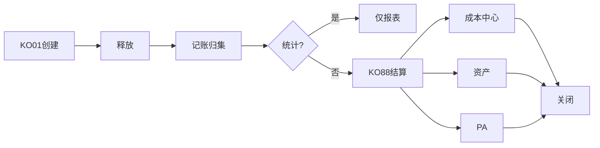

## 一句话结论

> 内部订单是临时性成本归集容器：成本中心管「常设组织归属」，订单管「一次性事项」；`KO01` 建单时选订单类型，统计（只记录不结算）还是真实（期末 `KO88` 可结算）就此定局，生命周期由类型驱动。

## 症状

- 费用进了订单就「住下」不出来：月底没人结算，订单余额逐月累积。
- 统计订单月底想 `KO88` 结算，系统拒绝或根本无余额可结。
- 订单预算录了却不控制：超预算照样过账，预算管理形同虚设。

## 根因（按概率）

| 根因（按概率） | 验证动作 | 修复动作 |
|---|---|---|
| 订单建成了统计订单：只记不结，余额躺在原费用科目 | `KO02` 查控制数据里的统计标志 | 新建真实订单重过账（已过账订单能否切换以你的系统为准） |
| 期末没跑结算：真实订单没人执行 `KO88` | `KOB1` 看订单当期余额 | 把订单结算排进月结日历按期执行 |
| 结算规则缺失或失效：没有可结对象 | `KO88` 测试运行看报错 | 维护结算规则（对象、百分比、有效期） |
| 预算可用性控制未激活：录了预算但不拦截 | 查预算状态与控制口径 | 激活可用性控制并核对预算档位（入口以你的系统为准） |

## 配错会怎样

- 统计/真实选错：该结算的做成统计，月余额清不掉；只做统计的建成真实，月结多一道空转结算。
- 结算规则指错对象：本该结成本中心，结去了资产或获利能力段，报表口径全乱。
- 预算不控：展会、市场活动类订单超支无预警，年终复盘才发现。

## 怎么配置

1. **定位**：一次性活动、临时项目、市场活动的归集容器。与成本中心的区别一句话：「这笔钱属于哪个部门」挂成本中心（常设），「这笔钱属于哪件事」挂订单（临时）——实务上常同时填，订单统计记账、成本中心真实承担。
2. **建单**：`KO01` 选订单类型（编号自动取自类型号段）；`KO02` 修改、查统计标志与结算规则。
3. **生命周期**：创建 → 释放（释放后才可记账）→ 记账归集 → `KO88` 结算 → 关闭收口；状态机语义与生产订单同源，详见[生产订单结算](/03-config-notes/co-pc-order-settlement)。
4. **结算**：真实订单按结算规则结到成本中心、资产或 PA；结算规则结构（对象＋百分比＋有效期）与生产订单是同一套概念。
5. **预算**：订单预算在预算管理里维护并激活可用性控制（入口以你的系统为准）；订单预算与成本中心预算是两套口径，别混着对。

## 参数与组合全解

**订单类型关键字段**（写稳：具体取值与组合以你的系统为准）：

| 字段 | 作用 | 要点 |
|---|---|---|
| 编号段 | 决定内部/外部编号 | 常用内部号段，外部编号易撞号 |
| 订单类别 | 决定整体行为 | 投资类订单借记 AuC，链路见[ AuC 结算与转固 ](/03-config-notes/auc-settlement) |
| 统计标志默认 | 该类型默认统计还是真实 | 建单时可在主数据层覆盖 |
| 结算配置文件 | 结算规则可维护范围与默认 | 从类型派生，逐单可覆盖 |

**统计 vs 真实对比**：

| 维度 | 统计订单 | 真实订单 |
|---|---|---|
| 结算 | 不可 `KO88` 结算 | 可结到成本中心/资产/PA |
| 余额 | 不产生待结余额，费用留在原科目 | 期末必须结算清零 |
| 预算 | 可做预算与可用性控制 | 同样可做（口径以你的系统为准） |
| 报表 | 统计口径展示 | `KOB1` 完整借贷可追溯 |

**计划与报表口径**：订单计划（成本、活动数量）与实际数对比在订单报表直接出；多张同类订单可挂同一订单组统一出报表——是否启用订单组以你的蓝图为准。`KOB1` 按期间出实际行项目，是月末追溯的第一入口。

**与 AuC 投资订单的关系**：订单类别＝投资的内部订单，结算时借记 AuC 资产，是「投资归集→在建→转固」链路的入口，完整机制见[ AuC 结算与转固 ](/03-config-notes/auc-settlement)。

## 边缘与高级场景

- **误建统计订单记账后转真实**：已过账订单能否直接切换统计标志写稳（以你的系统为准）；多数项目选「冲销过账 → 新建真实订单 → 重新过账」的干净路径，避免口径混挂。
- **结算规则的派生与覆盖**：结算规则从订单类型派生默认值，逐单可覆盖对象、百分比与有效期；单层覆盖后尽量别再改类型层默认，防止口径漂移。
- **年末未结订单**：年末盘点未结订单——该结的结、该关的关，未结清单核对并入[年末核对清单](/01-daily-ops/year-end-checklist)。
- **订单记账被成本中心拦住**：订单记账常要求同时给真实成本中心（统计口径），报错处理见[成本中心缺失](/01-daily-ops/errors/cost-center-missing)。

## 怎么验证

公司代码 1000：`KO01` 建一张真实订单（非统计），释放后过一笔费用，期末 `KO88` 结算到成本中心。

**验证 T-Code**：`KO88`
**验证判据**：结算后订单当期余额＝0；`KOB1` 行项目完整可追溯——费用借方、结算贷方；成本中心报表能查到该笔结算流入。
**失败对照**：报「订单是统计的/不可结算」→ 根因表第 1 行换真实订单；报「无结算规则」→ 补规则并核对 100% 分配；余额不清 → 查分配结构与结算规则覆盖，概念见[生产订单结算](/03-config-notes/co-pc-order-settlement)。

## 相关 T-Code

`KO01` · `KO02` · `KOB1` · `KO88`
