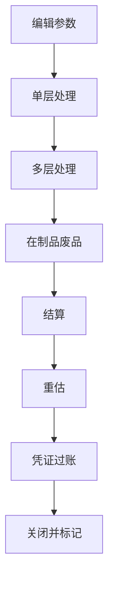

## 一句话结论

> S/4 物料账强制激活，`CKMLCP` 不结算完，CO 月结走不动；月结顺序里物料账在前——实际成本先关账，后面的分摊、重估、报表才有底。

## 症状

- `CKMLCP` 卡在「结算」步骤报错，清单里逐条列物料，月结日历被迫停下等物料账。
- CO 月结各步（分摊、对象结算）等待物料账状态，整个日历往后压。
- 月结跑完成本报表对不上：物料价格差异没有分摊进实际成本，报表还是标准价口径，与总账对不平。

## 根因（按概率）

| 根因（按概率） | 验证动作 | 修复动作 |
|---|---|---|
| 还有未结算生产订单 / 采购订单未清 | 订单管理器查未结算订单，`MB51` 查跨期移动 | 先收口订单（结算 / 技术性关闭），采购未清按业务确认后在途或补收口，再重跑结算 |
| 前一期间未关——物料账必须顺序结算，不能跳期 | `CKMLCP` 选前期看状态 | 回到最早的未结期间逐期结算关闭，再回来跑当期 |
| 某物料价格差异金额悬殊（收发票价差、汇率影响集中在一个料上） | `CKM3` 多层视图看该物料的材料价格构成 | 差异合理性核对：错票冲重、单价错误修源头；确属真实的让差异按多层逻辑分摊并在底稿留痕 |
| 允许负库存 / 价格导致负数结算报错 | `CKM3` 查该物料期间数量与价格，`MB51` 查负库存移动 | 收口负库存（补收货 / 盘点），或按公司政策处理负价格数据后重跑 |

## 配错会怎样

- 月结日历失守：物料账排在分摊后面，`CKMLCP` 一结算，重估凭证又改了成本中心余额，前面分摊全白做、返工重来。
- 差异挂账不透明：结算没跑，价格差异堆在差异科目，成本报表与总账各说各话，月末差异清单解释不了。
- 强行关期：前期差异没分摊就把期间标记关掉，事后补结要专门的开期间重处理流程，代价远高于按顺序跑。

## 怎么配置

这里没有太多可配的开关——S/4 物料账是强制激活的（ECC 可选、S/4 强制的口径差异见[版本差异总表](/00-about/version-matrix)），重点是掌握 `CKMLCP` 的步骤顺序。逻辑两条：**自下而上多层**（单层差异先归集，再沿 BOM 多层分摊）、**先确定后过账**（先测试确定结果，再正式过账）：

1. **编辑参数**：选公司代码 1000、期间、处理范围（测试/正式）。
2. **单层处理**：归集单层差异（收发票价差、汇率差异等先挂到物料上）。
3. **多层处理**：差异沿物料 BOM 自下而上层层分摊到上层半成品 / 成品。
4. **WIP / 废品**：处理在制品与废品的差异分摊。
5. **结算**：计算最终实际价格——报错最集中的一步，按根因表收口后重跑。
6. **重估**：按实际价格重估消耗与库存。
7. **凭证阅读 / 过账**：测试阅读无误再正式过账重估凭证。
8. **关闭 / 标记下一期间**：本期结算收口，标记开下一期间。

（步骤名称以你的系统为准，逻辑顺序不变。）前置配合：`MMPV` 关物料期间要等 `CKMLCP` 结算完成，顺序别反——月结里 MM 关账与物料账结算的先后见[月结检查清单](/01-daily-ops/month-end-checklist)。

`CKM3` 是差异分析的第一工具：选物料 + 期间看多层视图，材料价格构成（标准价、各项差异、实际价）一层层展开——差异从哪来、分到哪去，一张屏看全。

## 怎么验证

公司代码 1000，当月范围内先做测试运行（处理范围选测试）。

**验证 T-Code**：`CKMLCP`
**验证判据**：测试运行各步骤无错；切换正式运行后，「结算 / 重估 / 过账」状态全部完成（绿灯/完成标记以你的系统为准）；`CKM3` 抽查成品物料，多层视图能看到差异分摊进实际价格、消耗按实际价重估。
**失败对照**：结算步骤报错 → 按报错清单先查未结算订单与前期未关（根因表前两行），差异悬殊的物料用 `CKM3` 定位；过账步骤报错多为重估科目确定问题，回自动记账配置核对后重跑；具体报错消息定位见[报错速查](/01-daily-ops/errors/)。

## 相关 T-Code

`CKMLCP` · `CKM3` · `MMPV` · `MB51`
