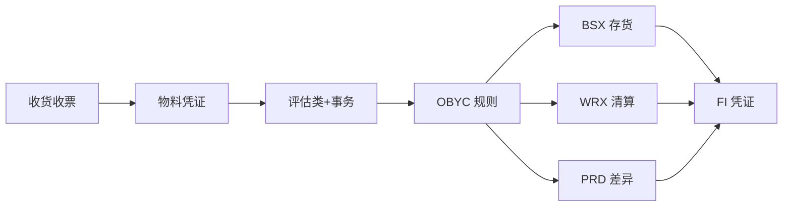

## 一句话结论

> `OBYC` 按「事务 + 评估类（叠加评估分组码、科目修改码）」把 MM 移动换算成 FI 科目；收货出不了 FI 凭证，先查物料主数据评估类到 `OBYC` 这条确定链，再查科目本身。

## 症状

- `MIGO` 对采购订单做 101 收货：物料凭证保存成功，但没有 FI 凭证，日志报「无法为事务 BSX/WRX 确定科目」（消息号以你的系统为准）。
- 移动平均价物料收发票后价格差异进了错误科目：`PRD` 挂错或未按评估类区分。
- `FBL3N` 查 GR/IR 科目长期挂账，收发货与收发票金额对不上，月末清理无从下手。

## 根因（按概率）

| 根因（按概率） | 验证动作 | 修复动作 |
|---|---|---|
| `OBYC` 缺事务+评估类组合（新评估类未配 BSX/WRX） | `OBYC` 进对应事务查规则行 | 补配存货 `140000`、GR/IR `191100` 等科目 |
| 物料主数据评估类为空或错误（会计 1 视图） | `MM03` 查会计 1 视图 | 维护正确评估类（如 2800 原材料），已估价库存需先处理 |
| 前置链断：评估区域/分组码不一致 | `OMSY` 查评估区域，`OMWD` 查工厂分组码 | 修正后回 `OBYC` 对齐规则行 |
| 目标科目被冻结或未建公司代码层 | `FS00` 查科目状态 | 解冻或补建公司代码层 |

## 配错会怎样

- 收货卡在物料凭证环节，`MB51` 有货、`FB03` 无账，仓库与财务账龄不一致。
- 差异串户（PRD、UMB），成本分析与总账对不上，月结差异清单解释不了。
- 事后补配置只管未来过账；已入账的错账要逐笔 `FB03` 找出来手工调整。

## 怎么配置

前置链先通，再挂科目：

1. `OMSY`：确认评估区域（通常等于工厂，如 1000）。新公司代码未维护评估区域会直接阻断收货。
2. `OMWD`：给评估区域（工厂 1000）分配评估分组码（如 0001）。
3. `OBYC`：按事务挂科目——`BSX` 存货（原材料 `140000`）、`WRX` 收货/收发票清算（`191100`）、`PRD` 价格差异、`UMB` 重估、`GBB` 抵销/消耗。`GBB` 按科目修改码细分：`AUF` 订单收货、`VAX`/`VAY` 销售发货成本、`BSA` 销售订单库存初始入账等（细分键以你的系统为准）。
4. 物料主数据（`MM01`/`MM02`）会计 1 视图维护评估类（如 2800），评估类决定 `OBYC` 命中哪一行规则。

## 怎么验证

对公司代码 1000 一张采购订单做 101 移动类型收货（数量任意）。

**验证 T-Code**：`MIGO`
**验证判据**：收货后 `FB03` 能查到配套 FI 凭证：借 `140000` 存货、贷 `191100` GR/IR；`MB51` 物料凭证环境里能看到 FI 凭证号。
**失败对照**：无 FI 凭证或科目缺失 → 回 `OBYC` 核对 BSX/WRX × 评估类 2800 的规则行，再沿 `OMWD`、`OMSY` 查前置链；具体报错定位见[报错速查](/01-daily-ops/errors/)。

## 相关 T-Code

`OBYC` · `OMWD` · `OMSY` · `MIGO` · `MIRO` · `FB03` · `MB51` · `FBL3N`
