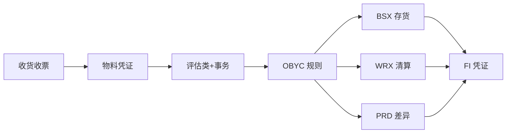

## 一句话结论

> `OBYC` 按「事务 + 评估类（叠加评估分组码、科目修改码）」把 MM 移动换算成 FI 科目；收货出不了 FI 凭证，先查物料主数据评估类到 `OBYC` 这条确定链，再查科目本身。

## 症状

- `MIGO` 对采购订单做 101 收货：物料凭证保存成功，但没有 FI 凭证，日志报「无法为事务 BSX/WRX 确定科目」（消息号以你的系统为准）。
- 移动平均价物料收发票后价格差异进了错误科目：`PRD` 挂错或未按评估类区分。
- `FBL3N` 查 GR/IR 科目长期挂账，收发货与收发票金额对不上，月末清理无从下手。

## 根因（按概率）

| 根因（按概率） | 验证动作 | 修复动作 |
|---|---|---|
| `OBYC` 缺事务+评估类组合（新评估类未配 BSX/WRX） | `OBYC` 进对应事务查规则行 | 补配存货 `140000`、GR/IR `191100` 等科目 |
| 物料主数据评估类为空或错误（会计 1 视图） | `MM03` 查会计 1 视图 | 维护正确评估类（如 2800 原材料），已估价库存需先处理 |
| 前置链断：评估区域/分组码不一致 | `OMSY` 查评估区域，`OMWD` 查工厂分组码 | 修正后回 `OBYC` 对齐规则行 |
| 目标科目被冻结或未建公司代码层 | `FS00` 查科目状态 | 解冻或补建公司代码层 |

## 配错会怎样

- 收货卡在物料凭证环节，`MB51` 有货、`FB03` 无账，仓库与财务账龄不一致。
- 差异串户（PRD、UMB），成本分析与总账对不上，月结差异清单解释不了。
- 事后补配置只管未来过账；已入账的错账要逐笔 `FB03` 找出来手工调整。

## 怎么配置

前置链先通，再挂科目：

1. `OMSY`：确认评估区域（通常等于工厂，如 1000）。新公司代码未维护评估区域会直接阻断收货。
2. `OMWD`：给评估区域（工厂 1000）分配评估分组码（如 0001）。
3. `OBYC`：按事务挂科目——`BSX` 存货（原材料 `140000`）、`WRX` 收货/收发票清算（`191100`）、`PRD` 价格差异、`UMB` 重估、`GBB` 抵销/消耗。`GBB` 按科目修改码细分：`AUF` 订单收货、`VAX`/`VAY` 销售发货成本、`BSA` 销售订单库存初始入账等（细分键以你的系统为准）。
4. 物料主数据（`MM01`/`MM02`）会计 1 视图维护评估类（如 2800），评估类决定 `OBYC` 命中哪一行规则。

## 参数与组合全解

### 事务键全表

| 事务键 | 记账场景 | 科目惯例（示意） | 常见错配 |
|---|---|---|---|
| `BSX` | 存货科目：收货、订单收货、盘点入库的存货价值 | 原材料 `140000` / 半成品 `140300` / 产成品 `140500`，按评估类分行 | 所有物料共用一个存货科目，成本分析拆不出材料构成 |
| `WRX` | 收货/收发票清算（GR/IR）：收货贷记、收票借记 | `191100` | 挂到往来类科目，月末 F.13 清账没有对冲对象 |
| `PRD` | 价格差异：收票价与订单价（或移动平均价）之差 | 材料价格差异 `231000` | 与 `UMB` 混挂，采购差异与重估差异解释不清 |
| `UMB` | 重估差异：价格变更/期末重估引起的存货价值变化 | 重估差异 `231001` | 错挂进 `PRD`，标准价物料的重估混入采购价差 |
| `GBB`（通用行） | 抵销/消耗的兜底行：找不到细分键时落到这里 | 消耗类 `271000` | 只配细分键不配通用行，非典型移动类型找不到科目 |
| `GBB`-`AUF` | 无 PO 的订单收货（生产订单收货的抵销） | `271001` | 配成存货科目，订单收货借贷两边都是存货 |
| `GBB`-`BSA` | 销售订单库存初始入账 | `271002` | 漏配，销售订单库存首笔收货直接报错 |
| `GBB`-`VAX` | 销售出库成本——标准价物料 | 主营业务成本 `640000` | 与 `VAY` 共用一个科目，报表分不出计价口径 |
| `GBB`-`VAY` | 销售出库成本——移动平均价物料 | `640001` | 错挂存货科目，出库金额与库存价值对不上 |
| `GBB`-`INV` | 盘盈盘亏（盘点差异） | 待处理财产损溢 `190001` | 盘盈盘亏不分方向，报批台账没法做 |
| `GBB`-`ZOF` | 订单收货冲销类特殊移动（`AUF`/`ZOF` 的具体分工以你的系统为准） | `271003` | 漏配后冲销找不到科目，收货冲销卡单 |

修改键（Modification）机制一句话：`GBB` 的细分键不是手工指定的——系统从移动类型携带的值串（Value String）反推出通用修改码（如 `AUF`/`INV`/`VAX`），再按「修改码 + 评估类」命中 `OBYC` 里的细分行；用 `OMJJ` 查移动类型的值串与修改码，就能解释某笔移动为什么命中（或没命中）某个科目。

### 评估类组合示例表

| 物料类型 | 评估类（示意） | 影响的键 |
|---|---|---|
| 原材料（ROH） | `2800` | `BSX` 存货、`WRX`、`PRD`/`UMB` 差异 |
| 半成品（HALB） | `7900` | `BSX`、`GBB`-`AUF` 订单收货抵销 |
| 产成品（FERT） | `3000` | `BSX`、`GBB`-`VAX`/`VAY` 出库成本 |
| 贸易商品（HAWA） | `3100` | `BSX`、`WRX`、`GBB`-`VAX`/`VAY` |

评估类与科目惯例均为示意，以你的系统为准。

## 边缘与高级场景

- **带库存物料改评估类**：有估价库存（或未清项）时 `MM02` 直接改会被拦。路子两条：先把库存出清为零再改评估类，或走标准改造流程（新建物料 + 库存转移/报废重入库），以项目方案为准；改完后 `BSX`/`PRD` 等规则行要同步复核一遍。
- **多工厂多评估分组码**：`OMWD` 决定每个工厂（评估区域）挂哪个评估分组码，而 `OBYC` 规则行的第一维度就是分组码。集团策略：科目口径一致的工厂共用一个分组码（`OBYC` 只配一轮），口径不同的（如海外工厂走不同科目）拆出独立分组码——比按工厂逐个配科目省事且不易漏。
- **S/4 物料账激活后的差异科目链**：物料账激活后 `PRD` 类差异会进一步细分（收发票差异、汇率差异等各自确定科目），期末经 `CKMLCP` 多层分摊进存货与销货成本，科目分配在物料账的分类账科目确定里维护；完整月结链路见[物料账结算](/03-config-notes/ml-closing-s4)。

## 怎么验证

对公司代码 1000 一张采购订单做 101 移动类型收货（数量任意）。

**验证 T-Code**：`MIGO`
**验证判据**：收货后 `FB03` 能查到配套 FI 凭证：借 `140000` 存货、贷 `191100` GR/IR；`MB51` 物料凭证环境里能看到 FI 凭证号。
**失败对照**：无 FI 凭证或科目缺失 → 回 `OBYC` 核对 BSX/WRX × 评估类 2800 的规则行，再沿 `OMWD`、`OMSY` 查前置链；具体报错定位见[报错速查](/01-daily-ops/errors/)。

## 相关 T-Code

`OBYC` · `OMWD` · `OMSY` · `MIGO` · `MIRO` · `FB03` · `MB51` · `FBL3N`
