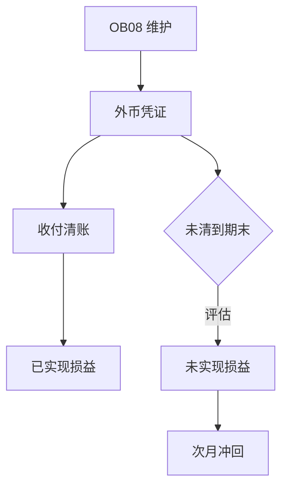

## 一句话结论

> 外币业务三层折算：凭证货币（录入）→ 本位币（公司代码货币）→ 并行货币（集团/硬通货）；日常凭证按 `OB08` 的类型 M 汇率折算，收付清账落已实现汇差，期末 `FAGL_FC_VAL` 对未清项重估未实现损益——汇率维护在前、清账居中、评估收尾。

## 症状

- 外币凭证一录就报无汇率可用，业务被卡在录入环节。
- 期末评估差异异常大：`OB08` 里混进错汇率或报价方向反了，重估一次炸出量级离谱的损益。
- 清账汇兑损益挂错科目（该进财务费用的进了营业外），或清账尾差长期挂账没人清。

## 根因（按概率）

| 根因（按概率） | 验证动作 | 修复动作 |
|---|---|---|
| `OB08` 未维护货币对当期该类型汇率 | `OB08` 查货币对+有效期+类型 | 补当日汇率后重过账，详见[汇率缺失](/01-daily-ops/errors/exchange-rate-missing) |
| 直接/间接报价方向维护反 | 看本位币金额量级是否异常（差千倍） | `OB08` 纠正报价方向后重录凭证 |
| 汇率类型取错（应 M 取成 B/G） | 查凭证抬头带出的汇率类型 | 核对货币的默认汇率类型配置 |
| 无直接货币对、交叉汇率缺失 | 查是否需要经第三币换算 | `OBBS` 维护交叉汇率 |
| 评估科目确定缺失 | `FAGL_FC_VAL` 报科目确定错 | 补汇兑损益与评估科目确定（入口以你的系统为准） |

## 配错会怎样

- 汇率缺失：外币凭证录不进去，采购付款全被堵。
- 报价方向反：本位币金额差数个量级，报表当场不可用，且要逐笔冲销重录。
- 评估科目错：未实现损益挂错科目，审计必调；不跑评估则期末外币计量口径不完整，月结清单过不去。

## 怎么配置

1. 定货币体系：公司代码 1000 本位币 CNY；并行货币（集团货币/硬通货）在货币与分类账配置里定义第二、第三本位币，S/4 口径见[并行分类账](/03-config-notes/parallel-ledger)。
2. `OB08` 维护汇率：货币对+生效日期区间+汇率类型+比率；直接/间接报价按货币对设定。
3. `OBBS` 维护交叉汇率：无直接货币对时经第三币（如 USD）套算，避免业务临时找价。
4. 科目确定：已实现汇兑损益、清账差额、评估损益与调整科目（配置入口以你的系统为准）。
5. 月结挂载：`FAGL_FC_VAL` 测试→正式→按政策次月冲回，作为固定步骤进[月结清单](/01-daily-ops/month-end-checklist)。

## 参数与组合全解

**汇率类型用途表**：

| 汇率类型 | 语义 | 典型用途 |
|---|---|---|
| M | 平均汇率，日常记账默认取它（项目常按月维护，故俗称月末平均价） | FI 凭证折算、外购标准成本 |
| B | 银行卖出价 | 售汇、结汇收款类业务 |
| G | 银行买入价 | 购汇、付汇类业务 |
| 计划类（常自定义） | CO/预算的计划口径汇率 | 计划成本与预算折算（类型以项目配置为准） |

**直接 vs 间接报价示例**：

| 报价方式 | 示例 | 特征与坑 |
|---|---|---|
| 直接报价 | 1 USD = 7.1000 CNY | 以本币给外币标价，最常用 |
| 间接报价 | 1 CNY = 0.1408 USD（≈1÷7.1） | 以外币给本币标价；两行同时维护且方向弄反，取数金额差千倍 |

**汇兑损益两类对照**：

| 类别 | 触发时点 | 计算 | 凭证去向 |
|---|---|---|---|
| 已实现 | 收付清账时 | 清账汇率与原凭证汇率差×未清额 | 清账凭证内的汇差行，进汇兑损益科目 |
| 未实现 | 期末评估 `FAGL_FC_VAL` | 关键日期汇率与账面汇率差×未清额 | 独立评估凭证，次月自动冲回或按政策保留 |

翻译日（Translation Date）：系统按凭证日期还是过账日期取哪一天的汇率，由配置决定，口径以你的系统为准——跨月业务要留意 15 日入账、月末才过账时取到的汇率日不同。

## 边缘与高级场景

- **历史凭证改汇率不可行**：凭证过账后汇率锁定进行项目，事后发现用错价不能直接改；金额小时留给期末评估统一找平，金额大时冲销重录（冲销规则与凭证类型约束见[凭证类型与号码范围](/03-config-notes/doc-type-number-range)）。
- **外币清账尾差的兜底科目**：清账时本金加汇差与实际收付金额差个零头，落「清账差额科目」吸收（容差与科目以你的系统为准）——该科目月内清零，不留尾巴。
- **并行货币评估的分层**：第二本位币（集团货币）与第三本位币（硬通货）各按自己的汇率类型逐层折算：凭证货币→本位币→并行货币，评估也要分层跑，配置与账套结构见[并行分类账](/03-config-notes/parallel-ledger)。

## 实操走查（跟着做一遍）

公司代码 1000，本位币 CNY，期间 2026-11，全程约 12 分钟。前提：科目 `100201`（美元存款，示意）已启用外币与未清管理。

1. `OB08` 查当期汇率：进入 OB08，双击进入汇率维护表；定位 USD 行展开，确认类型 M、生效自 2026-11-01 的汇率为 7.10000（USD 对 CNY，直接报价）；没有就补一行，保存。
2. `FB50` 录外币凭证：公司代码 1000，凭证与过账日期 2026-11-15，凭证货币选 USD；借 `660299` 咨询费 1,000.00，贷 `100201` 1,000.00；回车后本位币列自动折算 7,100.00，抬头汇率带出 7.1000（类型 M）；模拟无误后过账，记下凭证号。
3. `FAGLL03` 看行项目：科目 100201、货币 USD、期间 11 月；未清行显示 1,000.00 USD 与本位币 7,100.00，双击可见汇率 7.1000。
4. `OB08` 维护月末汇率：新增类型 M、生效自 2026-11-30 的 USD 汇率 7.05000，保存。
5. `FAGL_FC_VAL` 测试运行：公司代码 1000，评估关键日期 2026-11-30，选评估方法（如 Z001 示意），勾「测试运行」执行；清单列出未清项 1,000.00 USD：账面 7,100.00 对比关键日折算 7,050.00，预计未实现汇兑损失 50.00 CNY。
6. 正式运行：不勾测试再执行；生成评估凭证——借汇兑损益科目（示意 `660303`）50.00，贷 100201（评估调整）50.00；清单下载留档。
7. 次月观察冲回：政策设为次月自动冲回时，2026-12-01 在 `FAGLL03` 看到 50.00 调整被冲回、未清项恢复账面 7,100.00，待实际收付清账再落已实现损益（冲回政策以你的系统为准）。

## 怎么验证

**验证 T-Code**：`FB50`
**验证判据**：外币凭证模拟时本位币金额 = 外币金额×当日 M 汇率，即 1,000.00×7.1000 = 7,100.00（允许系统尾差）；期末 `FAGL_FC_VAL` 测试清单的预计损益 = 7,100.00−7,050.00 = 50.00。
**失败对照**：报无汇率可用 → `OB08` 当日 M 汇率缺失（根因表第 1 行）；本位币金额量级离谱（如只有千分之一）→ 报价方向维护反（根因表第 2 行）；评估跑不出清单 → 评估方法或科目确定未配（根因表第 5 行）。

## 相关 T-Code

`OB08` · `OBBS` · `FAGL_FC_VAL` · `FB50` · `FAGLL03`
