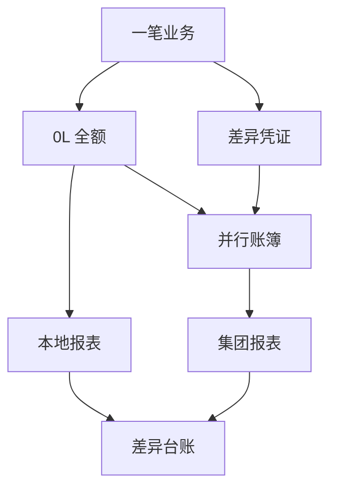

## 一句话结论

> S/4HANA 用分类账（ledger）实现两套准则并行：0L 主分类账记本地准则全额，并行分类账（如 IFRS/集团准则）默认继承 0L，准则差异只做**差异凭证**——通过账簿组（ledger group）把调整只过到目标账簿；验收标准是「两账簿差异 = 差异台账逐项可解释」。

## 症状

- 本地准则与集团准则两套报表长期调不平，差异散落、无台账可解释。
- 应只影响并行账簿的调整（减值、公允价值变动）串进了 0L，本地法定报表被「污染」。
- 外币折算差额放错账簿，集团合并时折算差异对不上。

## 根因（按概率）

| 根因（按概率） | 验证动作 | 修复动作 |
|---|---|---|
| 差异凭证过账时未选对账簿组（过到了全部账簿） | `FAGLL03` 分账簿查该差异凭证行 | 冲销后按正确账簿组重过 |
| 折旧区域与分类账映射错，折旧过错账簿 | 资产浏览器对比各折旧区域过账值 | 修正映射后重跑折旧 |
| 期初迁移只迁了 0L，并行账簿为空或残缺 | `FAGLL03` 查并行账簿期初余额 | 补并行账簿期初并逐科目勾稽 |
| 并行货币折算差额过错账簿 | 分账簿查折算差额科目 | 按准则口径重分类到对应账簿 |

## 配错会怎样

- 准则差异串账簿：本地法定报表混入 IFRS 调整，审计与申报两头不认。
- 并行账簿为空：集团合并直接缺数，月底补数代价远大于上线时配对。
- 无差异台账：账簿间差异「技术上存在、业务上说不清」，合并团队每月考古。

## 怎么配置

1. **账簿结构**：0L 主分类账对接本地准则；另建并行分类账（如 2L 对接集团/IFRS 口径）。并行账簿默认随 0L 记账，准则差异走**账簿特定过账**：`FB50` 手工凭证选择账簿组，凭证只过到该组内的账簿（分类账组与过账变体的具体配置路径以你的系统为准）。
2. **资产侧对接**：并行账簿的折旧差异靠折旧区域（depreciation area）实现——每个分类账对应自己的折旧区域，各自按本准则的折旧年限/政策计算并过账到对应账簿；S/4 新资产会计与分类账的联动细节见本目录「S/4 新资产会计」笔记。
3. **并行货币**：每个分类账可配自己的并行货币（如集团货币），外币折算差额按准则口径归集到对应账簿的折算科目。
4. **差异管理纪律**：每笔差异凭证登记差异台账（事项、科目、金额、准则依据）——这是月度两账簿对账的唯一解释源；期初迁移方法与验证见[上线切换 Runbook](/02-project/go-live-runbook) 的余额导入验证一节。

## 怎么验证

挑一个准则差异科目（如减值调整科目，示意），在 0L 与并行分类账下分别查同一科目余额。

**验证 T-Code**：`FAGLL03`
**验证判据**：`FAGLL03` 切换分类账对比同一科目，两账簿余额之差 = 差异台账预期调整清单逐项一致，无「台账之外的差异」。
**失败对照**：差异多出一笔 → 查差异凭证的账簿组是否选错；并行账簿余额为 0 → 期初迁移只迁了 0L；折旧类差异不对 → 查折旧区域与账簿映射后重跑折旧。

## 相关 T-Code

`FAGLL03` · `FB50`
