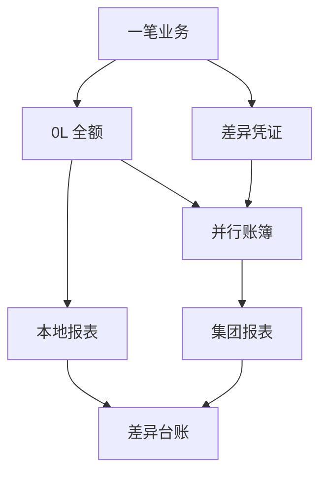

## 一句话结论

> S/4HANA 用分类账（ledger）实现两套准则并行：0L 主分类账记本地准则全额，并行分类账（如 IFRS/集团准则）默认继承 0L，准则差异只做**差异凭证**——通过账簿组（ledger group）把调整只过到目标账簿；验收标准是「两账簿差异 = 差异台账逐项可解释」。

## 症状

- 本地准则与集团准则两套报表长期调不平，差异散落、无台账可解释。
- 应只影响并行账簿的调整（减值、公允价值变动）串进了 0L，本地法定报表被「污染」。
- 外币折算差额放错账簿，集团合并时折算差异对不上。

## 根因（按概率）

| 根因（按概率） | 验证动作 | 修复动作 |
|---|---|---|
| 差异凭证过账时未选对账簿组（过到了全部账簿） | `FAGLL03` 分账簿查该差异凭证行 | 冲销后按正确账簿组重过 |
| 折旧区域与分类账映射错，折旧过错账簿 | 资产浏览器对比各折旧区域过账值 | 修正映射后重跑折旧 |
| 期初迁移只迁了 0L，并行账簿为空或残缺 | `FAGLL03` 查并行账簿期初余额 | 补并行账簿期初并逐科目勾稽 |
| 并行货币折算差额过错账簿 | 分账簿查折算差额科目 | 按准则口径重分类到对应账簿 |

## 配错会怎样

- 准则差异串账簿：本地法定报表混入 IFRS 调整，审计与申报两头不认。
- 并行账簿为空：集团合并直接缺数，月底补数代价远大于上线时配对。
- 无差异台账：账簿间差异「技术上存在、业务上说不清」，合并团队每月考古。

## 怎么配置

1. **账簿结构**：0L 主分类账对接本地准则；另建并行分类账（如 2L 对接集团/IFRS 口径）。并行账簿默认随 0L 记账，准则差异走**账簿特定过账**：`FB50` 手工凭证选择账簿组，凭证只过到该组内的账簿（分类账组与过账变体的具体配置路径以你的系统为准）。
2. **资产侧对接**：并行账簿的折旧差异靠折旧区域（depreciation area）实现——每个分类账对应自己的折旧区域，各自按本准则的折旧年限/政策计算并过账到对应账簿；S/4 新资产会计与分类账的联动细节见本目录「S/4 新资产会计」笔记。
3. **并行货币**：每个分类账可配自己的并行货币（如集团货币），外币折算差额按准则口径归集到对应账簿的折算科目。
4. **差异管理纪律**：每笔差异凭证登记差异台账（事项、科目、金额、准则依据）——这是月度两账簿对账的唯一解释源；期初迁移方法与验证见[上线切换 Runbook](/02-project/go-live-runbook) 的余额导入验证一节。

## 参数与组合全解

### 分类账类型与定位

| 类型 | 定位 | 典型用途 |
|---|---|---|
| 0L 主分类账 | 本地法定准则底账，公司代码本位币 | 法定报表与税务申报的唯一依据 |
| 并行分类账（如 2L） | 挂集团准则口径与并行货币，默认继承 0L 全部过账 | IFRS/集团报表，差异只走账簿特定凭证 |
| 次要分类账（secondary 统称） | 除 0L 外的附加账簿，可用不同货币类型甚至不同会计年度变式 | 管理口径、预算控制账簿（命名与用途以你的系统为准） |

### 账簿组 × 凭证入口的组合机制

| 场景 | 账簿组用法 | 效果 |
|---|---|---|
| 普通业务凭证（绝大多数） | 账簿组留空 | 过到 0L 与全部并行账簿——默认姿势 |
| 准则差异调整 | 选只含 2L 的账簿组 | 只有 2L 有这条行项目——差异凭证的正确写法 |
| 本地特定调整 | 选只含 0L 的账簿组 | 只动法定账不动集团账（罕见，需业务确认） |
| 哪类凭证可账簿特定 | 手工凭证（`FB50`/`FB01`）与经 BAPI/接口的凭证支持传账簿组；折旧、物料账等自动过账按各自配置带账簿 | 接口方案要逐个在蓝图确认，别默认全支持 |

### 折旧区域 × 分类账的映射三模式

| 模式 | 含义 | 典型用法 |
|---|---|---|
| 实时过账（区域实时过总账） | 区域算出的折旧实时生成 FI 凭证过到指定账簿 | 区域 01 → 0L；并行区域（如 30）→ 2L，IFRS 折旧差异实时进并行账簿 |
| 仅计算（不过总账） | 只在资产模块算数，不生成 FI 凭证 | 税务折旧、信息型区域——只出报表数 |
| 派生区域 | 由其他区域相减派生（如 31 = 30 − 01） | 自动承接两套准则的折旧差额，调节表的现成数据源 |

配置入口在资产会计与总账的集成设置里，以你的系统为准；各区域的过账值用 `AW01N` 资产浏览器逐区域对比。

### 账簿层科目确定的差异

并行账簿可分配自己的科目确定（账簿层 determination / 平行科目表，入口以你的系统为准），让同一业务在两套账簿落不同科目——属高阶方案，主数据与报表都要双份维护，成本陡增；多数项目选「同一科目表 + 差异凭证」，账簿层科目只在准则科目确实不可调和时启用。

## 边缘与高级场景

- **期初迁移必须同批**：0L 与并行账簿期初在同一批次、同一截止日导入，逐科目勾稽「0L ± 差异台账 = 2L」；只迁 0L 的账簿上线首月就是空的，集团报表直接缺数。迁移工具与验证见[上线切换 Runbook](/02-project/go-live-runbook)。
- **年末两套报表的调节差异台账**：按月维护科目级工作底稿，对账「0L 余额 − 2L 余额 = 差异台账合计」，每笔差异登记事项、准则依据、金额；年末两套报表的调节表直接从台账汇出——没有台账，年末等于一次大型考古。
- **外币折算差异进哪套账簿**：折算差额按**该账簿自己的并行货币与折算口径**归集到该账簿的折算科目（并行货币配置走 `OB22` 链路，示意）；两套账簿折算口径不同（期末汇率 vs 交易日汇率）时差异分别挂各自账簿，别把集团折算差串进 0L。

## 怎么验证

挑一个准则差异科目（如减值调整科目，示意），在 0L 与并行分类账下分别查同一科目余额。

**验证 T-Code**：`FAGLL03`
**验证判据**：`FAGLL03` 切换分类账对比同一科目，两账簿余额之差 = 差异台账预期调整清单逐项一致，无「台账之外的差异」。
**失败对照**：差异多出一笔 → 查差异凭证的账簿组是否选错；并行账簿余额为 0 → 期初迁移只迁了 0L；折旧类差异不对 → 查折旧区域与账簿映射后重跑折旧。

## 相关 T-Code

`FAGLL03` · `FB50` · `FB01` · `OB22` · `AW01N`
