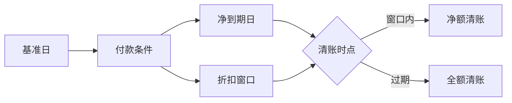

## 一句话结论

> 付款条件（`OBB8`）用「基准日 + 天数/固定日/月数」算出净到期日与两档现金折扣窗口，挂在供应商/客户主数据上、单据层可覆盖；窗口内清账自动按净额、过期按全额，`F-53`/`F110` 的现金流量全由它打底。

## 症状

- 发票到期日整体漂移：想要「次月 15 日」算成了「+30 天」，`F110` 按到期日挑发票，月结付款计划全乱。
- 折扣没吃到（基准日默认错，窗口过了才付款）或吃错（已过期仍按净额付，差额挂成未清项）。
- 供应商主数据没挂条件，`FBL1N` 的净到期日一栏是空的，按到期日筛选直接漏单。

## 根因（按概率）

| 根因（按概率） | 验证动作 | 修复动作 |
|---|---|---|
| 默认基准日类型配错（要过账日期，配成了凭证日期） | `OBB8` 查该条件的默认基准日 | 改对类型，未清发票按新口径看到期日 |
| 主数据没挂或挂错付款条件 | 供应商/客户主数据「付款交易」页核对 | 挂对条件，存量单据在单据层覆盖纠正 |
| 天数/固定日/月数参数填错 | `OBB8` 里手工复算一笔到期日 | 修正参数 |
| 分期条件各期百分比合计不等于 100% | `OBB9` 逐期加总 | 修正百分比 |

## 配错会怎样

- 到期日错，`F110` 付款提前或滞后，现金流量预测失真：不是被供应商催款，就是资金白白闲置。
- 折扣窗口错：净额清账不成立，`F-53` 产生付款差异，未清项越滚越多（清账链问题参见[特别总账标识](/03-config-notes/ap-special-gl)）。
- 分期比例合计错，发票过账直接被拦，业务侧以为系统坏了。

## 怎么配置

1. `OBB8` 建条件（示意自建 `Z001`）：净付款 30 天；现金折扣折扣 1：10 天内 1%；默认基准日选过账日期。经典两档如「2% 14 天 / 净 30 天」，国内常见 1/10 n/30 风格，照这个骨架填即可。
2. 基准日类型写稳这几档：无默认（过账时手工输基准日）、凭证日期、凭证输入日期、过账日期；再配合固定日玩法：天数 0 + 固定日 15 + 月数 1 = 次月 15 日到期。收货（GR）相关基准日由收货日推算，配置入口以你的系统为准。
3. 分期条件：`OBB8` 勾「分期付款」，`OBB9` 定义每期百分比（合计必须 100%）与每期的条件。
4. 挂载：供应商/客户主数据「付款交易」页挂条件；`FB60`/`FB70` 录单时可单据层覆盖，覆盖要走管控不要随手改。
5. 折扣过账科目在自动科目确定里维护（入口以你的系统为准），免得净额清账时折扣额没处落账。

## 参数与组合全解

### 基准日类型全表

| 类型 | 基准取什么 | 典型场景 |
|---|---|---|
| 无默认基准日 | 过账时必须手工输基准日 | 特殊合同逐单定锚点 |
| 凭证日期 | 凭证日期 | 发票日期即起算日的供应商 |
| 凭证输入日期 | 录入系统当天 | 对录入时效敏感、防倒签 |
| 过账日期 | 过账日期 | 与财务期间对齐，最常用 |
| 固定日锚点 | 由「月数 + 固定日」推算到固定某日 | 月结型「次月 15 日」条款（固定日玩法细节以你的系统为准） |
| 收货相关（GR 基准） | 由收货日推算基准日 | 以实际收货为准的货到付款条款（配置入口以你的系统为准） |

### 到期日三参数联动示例

同一套「天数 + 月数 + 固定日」参数，效果天差地别（基准日取 2026-11-16）：

| 参数组合 | 天数 | 月数 | 固定日 | 到期日 |
|---|---|---|---|---|
| 净 30 | 30 | — | — | 2026-12-16 |
| 次月 15 | — | 1 | 15 | 2026-12-15 |
| 当月月底 | — | — | 31 | 2026-11-30（固定日早于基准日当天时是否顺延下月，以你的系统为准） |

三参数优先级与组合边界以你的系统为准，但「先定基准日类型、再配三参数、最后复算一笔」的复核顺序是通用的。现金折扣的折扣 1/折扣 2 两档窗口各自再配一套天数，与净期限叠加成完整条件。

### 分期条件（OBB9）

- 期次百分比合计必须等于 100%，差一点发票过账直接被拦。
- 每期可挂不同付款条件：如首期 30% 净 10 天、尾款 70% 净 60 天，过账后生成多行未清项、各有自己的到期日与折扣窗口。
- 分期条件由主数据上的分期标识带出（期数上限与默认行为以你的系统为准）。

### 现金折扣两层

- 经典三段式：「2% / 10 天、1% / 20 天、净 30」——10 天内付扣 2%，11–20 天付扣 1%，之后全额清账。
- 折扣过账科目：窗口内净额清账时，折扣额要有落账科目，在自动科目确定里维护（入口以你的系统为准），漏配则清账差异无处落账。

## 边缘与高级场景

- **凭证层覆盖主数据条件**：`FB60`/`FB70` 录单时可临时改付款条件，这是最常见的「人为到期日漂移」来源。管控三件套：谁有权改（权限控制）、为什么改（单据留痕与审批）、改完谁复核（`FBL1N` 按异常到期日筛选）。随手覆盖必须被流程拦住。
- **跨币种条件**：外币发票清账时折扣额按过账口径折算本位币，清账日汇率变动还会产生汇兑差——汇兑差与折扣差是两回事，别在折扣科目上去找汇率差异的账。
- **付款条件与信贷检查联动**：AR 信贷敞口按净额与净到期日计算占用，付款条件配错会连累信贷监控口径（AR 管理详见[信贷管理](/03-config-notes/ar-credit-management)）。

## 实操走查（跟着做一遍）

> 目标：用一张 1,130.00 的发票验证「条件参数 → 到期日/折扣窗口」整条计算链。以公司代码 1000、供应商 200001、条件 `Z001`（1/10 净 30）为例，全程约 10 分钟。

1. **`OBB8` 看参数**：双击 Z001 进明细，预期：默认基准日类型 = 过账日期；付款期限行天数 30、月数/固定日为空；折扣 1 行天数 10、百分比 1%；如果看到月数 1 + 固定日 15 → 说明这套条件实际是「次月 15 日」口径，到期日会差整月。
2. **`FB60` 录发票**：公司代码 1000、供应商 200001、发票日期与过账日期均 2026-11-11、总额 1,130.00（净额 1,000.00 + 税 130.00，税率 13%，税码按你的系统）。
3. **挂条件并过账**：付款条件字段带出主数据的 Z001（为空则手工补 Z001）→ 点「模拟」，预期借费用类 1,000.00、借进项税 130.00、贷应付 200001 1,130.00 → 过账，记下凭证号（如 5105000123）。
4. **`FBL1N` 看三列**：供应商 200001、公司代码 1000、只列未清项 → 预期一行 1,130.00；双击/加列看到：净到期日 2026-12-11、现金折扣到期日 2026-11-21、折扣额 11.30（1,130.00 × 1%）。
5. **手算复核**：基准日 = 过账日期 2026-11-11；净到期日 = +30 天 = 2026-12-11；折扣 1 到期 = +10 天 = 2026-11-21——与屏幕三列逐一相等；如果净到期日算成 2026-12-15 之类 → 说明固定日/月数参数在起作用，回 `OBB8` 核对。
6. **推演清账窗口**：2026-11-21（含）前用 `F-53` 付款按净额 1,118.70 清账，折扣 11.30 落折扣科目；之后付款按全额 1,130.00 清账。
7. **收口**：`FBL1N` 三列（净到期日/折扣到期日/折扣额）与手算一致，与「怎么验证」判据完全一致，闭环；AR 侧同口径用 `FB70` + `FBL5N` 复跑一遍即可。

## 怎么验证

公司代码 1000、供应商 200001，`FB60` 录一笔付款条件 `Z001`（1/10 净 30、基准日=过账日期）的发票，过账日期 2026-11-11。

**验证 T-Code**：`FB60`
**验证判据**：`FBL1N` 查该未清发票：净到期日 = 基准日 + 30 = 2026-12-11；现金折扣到期日 = 基准日 + 10 = 2026-11-21，折扣额按发票额 1% 显示；客户侧同口径用 `FBL5N` 复核 `FB70` 录的发票。
**失败对照**：到期日差整月 → 回 `OBB8` 查固定日/月数参数；基准日为空或算不出折扣 → 查默认基准日类型；主数据没带出条件 → 查「付款交易」页是否漏挂。

## 相关 T-Code

`OBB8` · `OBB9` · `FBL1N` · `FBL5N` · `FB60` · `FB70`
