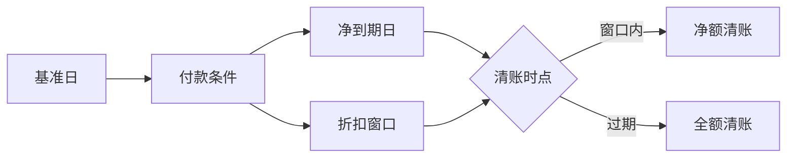

## 一句话结论

> 付款条件（`OBB8`）用「基准日 + 天数/固定日/月数」算出净到期日与两档现金折扣窗口，挂在供应商/客户主数据上、单据层可覆盖；窗口内清账自动按净额、过期按全额，`F-53`/`F110` 的现金流量全由它打底。

## 症状

- 发票到期日整体漂移：想要「次月 15 日」算成了「+30 天」，`F110` 按到期日挑发票，月结付款计划全乱。
- 折扣没吃到（基准日默认错，窗口过了才付款）或吃错（已过期仍按净额付，差额挂成未清项）。
- 供应商主数据没挂条件，`FBL1N` 的净到期日一栏是空的，按到期日筛选直接漏单。

## 根因（按概率）

| 根因（按概率） | 验证动作 | 修复动作 |
|---|---|---|
| 默认基准日类型配错（要过账日期，配成了凭证日期） | `OBB8` 查该条件的默认基准日 | 改对类型，未清发票按新口径看到期日 |
| 主数据没挂或挂错付款条件 | 供应商/客户主数据「付款交易」页核对 | 挂对条件，存量单据在单据层覆盖纠正 |
| 天数/固定日/月数参数填错 | `OBB8` 里手工复算一笔到期日 | 修正参数 |
| 分期条件各期百分比合计不等于 100% | `OBB9` 逐期加总 | 修正百分比 |

## 配错会怎样

- 到期日错，`F110` 付款提前或滞后，现金流量预测失真：不是被供应商催款，就是资金白白闲置。
- 折扣窗口错：净额清账不成立，`F-53` 产生付款差异，未清项越滚越多（清账链问题参见[特别总账标识](/03-config-notes/ap-special-gl)）。
- 分期比例合计错，发票过账直接被拦，业务侧以为系统坏了。

## 怎么配置

1. `OBB8` 建条件（示意自建 `Z001`）：净付款 30 天；现金折扣折扣 1：10 天内 1%；默认基准日选过账日期。经典两档如「2% 14 天 / 净 30 天」，国内常见 1/10 n/30 风格，照这个骨架填即可。
2. 基准日类型写稳这几档：无默认（过账时手工输基准日）、凭证日期、凭证输入日期、过账日期；再配合固定日玩法：天数 0 + 固定日 15 + 月数 1 = 次月 15 日到期。收货（GR）相关基准日由收货日推算，配置入口以你的系统为准。
3. 分期条件：`OBB8` 勾「分期付款」，`OBB9` 定义每期百分比（合计必须 100%）与每期的条件。
4. 挂载：供应商/客户主数据「付款交易」页挂条件；`FB60`/`FB70` 录单时可单据层覆盖，覆盖要走管控不要随手改。
5. 折扣过账科目在自动科目确定里维护（入口以你的系统为准），免得净额清账时折扣额没处落账。

## 怎么验证

公司代码 1000、供应商 200001，`FB60` 录一笔付款条件 `Z001`（1/10 净 30、基准日=过账日期）的发票，过账日期 2026-11-11。

**验证 T-Code**：`FB60`
**验证判据**：`FBL1N` 查该未清发票：净到期日 = 基准日 + 30 = 2026-12-11；现金折扣到期日 = 基准日 + 10 = 2026-11-21，折扣额按发票额 1% 显示；客户侧同口径用 `FBL5N` 复核 `FB70` 录的发票。
**失败对照**：到期日差整月 → 回 `OBB8` 查固定日/月数参数；基准日为空或算不出折扣 → 查默认基准日类型；主数据没带出条件 → 查「付款交易」页是否漏挂。

## 相关 T-Code

`OBB8` · `OBB9` · `FBL1N` · `FBL5N` · `FB60` · `FB70`
