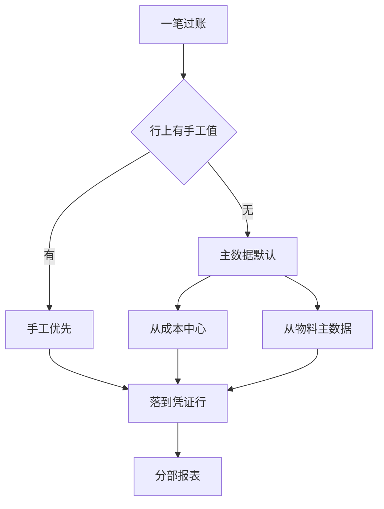

## 一句话结论

> 利润中心是回答「哪个分部赚不赚钱」的组织维度：让每条凭证行带上 P100/P200，收入、成本乃至资产负债表科目都能按分部切开；它默认从成本中心/物料主数据派生、凭证行手工可覆盖，ECC 里靠独立的 PCA 模块出报表，S/4 里利润中心就是统一日记账 `ACDOCA` 的一个维度字段——验收标准是「未分配桶接近零、各分部利润能勾稽到公司利润」。

## 症状

- 分部损益表大头挂在「未分配（unassigned）」利润中心，P100/P200 只剩零星数，管理层不信这张表。
- P100 与 P200 的分部利润加总对不上公司代码 1000 的法人利润，差额无人认领。
- 新建成本中心漏派利润中心：费用过账要么直接报错（见[成本对象缺失](/01-daily-ops/errors/cost-center-missing)），要么静默落进未分配兜底桶。

## 根因（按概率）

| 根因（按概率） | 验证动作 | 修复动作 |
|---|---|---|
| 成本中心/物料主数据漏维护利润中心，过账落未分配桶 | `FAGLL03` 按利润中心筛未分配行项目 | 补主数据派生，增量过账自然归位 |
| 物料主数据的利润中心与实际产销归属不符（跨厂发货、代工） | 对比物料主数据与发货工厂/销售订单 | 修正归属或用内部结算转移利润 |
| 变更成本中心利润中心后误以为历史行项目会跟着走 | `KSB1` 查历史行项目仍挂旧利润中心 | 承认历史口径，只对增量生效 |
| 手工凭证敲错利润中心且无字段校验 | `FB03` 打开凭证看行项目 | 冲销重过；收紧字段控制见[字段状态组](/03-config-notes/gl-field-status) |

## 配错会怎样

- 未分配桶常年挂大头：分部报表失去公信力，月结后总要人工拆数补洞。
- 物料产销归属错：收入记在 P100、成本记在 P200，两边分部利润一虚一实，内部定价争议无解。
- 资产负债表维度没配全：只有分部损益没有分部资产负债表，IFRS 8 披露缺半张表。

## 怎么配置

1. **主数据与标准层级**：利润中心（P100/P200）建在控制范围下，必须挂进**标准层级树**——分部报表按树汇总，不在树上的利润中心出不了报表；主数据创建/变更事务与层级维护入口以你的系统为准。
2. **派生来源**：成本中心主数据上的利润中心是费用行的默认来源；物料主数据上的利润中心决定销售与存货过账的产销归属；两者都是「默认」，凭证行手工录入可覆盖，且手工优先。
3. **架构版本**：ECC 经典 PCA 是独立模块，有自己的 PCA 分类账（独立余额/行项目表），资产负债表维度靠集成进 PCA 分类账，年末要做 PCA 余额结转；S/4 里 PCA 模块消失，利润中心成为 `ACDOCA` 的维度，FI/CO/物料明细同源，报表直接按维度取数。两代差异细节见[版本兼容矩阵](/00-about/version-matrix)。
4. **与段的关系**：段是 IFRS 8 意义上的法定披露维度，利润中心是管理维度；S/4 文档拆分下段默认由利润中心派生——一套利润中心树同时喂管理报表与法定分部披露，别建成两套树。

## 参数与组合全解

### 利润中心派生优先级

| 优先级 | 来源 | 覆盖场景 | 典型坑 |
|---|---|---|---|
| 1 手工（凭证行） | 行项目直接录入 | 特殊业务改归属 | 手工值无人复核，错值永久留档 |
| 2 物料主数据 | 销售/存货过账按物料归属 | 开票收入、库存过账 | 跨厂调拨时归属与物流不一致 |
| 3 成本中心主数据 | 费用/作业过账默认 | 人工、折旧、费用分摊 | 成本中心改组后忘了同步改派生 |

### ECC PCA vs S/4 维度化

| 方面 | ECC 经典 PCA | S/4HANA |
|---|---|---|
| 数据存储 | 独立 PCA 分类账（余额/行项目表） | `ACDOCA` 维度字段，独立模块消失 |
| 资产负债表维度 | 需把资产负债表科目集成进 PCA | 全部凭证行天然带利润中心 |
| 年度结转 | PCA 余额年末单独结转（含留存收益分摊） | 随总账统一结转 |
| 报表入口 | PCA 报表族（事务以你的系统为准） | 通用报表按维度直接取数 |

### 分部利润 vs CO-PA 获利分析

利润中心按**组织维度**切利润（哪个经营单元赚钱），CO-PA 按**市场维度**切利润（什么产品/客户/区域赚钱），互补不互替；特征与架构选型见[CO-PA 获利能力分析](/03-config-notes/co-pa)。

## 边缘与高级场景

- **未分配桶清理**：未分配利润中心是主数据漏派生的兜底桶，要月结例行检查：`FAGLL03` 筛未分配行，能归因的补主数据后重分类，业务说不清的走清理规则强制归零；桶里常年有数等于派生链有洞。
- **变更成本中心利润中心的历史口径**：改派生只影响增量，历史行项目保留旧利润中心——分部报表跨年对比会出现「组织改组断层」；把历史重分类到新树属于项目级的重述行动，别在月结里临时做。
- **内部定价与跨利润中心往来**：分部之间调拨、服务按内部转移价结算，价格高低直接搬移分部利润——转移价要经分摊/结算落地（机制见[成本中心分摊](/03-config-notes/co-assessment)）；跨分部内部往来在分部资产负债表上互挂内部应收应付，合并口径对抵，勾稽方法见[对账专题](/01-daily-ops/reconciliation)。

## 怎么验证

挑当月新发生的几笔费用与销售，查行项目维度。

**验证 T-Code**：`FAGLL03`
**验证判据**：新发生过账的物料/成本中心维度抽查：`FAGLL03` 行项目利润中心非空且与主数据派生一致；按利润中心出当期分部损益，未分配桶余额接近 0，P100+P200 利润合计与公司利润的差异逐项可解释。
**失败对照**：行项目利润中心为空 → 主数据漏派生；分部加总 ≠ 公司利润 → 查手工覆盖与内部往来未对抵；未分配桶有余额 → 按根因表逐项清。

## 相关 T-Code

`FAGLL03` · `KSB1` · `FB03`
