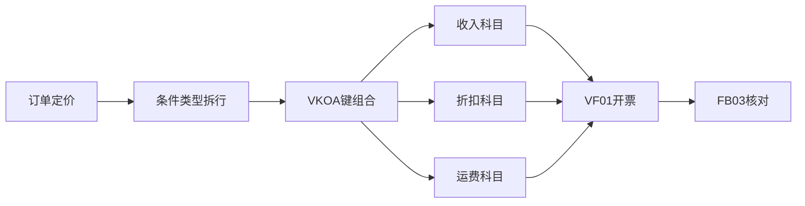

## 一句话结论

> SD 到 FI 的收入科目不是开票时拍脑袋选的：定价过程把金额拆成一个个条件类型，`VKOA` 用键组合把每个条件映射到科目，`VF01` 开票时逐条件生成 FI 行——收入串科目，九成是 `VKOA` 缺行或键组合字段没维护。

## 症状

- 同类物料开票，一部分收入落 `600101` 主营收入，另一部分落错科目或直接报科目确定失败。
- 折扣金额没有冲减收入而是全额进了收入科目（或反之），毛利口径与财务报表对不上。
- `VF01` 开票完成，会计凭证里缺了某个条件的 FI 行（如运费行），发票与凭证金额解释不清。

## 根因（按概率）

| 根因（按概率） | 验证动作 | 修复动作 |
|---|---|---|
| `VKOA` 缺该键组合行 | `VKOA` 按条件+客户组+物料组逐级收窄查 | 补精确行，并留空白兜底行 |
| 物料主数据没维护科目确定组 | 查物料销售视图的科目确定组 | 补维护后对未开票单据重开 |
| 客户主数据科目确定组错 | 查客户销售视图的科目确定组 | 修正后对后续开票生效 |
| 定价过程变更后新条件没配科目 | 对比变更前后条件类型清单 | 新条件逐个补 `VKOA` 行 |
| 条件类型的科目键/应计未启用 | 查条件类型设置（以系统为准） | 启用后重开票到账 |

## 配错会怎样

- 收入串科目：主营/其他收入口径乱，报表重分类失真，月末调整凭证成堆。
- 折扣落错路线：要么收入虚增毛利失真，要么折扣科目与会计政策冲突，两边口径都说不清。
- 开票缺 FI 行：发票与会计凭证金额不齐，用户反复查询重开，O2C 对账链断裂。

## 怎么配置

1. **前置——定价过程拆条件**：订单定价过程决定开票拆行结构：收入类条件（示意 PR00）、折扣类（示意 K004/K007）、运费类（示意 KF00）——条件码以你的系统为准；条件是否参与科目确定由其科目键/应计设置控制（口径以系统为准）。
2. **`VKOA` 维护键组合**：每行 = 条件类型（科目键）+ 科目表 + 销售组织 + 客户科目确定组 + 物料科目确定组 + 总账科目；匹配时按具体键逐级回退到兜底行（回退机制以系统为准）。示例：销售组织 1000 + 客户组 01 + 物料组 01 + 收入科目键 → `600101`。
3. **折扣路线二选一**：收入扣减（净额进收入）或独立折扣科目（显性冲减）——中国口径常用冲减收入，两种写法都成立，以会计政策为准（对照见全解表）。
4. **税码链**：销项税码由客户主数据税分类 × 物料税分类在开票时确定，税额按税码档位计算并过账到销项税科目。
5. **全链视角**：订单 → 交货 → 开票 → 收款的完整口径见[O2C 流程](/01-daily-ops/flow-o2c)。

## 参数与组合全解

### VKOA 键组合优先级（示意结构，回退机制以系统为准）

| 优先级 | 销售组织 | 客户组 | 物料组 | 命中场景 |
|---|---|---|---|---|
| 1 | 1000 | 01 | 01 | 精确组合，最常用 |
| 2 | 1000 | 01 | 空 | 客户精确、物料兜底 |
| 3 | 1000 | 空 | 空 | 销售组织级兜底 |
| 4 | 空 | 空 | 空 | 全局兜底，最后一道网 |

### 条件类型到科目示意

| 条件角色 | 科目键（示意） | 常搭键组合 | 落科目（示意） |
|---|---|---|---|
| 基础收入 | ERL | 条件+物料组 | `600101` 主营业务收入 |
| 折扣 | ERS | 条件+物料组 | `602101` 折扣备抵 |
| 运费 | ERF | 条件+客户组 | `600201` 运费收入 |
| 销项税 | MWS | 按税码 | `222102` 销项税额 |

科目键 ERL/ERS/ERF 与科目编号均以你的系统为准。

### 折扣两条路

| 路线 | 机制 | 适用 |
|---|---|---|
| 收入扣减 | 定价时折扣已从收入条件减除，收入按净额过账 | 定价直接做净价，科目最简 |
| 独立折扣科目 | 折扣条件单独过账，显性冲减收入或挂备抵 | 需要折扣分析、毛利显性管理 |

中国口径常用冲减收入做备抵；两种都成立，写进会计政策后别混用。

## 边缘与高级场景

- **红票（贷项凭证）**：冲票开贷项凭证，科目链与蓝票完全一致（同一 `VKOA` 行、金额取负），不需要单独配红字科目；红字发票号回写等中国要求以项目实现为准。
- **CO-PA 值字段联动**：条件类型除了映射 FI 科目，还可向 CO-PA 传输值字段（收入、折扣作为获利能力分析的值）——FI 科目映射与 CO-PA 值字段映射两套配置要同步维护，否则总账毛利与获利分析口径对不上。
- **退货收入冲回**：退货单开贷项冲收入与销项税，走同一科目链；冲回与原发票的勾稽靠开票参照号，退货定价若改了条件结构要同步检查 `VKOA` 是否仍命中。
- **定价过程变更窗口**：变更定价过程或条件类型清单时，把「新条件逐个过 `VKOA`」写进变更清单——这是收入串科目最集中的事故源。

## 怎么验证

公司代码/销售组织 1000，建一张含基础价与折扣条件的测试销售订单（物料与客户的科目确定组已知），`VF01` 开票。

**验证 T-Code**：`VF01`
**验证判据**：`FB03` 查开票生成的会计凭证——收入行落 `VKOA` 命中组合对应的 `600101`；折扣行按选定路线冲减收入或落 `602101`；FI 行数与参与科目确定的条件类型一致；借贷平衡、税额与税码档位相符。
**失败对照**：收入串科目 → 拿订单的客户组+物料组回 `VKOA` 反查命中行；报科目确定失败 → 键组合缺行，先补兜底；缺 FI 行 → 查条件类型的科目键/应计设置；全链口径见[O2C 流程](/01-daily-ops/flow-o2c)，报错入口见[报错速查](/01-daily-ops/errors/)。

## 相关 T-Code

`VKOA` · `VF01` · `FB03`
