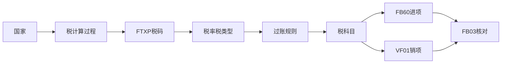

## 一句话结论

> 增值税在 SAP 里是一条「国家 → 税计算过程 → 税码 → 过账科目」的配置链：`OBBG` 把国家挂到计算过程并承载过账规则与税科目确定，`FTXP` 按国家维护每个税码的税率、税类型（进项/销项）与计算基准，凭证侧选对税码即自动价税分离——税额不算、科目挂错、勾稽差，九成是这条链断了一环。

## 症状

- `FB60`/`MIRO` 录发票，税额恒为 0.00：税码录了不算税，或直接报税码无效（排查见[税码无效](/01-daily-ops/errors/tax-code-invalid)）。
- 税额算出来了却串方向：进项税落销项税科目（或相反），应交增值税两方向混账，月末结转对不上。
- 申报勾稽差：税科目当月发生额与申报表合计有差，差额散在大量小额凭证里，逐笔翻 `FB03` 也定位不到。

## 根因（按概率）

| 根因（按概率） | 验证动作 | 修复动作 |
|---|---|---|
| 国家未挂税计算过程或缺条件行 | `OBBG` 查国家指向，进过程看条件行 | 补挂/补行后重试过账 |
| 税码税率或税类型配错（进销方向反了） | `FTXP` 逐项复核税率、税类型 | 修正配置；已过账凭证红冲或调整 |
| 录入侧税码为空或未激活算税 | 查 `FB60`/`MIRO` 界面税码字段与计算税额开关 | 补税码重录；默认码可经 `FB00` 预设 |
| 税科目确定缺行或挂错 | 顺着 `OBBG` 过账规则反查科目确定 | 补/改映射，进项销项各一行 |
| 档位用错（免税码上到应税业务） | `FTXP` 复核档位，与申报表分档比对 | 换码红冲重开，同步修申报口径 |

## 配错会怎样

- 税额不算：进项税漏抵直接损益化，销项税漏计面临补税滞纳金，两头都是真金白银。
- 科目串方向：应交增值税进项/销项发生额失真，结转与申报勾稽全线崩，`FB03` 每笔都要人肉重分类。
- 勾稽差堆积：一个月差几百笔，配置错、录入错、跨期错位搅在一起，审计口径跟着失守（政策背景见[中国本地化](/03-config-notes/cn-localization)）。

## 怎么配置

1. **国家挂过程**：`OBBG` 把国家 CN 指向税计算过程；过程里排好税条件行、过账规则（税额按规则进税科目）与规则上的科目确定——应交税金-进项/销项各挂一行（科目确定入口标准系统为 `OB40`，路径以你的系统为准）。
2. **定义税码**：`FTXP` 按国家维护，每码定三件事：税类型（示意 A=销项、V=进项，取值以系统为准）、税率（如 13.00%）、计算基准（净额×百分比或总额×百分比——总额基准可自动拆含税发票）。
3. **放开可用性**：税码建好只是存在，还要凭证与定价侧可用——`FB00` 可预设默认税码；SD 定价的税条件类型（经典销项税条件 MWST）开票按税码自动算税，拆行见[SD 收入科目确定](/03-config-notes/sd-revenue-account)。
4. **凭证侧接线**：进项走 `FB60`（无 PO 费用票）/`MIRO`（有 PO 采购票），录税码自动价税分离；销项 `VF01` 开票由税条件算出，全链见[O2C 流程](/01-daily-ops/flow-o2c)。
5. **申报数据抽取**：月度以税科目发生额对申报表勾稽，报表走 S_ALR 系列方向（报表名以你的系统为准），核对纳入[月结检查清单](/01-daily-ops/month-end-checklist)。
6. **两个边界**：jurisdiction（辖区税）是美国式州/县/市分层计税模型，中国增值税不用，多为跨国模板残留，以你的系统为准；中国 13%/9%/6% 加免税档位见[中国本地化](/03-config-notes/cn-localization)，以最新政策为准。

## 参数与组合全解

### 税码结构（FTXP 逐字段）

| 字段 | 取值示意 | 管什么 |
|---|---|---|
| 税类型 | A 销项 / V 进项（以系统为准） | 进销方向，决定借贷与申报口径 |
| 税率 | 13% / 9% / 6% / 0 / 免税 | 税额 = 计算基准 × 税率 |
| 计算基准 | 净额×百分比 / 总额×百分比 | 含税发票能否自动拆出净额与税额 |
| 过账方式 | 税额单独成行等（以系统为准） | 税额是否生成独立凭证行 |

### 税码三件套配置清单

| 件 | 事务/入口 | 动作 | 漏了会怎样 |
|---|---|---|---|
| 定义 | `FTXP` | 建码：税率、税类型、基准 | 税码不存在，录入直接被拦 |
| 挂账 | `OBBG` 链上科目确定 | 规则挂进项/销项税科目 | 税额算出无处落账或串科目 |
| 可用 | `FB00`/定价条件 | 默认码预设、税条件带码 | 每笔手工带码，漏带则不算税 |

### 进项 vs 销项方向对照

| 维度 | 进项（采购方向） | 销项（销售方向） |
|---|---|---|
| 凭证入口 | `FB60` / `MIRO` | `VF01` 开票 |
| 借贷方向 | 借：应交税金-进项 | 贷：应交税金-销项 |
| 科目示意 | 222101 | 222102 |
| 申报口径 | 认证抵扣后转出 | 按开票清单申报 |

科目编号均为示意，以你的系统为准。

## 边缘与高级场景

- **税码冻结与历史凭证**：`FTXP` 改税率或停用税码只影响新凭证，历史凭证保持原口径；政策性调税不要直接改老码——老码封存、新码接棒，申报按各自期间取数。
- **免税码 + 含税采购的价税分离**：含价税合计的发票拆净额需总额基准；免税业务拆出的税额是不可抵扣进项（走进项转出或价内合并口径），别混进可抵扣科目——税类型与科目指向成对设计，以最新政策为准。
- **跨期税率变更的双码过渡**：政策变更月，变更日前后业务分别用旧码与新码并存，期末按码取数对申报表，避免一刀切把跨期业务算错档。

## 实操走查（跟着做一遍）

公司代码 1000，10–15 分钟，走通「定义 → 挂账 → 凭证 → 核对」闭环。税码 J1/F1（销项/进项 13%）、科目 222101/222102/660299 均为示意，以你的系统为准。

1. `FTXP`：国家输 CN、税码输 J1，回车——预期税类型为销项、税率 13.00%、基准净额（示意）。抄下税率与方向。
2. `OBBG`：查国家 CN 指向的税计算过程，看税条件行与过账规则；顺规则到科目确定，确认销项指 `222102`、进项指 `222101`。
3. `FB60`：公司代码 1000、供应商 200001、日期均 2026-11-17；金额输 1,130.00，税码输 F1，勾「计算税额」——预期拆为净额 1,000.00、税额 130.00；费用科目输 `660299`。
4. 点「模拟」——预期三行：借 `660299` 1,000.00、借进项税 `222101` 130.00、贷应付 200001 1,130.00，借贷平衡。
5. 点「过账」抄下凭证号（到期日机制另见[付款条件](/03-config-notes/payment-terms)）。
6. `FB03`：输凭证号回车——预期三行与模拟一致，重点核对进项税 130.00 落在 `222101` 而非销项科目。
7. `MIRO`：公司代码 1000，选已收货采购订单（净额 1,000），日期 2026-11-17，金额输 1,000、税码 F1——预期税额 130.00 自动算出（含税/不含税口径以页签为准）；「模拟」确认进项税同落 `222101`，过账。
8. `FB03` 复核 `MIRO` 凭证：进项税行 130.00、科目与第 6 步一致——两个入口同科目，闭环成立。

## 怎么验证

**验证 T-Code**：`FB60`
**验证判据**：含税发票 1,130.00（13% 税码）过账后，`FB03` 三行——净额行 1,000.00、进项税行 130.00 落配置指定科目、应付行 1,130.00 挂供应商 200001；税额 = 净额 1,000 × 13% 精确成立；`MIRO` 复测进项税科目一致。
**失败对照**：税额为 0 → 回 `FTXP` 查税率，再查「计算税额」开关，或按[税码无效](/01-daily-ops/errors/tax-code-invalid)排查；科目挂错 → 顺 `OBBG` 规则反查命中行；两入口科目不一致 → 查是否各用一套规则；勾稽差 → 按[月结检查清单](/01-daily-ops/month-end-checklist)分档比对，版本差异见[版本矩阵](/00-about/version-matrix)。

## 相关 T-Code

`FTXP` · `OBBG` · `FB60` · `MIRO`
