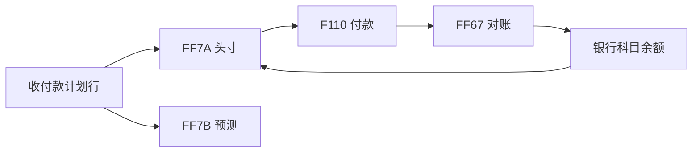

## 一句话结论

> `FF7A` 看当日现金头寸、`FF7B` 看前瞻流动性，数据源头都是 FI 凭证的收付款计划行——计划行没维护或计划级别用错，两张报表直接开天窗。

## 症状

- 管理层问「今天账上到底有多少可用资金」，没人能 30 秒内报出数。
- 付款日才发现资金缺口，之前没有任何预警。
- `FF7A` 打开后某银行账户整行空白，但该科目余额明明天天在动。

## 根因（按概率）

| 根因（按概率） | 验证动作 | 修复动作 |
|---|---|---|
| 收付款计划行维护缺失或计划级别用错 | `FF7A` 看该银行科目有无到期数据 | 补计划行，统一计划级别口径 |
| 银行科目直记绕过计划（`FB50` 直接敲银行科目） | 科目余额在动、计划行无记录 | 收付改走带计划的路径或手工补计划行 |
| `FF7B` 预测规则未配 | `FF7B` 无预测性收付数据 | 配预测规则与层级（以你的系统为准） |
| 报表变体层级选错（没按银行账户分组） | 换标准变体再看 | 调整变体的分组层级 |

## 配错会怎样

- 资金缺口无预警：付款日才发现头寸不够，被迫透支或紧急调头寸。
- 口径分裂：资金例会上 `FF7A` 数、银行对账数、报表数三个数对不上，各说各话。

## 怎么配置

本页定位「入门 + 日常监控」：只覆盖现金头寸与流动性预测，TR 全模块（贷款管理、交易管理）不展开，以项目范围为准。

1. **数据源头**：收付款计划行挂在 FI 凭证与未清项上——计划级别（planning level）与计划类型（planning type）区分实际与计划数据；客户/供应商未清发票自带到期日自动进计划，工资、税金等大额固定收付手工补计划行。
2. **`FF7A` 现金头寸**：按银行账户 × 日看收付计划与余额，当日头寸 = 银行科目余额 + 当日到期收付。
3. **`FF7B` 流动性预测**：在头寸之上叠加预测性收付款，往未来看周/月的流动性缺口。
4. **日资金循环**：`F110` 付款建议先在 `FF7A` 上显形为资金需求（付款运行配置见 [F110 自动付款](/03-config-notes/ap-auto-payment)）→ 执行付款 → 银行对账 `FF67`（对账流程见「银行对账」配置笔记）→ 余额更新回流头寸。

## 怎么验证

公司代码 1000，选付款运行日：先跑 `F110` 测试建议，再开 `FF7A` 看当日与付款日的头寸。

**验证 T-Code**：`FF7A`
**验证判据**：当日头寸 = 各银行科目余额 + 当日到期收付款计划行合计；`F110` 测试建议生成后，付款日当天在 `FF7A` 能看到对应金额的资金需求。
**失败对照**：头寸缺数 → 按根因表查计划级别与计划行维护；某银行科目整列空白 → 多为直记绕过计划行；`FF7B` 没有预测数据 → 查预测规则配置。

## 相关 T-Code

`FF7A` · `FF7B` · `F110` · `FF67`
